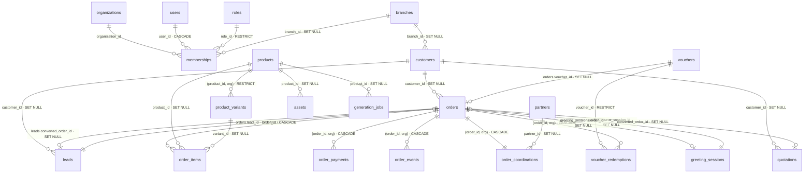

# 20 — Audit kiến trúc cơ sở dữ liệu

> Loại tài liệu: báo cáo audit (chỉ đọc; không sửa schema hay mã). Ngày: 06/11/2026. Commit: `00a6823` (lược đồ giống `main` `d8dd00d`).
> Đối chiếu với chương trình đang chạy `docs/plan/db-enterprise-architecture.md` (GĐ1–GĐ2 xong, GĐ3–GĐ6 mở). Phát hiện nào đã có mục trong kế hoạch thì ghi mã mục, không đề xuất lại.
>
> **Cách đo.** Đọc kết quả trên CSDL thật, không đọc tài liệu:
> 1. Dựng Postgres 16 rỗng, áp lần lượt **72/72 migration**: tất cả chạy sạch.
> 2. `prisma migrate diff --from-config-datasource --to-schema prisma/schema.prisma` (Prisma 7.10.1) ra migration rỗng, tức **không lệch** giữa schema và migration.
> 3. Đo cấu trúc bằng `evidence/db-catalog-checks.sql`; quét mã truy cập dữ liệu bằng `evidence/db-code-scan.mjs`.
> 4. `evidence/db-orphan-checks.sql` đếm bản ghi mồ côi. **Chưa chạy trên dữ liệu thật** (§8).
>
> Mã phát hiện: `DB-xx`.

## 1. Kết luận

Nền móng CSDL **tốt hơn mức thường gặp**:
- không lệch schema; mọi cột thời gian là `timestamptz`; mọi khoá ngoại có index; không có index thừa;
- có RLS trên 117 bảng tenant; migration có cổng expand/contract;
- các phép ghi tiền dùng so-sánh-rồi-ghi hoặc khoá advisory.

Rủi ro sai lệch dữ liệu nằm ở chỗ **toàn vẹn được giữ bằng mã ứng dụng, không bằng CSDL**:
- 76 khoá ngoại giữa hai bảng tenant không kèm `organization_id`;
- 76 cột `*_id` không có khoá ngoại;
- chỉ có 8 ràng buộc CHECK;
- chính sách xoá mâu thuẫn: 50 CASCADE và 69 RESTRICT cùng trỏ vào `organizations`; CASCADE chạm cả bảng tiền;
- nhiều "nguồn sự thật thứ hai": con trỏ hai chiều, bộ đếm cache, dữ liệu nghiệp vụ trong JSON.

Mã hiện tại tự kiểm phần lớn các luật này. Nhưng **mọi đường không đi qua mã đó** (script bàn giao, SQL tay, worker, mã mới) đều có thể ghi dữ liệu sai mà CSDL không chặn.

## 2. Số đo nền

| Hạng mục | Giá trị | Nguồn |
|---|---|---|
| Bảng · enum · migration | 147 · 71 · 72 (baseline gộp 22/10/2026) | catalog §1; `grep -c '^enum '`; `ls prisma/migrations` |
| Bảng có `organization_id` | 117 (2 cho phép NULL: `roles`, `sessions` — bản ghi hệ thống) | catalog §1 |
| Bảng không có `organization_id` | 30, gồm cấp nền tảng/danh mục (`users`, `industries`, `ai_models`, `topics`…) và `organization_links`, `governance_decisions` (khoá phạm vi riêng) | catalog §1 |
| Khoá ngoại | 245: CASCADE 108 · RESTRICT 83 · SET NULL 54 | catalog §2 |
| Index | 587 (249 unique); 0 index biểu thức/GIN; 0 index thừa (tiền tố trùng) | catalog §10 |
| CHECK · trigger · RLS | 8 · 5 · 117 bảng bật + FORCE, 117 policy | catalog §4 |
| Cột JSON | 101 cột trên 58 bảng | catalog §11 |
| Giao dịch trong mã | 82 `$transaction` (73 interactive); 1 chỗ đặt `isolationLevel` | `db-code-scan.mjs summary` |
| SQL thô | 36 `$queryRaw/$executeRaw` có tham số; 2 `…Unsafe` (đều là chuỗi hằng: `NOTIFY`, `pg_advisory_xact_lock`) | như trên |

## 3. Đánh giá theo miền (0–5)

| Miền | Điểm | Căn cứ |
|---|:---:|---|
| Schema & quy ước | 4 | snake_case, `timestamptz(3)`, nhãn `@pii`, sổ bảng-tenant sinh từ schema |
| ERD & tài liệu mô hình | 1 | Không có ERD (P3-03 mở); §7 có ERD lõi dựng từ catalog |
| Entity & quan hệ | 2,5 | Con trỏ hai chiều, khái niệm trùng (thông báo, link chia sẻ, chat, đo dùng) — DB-05 |
| Ràng buộc | 2 | 8 CHECK; 76 cột `*_id` thiếu khoá ngoại; 76 khoá ngoại tenant một cột — DB-01, DB-02, DB-04 |
| Index | 3,5 | Đủ cho khoá ngoại; thiếu index sắp xếp mặc định và tìm kiếm văn bản — DB-07 |
| Migration | 4 | Không lệch; expand/contract có cổng; còn vài lỗ ở cổng — DB-08 |
| Giao dịch & đồng thời | 4 | Luồng tiền/credit/job/hoàn tiền đều trong giao dịch + CAS/advisory lock; bộ gác xoá sản phẩm kiểm ngoài giao dịch — DB-03 |
| Toàn vẹn dữ liệu | 2 | Toàn vẹn chủ yếu ở mã; chính sách xoá mâu thuẫn; JSON chứa tham chiếu — DB-02, DB-03, DB-06 |

## 4. Phát hiện

### DB-01 (P1) — CSDL không chặn tham chiếu xuyên tổ chức trên 76 khoá ngoại

- Catalog §6: khoá ngoại bảng-tenant → bảng-tenant có **30 ghép** (`cha_id, organization_id`) và **76 một cột**. Ví dụ một cột: `orders→customers`, `orders→branches`, `order_items→orders`, `order_items→products`, `vouchers→customers`, `leads→customers`, `quotations→orders`, `memberships→roles`, `products→branches`, `sales_channel_orders→orders`.
- Đầu `schema.prisma` ghi luật 4: "bảng con… trỏ về cha bằng khoá ghép — hoàn thiện CSDL 05/11/2026". Mới làm được **28%**.
- Lớp chặn thứ hai là RLS, nhưng production chạy `DB_RLS_MODE=audit` (`render.yaml:47`). Policy cho qua mọi dòng khi `app.rls_mode` khác `enforce`.
- Ngữ cảnh chưa phân loại được gán `system: "on"` (`src/core/tenancy/infra/rls-pool.ts:39`). Tức là **ở chế độ `enforce`, truy vấn thiếu ngữ cảnh vẫn được quyền hệ thống** (fail-open). Kế hoạch I-4/I-6 chưa nhắc tới điểm này.
- Hệ quả: chỉ cần một đường ghi quên `scopedWhere` (đúng lớp lỗi ở `AGENT_RULES` §14 #9) là tạo được đơn trỏ tới khách, chi nhánh hoặc sản phẩm của tổ chức khác, và CSDL nhận.

### DB-02 (P1) — 76 cột tham chiếu không có khoá ngoại; tham chiếu trong JSON lọt khỏi bộ gác

- Catalog §5 liệt kê 76 cột. Phần lớn có chủ đích: nhật ký (`audit_logs.entity_id`), id phía nhà cung cấp (`external_*`, `provider_*`). Phần cần xử lý:
  - **trỏ `users.id`** (22 cột): `orders.owner_sale_id`, `order_assignments.assignee_id`, `order_coordinations.coordinator_id`/`sales_owner_id`/`next_action_owner_id`, `order_qc_records.inspector_id`, `leads.assignee_user_id`, `notification_inbox.user_id`, `generation_jobs.user_id`, `usage.user_id`, `order_events.actor_id`…;
  - **trỏ `assets.id`**: `product_images.asset_id` (đúng cột gây lỗi §14 #9), `order_payments.evidence_asset_id`, `brand_profiles.logo_asset_id`, `video_jobs.final_asset_id`…;
  - **trỏ job**: `ai_requests.job_id`, `usage.job_id`, `product_copies.job_id`…
- Asset được bảo vệ bằng sổ tham chiếu ở tầng ứng dụng (`assets/infra/asset-usage-guard.ts`, gác bởi `asset-usage-guard.test.ts`). Nhưng test chỉ bắt cột kiểu `String` (`/^\s+(\w*asset_ids?)\s+String/`). Vì vậy hai mảng id ảnh kiểu `Json` **không được tính là "đang dùng"**:
  - `order_coordinations.finished_asset_ids` (ảnh thành phẩm, ghi tại `coordinator/use-cases/operations.ts:190`);
  - `order_qc_records.image_asset_ids` (ảnh QC).

  Xoá ảnh trong thư viện sẽ để lại id treo, mất bằng chứng giao hàng của đơn.
- Giá trị giả trong cột id: `greeting_sessions.sale_id = "public"` (`greeting-card/infra/greeting-card-repository.ts:118`) thay cho NULL, nên cột này không thể có khoá ngoại.
- Tham chiếu vào JSON: `vouchers.promotion_id`/`voucher_batches.promotion_id` trỏ tới một mục trong danh mục `store_policies` (JSON). Chỉ use-case kiểm.

### DB-03 (P1) — Chính sách xoá mâu thuẫn, chạm dữ liệu tiền

- Khoá ngoại tới `organizations` (catalog §3): **50 CASCADE, 69 RESTRICT, 2 SET NULL**. Xoá một tổ chức không chạy được (bị RESTRICT chặn). Nhưng script dọn sau khi gỡ các bảng RESTRICT sẽ kéo CASCADE xuống `credit_transactions`, `subscription_invoices`, `provider_cost_entries`, `reconciliation_findings`, `greeting_payment_events`, `order_payments` (catalog §7).
- Xoá một đơn kéo CASCADE `order_payments`, `order_items`, `order_events`, `voucher_redemptions`. Có đường xoá cứng đơn: `scripts/handover-clean-tenant.ts:273`, `prisma/seed/clean-siin-store-orders.ts:79`. Sổ thu và nhật ký đơn mất theo, không có dấu vết (I-2 nhật ký bất biến còn mở).
- **CSDL nói ngược luật nghiệp vụ:** `order_items.product_id` khai `ON DELETE SET NULL`, trong khi luật là "mẫu đã có đơn không được xoá" (`storage/infra/trash-repository.ts:293`). Bộ gác đếm `order_items` **ngoài** giao dịch xoá (dòng 295–305), nên có cửa sổ tranh chấp: đơn tạo đúng lúc xoá sẽ bị NULL `product_id`. Lại thêm `order_items.description` cho phép NULL, nên dòng đơn có thể mất luôn danh tính món đã bán.

### DB-04 (P2) — Ràng buộc miền quá mỏng

- Cả CSDL chỉ có **8 CHECK**: 7 tập trạng thái và 1 `organization_links_not_self_check`.
- **13 cột trạng thái kiểu text không có CHECK** (catalog §8), trong đó có `order_payments.status`, `order_approval_requests.status`, `order_exceptions.status`, `order_coordinations.delivery_state`, `chat_conversations.status`, `generation_jobs.stage`.
- Không có bất biến số học nào: `orders.balance_vnd = total_vnd − paid_vnd`, `paid_vnd ≥ 0`, `quantity > 0`, `unit_price_vnd ≥ 0`, `discount_value` trong khoảng. Hiện chỉ mã giữ các bất biến này. Job I-3 chỉ phát hiện `paid_vnd` lệch sau khi đã xảy ra.
- Kiểu tiền không thống nhất (catalog §9):
  - `orders`/`order_items` dùng `numeric(14,2)`, còn `quotations`/`quotation_items` dùng `numeric(12,2)`, dù báo giá được chuyển thành đơn;
  - `products.cost_price_vnd` là `integer`;
  - 5 cột `cost_usd` là `double precision` (sai số cộng dồn trong báo cáo biên lợi nhuận).

### DB-05 (P2) — Cùng một sự thật lưu ở hai nơi

| Dạng | Ví dụ (từ catalog / mã) | Rủi ro |
|---|---|---|
| Con trỏ hai chiều | `orders.lead_id` ↔ `leads.converted_order_id`; `orders.source_session_id` ↔ `greeting_sessions.order_id`; `orders.voucher_id` ↔ `vouchers.order_id` (+ `voucher_redemptions`); `quotations.converted_order_id` | Hai đầu lệch nhau; không bất biến nào giữ chúng khớp |
| Bộ đếm cache | `organizations.credit_balance` vs `credit_transactions` (đối soát credit hoãn, ghi chú I-3); `vouchers.used_count`/`is_used` vs `voucher_redemptions`; `orders.paid_vnd` vs `order_payments` (đã có I-3) | Lệch âm thầm |
| Khái niệm trùng | 3 kho thông báo (`notification_inbox`, `staff_notifications`, `greeting_notifications`); 5 bảng link chia sẻ (`short_links`, `catalog_links`, `store_share_links`, `greeting_share_links`, `partner_marketplace_share_links`); 3 kho chat (`chat_*`, `internal_chat_*`, `greeting_messages`); 4 bảng đo dùng (`usage`, `ai_requests`, `credit_transactions`, `provider_cost_entries`) | Báo cáo và chính sách hạn lưu (P-6) phải làm lại nhiều lần |
| Dữ liệu cá nhân rải rác | `phone` ở 5 bảng, `address` ở 6 bảng, `greeting_sessions.customer_phone`/`customer_name` | Đã có kế hoạch P-2, P-3, P-5 |

### DB-06 (P2) — JSON làm kho dữ liệu nghiệp vụ cần truy vấn

- 101 cột JSON, **0 index GIN/biểu thức**.
- `orders.delivery_window` (83 chỗ dùng trong `src/modules`) chứa ngày giao. `costing/infra/costing-repository.ts:254` vì thế tải **mọi** đơn `CONFIRMED`/`PROCESSING` kèm dòng hàng rồi lọc ngày trong JavaScript.
- `order_coordinations.metadata.qc_photos`/`pod_photos` chứa khoá tệp; sổ tham chiếu phải truy vấn JSON (`assets/infra/payload-references.ts`).
- `order_coordinations` rộng **62 cột** (rộng nhất), `orders` 32, `assets` 36. Việc tách bảng đã được hoãn có chủ đích (D-45).

### DB-07 (P2) — Truy vấn kém hiệu quả (ứng viên đo được)

- **Danh sách đơn tải quá nhiều:** `orders/infra/order-repository.ts:200-210` lấy toàn bộ 32 cột đơn, mọi `items`, `assignments` và **mọi `events`** của từng đơn cho một trang 50 đơn, kèm `count(*)` (anti-pattern A10).
- **Thiếu index cho sắp xếp mặc định:** `orders` có `(organization_id, status)`, `(organization_id, source)`… nhưng **không có `(organization_id, created_at)`** cho `orderBy: created_at desc`.
- **Tìm kiếm không có index:** 25 phép `contains … mode: "insensitive"` trong 10 tệp (`db-code-scan.mjs containsInsensitive`), tức `ILIKE '%…%'`. Không có index trigram nên quét toàn phần dữ liệu của tổ chức.
- **Tính tổng trong ứng dụng:**
  - `crm/infra/customer-repository.ts:244` tải mọi đơn của khách để cộng `total_vnd`, thay vì `aggregate`;
  - `platform/infra/platform-data-repository.ts:59` dùng `distinct` của Prisma trên `orders` của nhiều tổ chức. Prisma thực hiện `distinct` trong engine, nên mọi dòng khớp đều được đọc lên.
- 161/327 `findMany` không có `take`: đa số là danh sách con có cận tự nhiên; ứng viên cần đọc tay là `orders` (9) và `assets` (19).
- 22 vòng lặp có truy vấn `await` bên trong (N+1), phần lớn ở seed và bộ quét.

### DB-08 (P2) — Migration: mạnh, còn vài lỗ ở cổng kiểm

- Mạnh:
  - không lệch;
  - 72 migration áp sạch từ rỗng;
  - `check:migrations` chặn DROP không chú thích `-- contract:`, đổi kiểu không có `USING`, và NOT NULL không backfill;
  - contract có bước đối chiếu, lệch thì `RAISE` và cuộn lại.
- Lỗ:
  - 2 migration sau mốc kiểm không có `BEGIN` (`20261106020000_row_level_security` với 117 bảng, `20261106040100_grant_custom_domains_to_superadmin`), trong khi kế hoạch §4 yêu cầu "chạy trong một giao dịch". Cổng không bắt buộc điều này.
  - Cổng không đòi `CREATE INDEX CONCURRENTLY` cho bảng lớn. Ví dụ `20261106000000_foreign_key_indexes` tạo 61 index có khoá ghi.
  - Hai cặp thư mục trùng tiền tố thời gian (`20261106020000_*` ×2, `20261106040000_*` ×2). Thứ tự chạy khi đó phụ thuộc thứ tự chữ cái của tên.
- Sao lưu, PITR, diễn tập khôi phục **chưa có bằng chứng** (O-6, O-7 mở).

### DB-09 (P3) — Cách ly ở tầng CSDL mới là khung

117 policy RLS và FORCE đã có, nhưng:
- production ở chế độ `audit`;
- mọi dịch vụ dùng chung một tài khoản CSDL (I-1 mở);
- `app.rls_mode` do chính ứng dụng đặt;
- ngữ cảnh thiếu thì fail-open (DB-01).

Đây là đúng lộ trình I-1, I-4, I-6, chỉ cần bổ sung mục fail-closed.

## 5. Điểm mạnh đã kiểm chứng

- Lược đồ khớp migration (`migrate diff` rỗng); 72/72 migration áp sạch; 0 ràng buộc `NOT VALID` trên CSDL dựng từ migration. Production có thể còn: mục "Dọn khoá `NOT VALID` còn sót của PR #127" chưa được tích, cần kiểm bằng catalog §4 trên production.
- 0 cột `timestamp` không múi giờ; mọi khoá ngoại có index (O-1); 0 index thừa; mọi bảng có khoá chính.
- Ghi tiền an toàn khi chạy đồng thời:
  - `paid_vnd` cập nhật kiểu CAS (`where: { paid_vnd: order.paid_vnd }`, `greeting-card/infra/brochure-payment-repository.ts:77`);
  - lượt dùng mã giảm giá bằng một `UPDATE` có điều kiện, kèm khoá advisory theo khách (`promotions/infra/voucher-redemption-repository.ts:27-40`);
  - trừ credit, xếp job và ghi `usage` trong cùng giao dịch (`jobs/use-cases/enqueue-job.ts:100-160`);
  - hoàn tiền dưới `pg_advisory_xact_lock` (`usage/use-cases/refund-job.ts:70`).
- Idempotency: `idempotency_keys`, `(organization_id, feature, idempotency_key)` trên `generation_jobs`, unique `(connection_id, external_order_id)` cho đơn kênh bán.
- Chương trình CSDL có kỷ luật: expand → backfill → ghi kép → contract có chốt, mỗi bước có test tenant.

## 6. Kiến trúc CSDL tối ưu đề xuất

Giữ **một Postgres, schema `public`, cách ly theo hàng** (đúng D6-1 và ADR-016). Đề xuất chuyển toàn vẹn từ mã xuống CSDL theo **5 nguyên tắc**:

1. **Khoá tenant trong mọi tham chiếu:** mọi khoá ngoại giữa hai bảng tenant là khoá ghép `(x_id, organization_id) → (id, organization_id)`.
   - Bảng cha lớn (`orders`, `customers`, `products`…) đã có unique `(id, organization_id)`.
   - **20 bảng cha còn thiếu** và phải thêm trước: `asset_usages`, `assets`, `branches`, `campaigns`, `chat_conversations`, `greeting_catalogs`, `greeting_messages`, `integration_connections`, `integration_tokens`, `leads`, `materials`, `partners`, `product_import_batches`, `product_recipes`, `product_variants`, `roles`, `short_links`, `voucher_batches`, `vouchers`, `workspaces`.
   - RLS `enforce` là lớp thứ hai và **fail-closed** khi thiếu ngữ cảnh.
2. **Ma trận chính sách xoá theo loại bảng:**

| Loại | Bảng | `ON DELETE` | Xoá thế nào |
|---|---|---|---|
| A. Sổ tiền & nhật ký | `order_payments`, `credit_transactions`, `subscription_invoices`, `voucher_redemptions`, `order_events`, `audit_logs`, `provider_cost_entries` | RESTRICT; chỉ thêm, không sửa (I-2) | Chỉ qua thủ tục purge có lý do (S-3, P-6) |
| B. Con sở hữu | `order_items`, `product_images`, `product_variants`, `video_scenes` | CASCADE từ cha (khoá ghép) | Theo cha |
| C. Tham chiếu nghiệp vụ | `order_items→products`, `orders→customers`, mọi `*_asset_id` | RESTRICT (thay cho bộ gác đếm ngoài giao dịch) | Lưu trữ (`archived_at`) thay vì xoá |
| D. Tham chiếu người | các cột trỏ `users` | SET NULL + giữ ảnh chụp tên trong nhật ký | Người rời tổ chức không xoá lịch sử |
| E. Gốc tenant | mọi khoá ngoại tới `organizations` | RESTRICT (đổi 50 CASCADE) | Chỉ qua thủ tục vòng đời tenant (S-3) |

3. **Một sự thật một chỗ:**
   - mỗi quan hệ chỉ một chiều, ví dụ giữ `orders.lead_id`, bỏ `leads.converted_order_id` và tra ngược bằng index;
   - bộ đếm cache (`credit_balance`, `used_count`) hoặc dẫn xuất, hoặc có đối soát hằng đêm (mở rộng I-3);
   - mảng id trong JSON thay bằng bảng nối, ví dụ `order_coordination_assets(order_id, organization_id, asset_id, role: FINISHED|QC|POD)`;
   - không dùng giá trị giả trong cột id.
4. **Ràng buộc miền nền:**
   - mọi cột trạng thái là enum, hoặc text + CHECK có test khớp mã (mở rộng `status-check-constraints.test.ts`);
   - CHECK tiền ≥ 0, `balance_vnd = total_vnd − paid_vnd`, `quantity > 0`;
   - một kiểu tiền VND `numeric(14,2)`; chi phí USD `numeric(14,6)`.
5. **JSON chỉ cho dữ liệu mờ:** ảnh chụp (snapshot), cấu hình, payload nhà cung cấp. Trường cần lọc hay sắp xếp phải là cột, ví dụ `orders.delivery_date` tách từ `delivery_window`, cùng `order_recipients` (P-3).

**Chuẩn truy vấn:**
- danh sách dùng `select` theo màn hình, phân trang con trỏ `(organization_id, created_at, id)` và có index tương ứng;
- tìm kiếm văn bản dùng `pg_trgm` + GIN (thêm extension cần PO duyệt);
- tổng và đếm làm trong CSDL;
- danh sách không `include` nhật ký sự kiện.

**Gộp khái niệm** (khi chạm tính năng, theo D-45):
- một nhật ký gửi tin (`message_deliveries`: kênh, người nhận, sự kiện), thay 3 kho thông báo;
- một bảng link công khai có `kind`, thay 5 bảng link;
- `ai_requests` là đo kỹ thuật, `usage` + `credit_transactions` là sổ tiền.

## 7. ERD lõi (dựng từ catalog; nhãn = cột khoá ngoại · ON DELETE)

Các cặp vẽ hai lần (`orders`↔`leads`, `orders`↔`greeting_sessions`, `orders`↔`vouchers`) chính là con trỏ hai chiều của DB-05. ERD đầy đủ theo miền vẫn là việc P3-03.

## 8. Lộ trình

| Bước | Việc | Phát hiện | Schema? | Cần PO? |
|---|---|---|:---:|---|
| 0 | Chạy `evidence/db-orphan-checks.sql` trên bản khôi phục production; ghi kết quả vào phụ lục tài liệu này | DB-01, 02, 04, 05 | Không | Không (cần quyền đọc bản khôi phục) |
| 1 | Test kiến trúc (ratchet, chỉ giảm): (a) `asset-usage-guard` bắt cả cột `Json`/`String[]` chứa id asset và thêm `finished_asset_ids`, `image_asset_ids` vào sổ; (b) cột `*_id` không khoá ngoại phải nằm trong danh sách ngoại lệ có lý do (mốc 76); (c) cột trạng thái text phải có CHECK (mốc 13); (d) `check:migrations` đòi `BEGIN` và tiền tố thời gian duy nhất | DB-02, 04, 08 | Không | Không |
| 2 | `rls-pool.ts`: ngữ cảnh chưa phân loại → không có quyền ở chế độ `enforce` (fail-closed), kèm test | DB-01, 09 | Không | Có (chạm tenancy) |
| 3 | Bộ gác xoá sản phẩm chuyển vào trong giao dịch; danh sách đơn bỏ `events`, dùng `select`; `aggregate` cho chỉ số khách | DB-03, 07 | Không | Không |
| 4 | Migration expand: CHECK (`NOT VALID` → dọn → `VALIDATE`) cho 13 cột trạng thái và bất biến tiền; index `orders(organization_id, created_at)` | DB-04, 07 | Có | Có |
| 5 | Migration expand: unique `(id, organization_id)` cho 20 bảng cha còn thiếu; khoá ngoại ghép cho 76 khoá một cột (`NOT VALID` → dọn theo bước 0 → `VALIDATE`), rồi bỏ khoá một cột | DB-01 | Có | Có |
| 6 | Ma trận chính sách xoá §6.2: đổi CASCADE ở loại A/E thành RESTRICT; `order_items→products` RESTRICT; khoá ngoại cho các cột trỏ `users`/`assets`; `sale_id` bỏ giá trị `"public"` | DB-02, 03 | Có | Có (B5 cho Thẻ chào) |
| 7 | Bảng nối thay mảng id JSON; cột `delivery_date`; bỏ một chiều của mỗi con trỏ hai chiều; đối soát `credit_balance` và `used_count` | DB-02, 05, 06 | Có | Có |
| 8 | `pg_trgm` + GIN cho tìm kiếm; thống nhất kiểu tiền | DB-04, 07 | Có | Có (extension) |
| — | Đã có trong kế hoạch, giữ nguyên: I-1/I-4/I-6 (RLS chặn thật), I-2 (nhật ký bất biến), P-2/P-3/P-5 (dữ liệu cá nhân), O-6/O-7 (sao lưu, PITR), S-3 (vòng đời tenant), P3-03 (ERD trong CI) | DB-03, 05, 08, 09 | — | — |

Bước 1 làm trước: nó chặn nợ mới mà không đổi hành vi. Bước 0 phải xong trước bước 5–6, vì khoá ngoại mới sẽ không `VALIDATE` được nếu còn dữ liệu bẩn.

## 9. Chưa kiểm chứng

- **Bản ghi mồ côi và tham chiếu xuyên tổ chức trên dữ liệu thật:** chưa đếm. Phiên audit không có quyền vào CSDL production hay bản khôi phục; seed cũng không chạy được (`npm ci` bị chặn tải `cdn.sheetjs.com`). Mọi rủi ro DB-01/02/05 ở trên là rủi ro **cấu trúc**, chưa phải số dòng sai đã đo.
- Hiệu năng thật: chưa có `EXPLAIN ANALYZE` trên dữ liệu thật, chưa có `pg_stat_statements` (O-3 mở). DB-07 là ứng viên suy từ mã.
- Prisma có tự bọc giao dịch cho migration không có `BEGIN` hay không: chưa thử với `migrate deploy`.
- Tiêu chí DoD-3, DoD-7, DoD-8, DoD-12, DoD-14 của kế hoạch CSDL không được kiểm lại ở lượt này.
