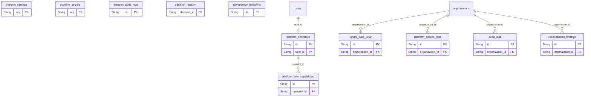
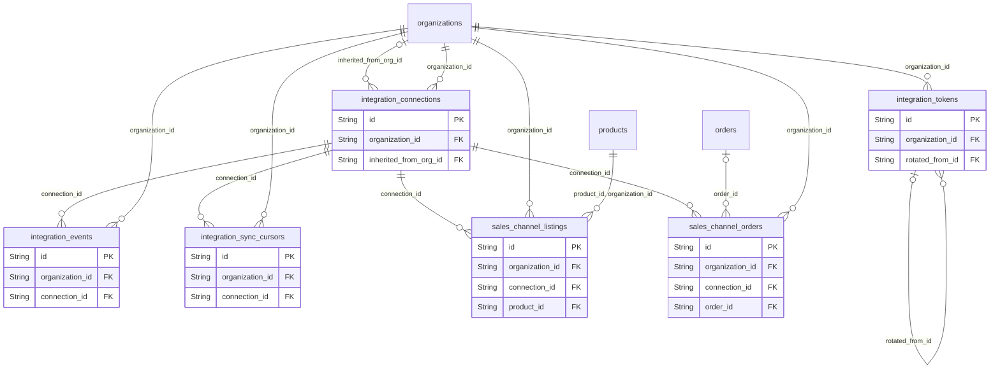
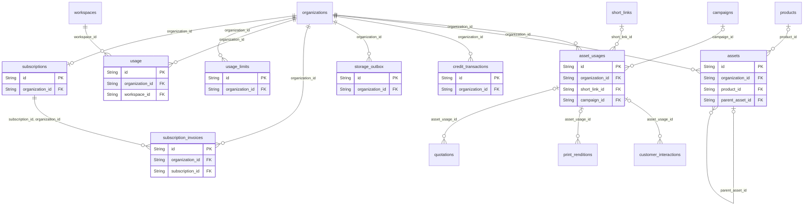

<!-- TỆP SINH TỰ ĐỘNG từ prisma/schema.prisma — không sửa tay. Chạy `npm run gen:erd`. -->
# ERD theo miền

Sinh từ `prisma/schema.prisma` bởi `scripts/gen-erd.mjs` (kế hoạch DB, bước P3-03). Mỗi miền: bảng của miền với cột khoá
(PK, FK, `organization_id`) và khoá ngoại tới bảng cha; bảng của miền khác chỉ hiện tên. Cột đầy đủ, ý nghĩa và quy tắc
ở đặc tả `docs/dac-ta/07-database-specification.md`. `tests/unit/architecture/erd.test.ts` đỏ khi tệp này lệch schema.

Tổng: 151 bảng, 10 miền.

## Tổ chức, người dùng, phân quyền

Bảng: `organizations`, `organization_links`, `industries`, `workspaces`, `branches`, `users`, `sessions`, `memberships`, `roles`, `role_capabilities`, `capability_overrides`, `custom_domains`, `business_profiles`, `idempotency_keys`.

```mermaid
erDiagram
  organizations {
    String id PK
    String industry_key FK
  }
  organization_links {
    String id PK
    String parent_org_id FK
    String child_org_id FK
  }
  industries {
    String key PK
  }
  workspaces {
    String id PK
    String organization_id FK
  }
  branches {
    String id PK
    String organization_id FK
  }
  users {
    String id PK
  }
  sessions {
    String id PK
    String user_id FK
    String organization_id FK
  }
  memberships {
    String id PK
    String organization_id FK
    String user_id FK
    String role_id FK
    String branch_id FK
  }
  roles {
    String id PK
    String organization_id FK
  }
  role_capabilities {
    String id PK
    String role_id FK
  }
  capability_overrides {
    String id PK
    String organization_id FK
    String role_id FK
  }
  custom_domains {
    String id PK
    String organization_id FK
  }
  business_profiles {
    String id PK
    String organization_id FK
  }
  idempotency_keys {
    String id PK
    String organization_id FK
  }
  ai_evaluations
  ai_policies
  ai_requests
  asset_usages
  assets
  audit_logs
  brand_library_items
  brand_library_versions
  brand_profiles
  campaign_packages
  campaigns
  catalog_links
  chat_channel_integrations
  chat_conversations
  chat_messages
  content_drafts
  content_generations
  content_metrics
  content_opportunities
  credit_transactions
  customer_consents
  customer_interactions
  customer_occasions
  customer_segments
  customers
  field_config_overrides
  field_definitions
  generation_jobs
  greeting_catalog_events
  greeting_catalog_products
  greeting_catalogs
  greeting_integrations
  greeting_journey_events
  greeting_message_reads
  greeting_messages
  greeting_notifications
  greeting_payment_events
  greeting_sessions
  greeting_share_links
  integration_connections
  integration_events
  integration_sync_cursors
  integration_tokens
  internal_chat_conversations
  internal_chat_messages
  internal_chat_participants
  job_events
  journey_runs
  landing_pages
  leads
  link_events
  material_price_history
  materials
  music_tracks
  notification_inbox
  notification_org_policies
  notification_store_defaults
  notification_user_preferences
  occasions
  order_approval_requests
  order_assignments
  order_change_requests
  order_coordinations
  order_events
  order_exceptions
  order_info_requests
  order_items
  order_payments
  order_qc_records
  order_recipients
  orders
  partners
  platform_access_logs
  platform_operators
  pricing_rules
  print_renditions
  product_analyses
  product_analysis_runs
  product_bookings
  product_change_requests
  product_copies
  product_images
  product_import_batches
  product_inventory
  product_recipe_items
  product_recipes
  product_revisions
  product_variants
  products
  provider_cost_entries
  quotation_items
  quotation_revisions
  quotations
  reconciliation_findings
  sales_channel_listings
  sales_channel_orders
  shared_order_access
  shop_reviews
  short_links
  staff_notifications
  storage_outbox
  store_share_links
  subscription_invoices
  subscriptions
  template_overrides
  tenant_data_keys
  usage
  usage_limits
  video_jobs
  video_scenes
  voice_clones
  voucher_batches
  voucher_redemptions
  vouchers
  branches |o--o{ customers : "branch_id"
  branches |o--o{ generation_jobs : "branch_id"
  branches |o--o{ memberships : "branch_id"
  branches |o--o{ orders : "branch_id"
  branches |o--o{ pricing_rules : "branch_id"
  branches |o--o{ products : "branch_id"
  branches ||--o{ product_inventory : "branch_id"
  industries |o--o{ organizations : "industry_key"
  organizations |o--o{ field_definitions : "owner_organization_id"
  organizations |o--o{ integration_connections : "inherited_from_org_id"
  organizations |o--o{ roles : "organization_id"
  organizations |o--o{ sessions : "organization_id"
  organizations ||--o{ ai_evaluations : "organization_id"
  organizations ||--o{ ai_policies : "organization_id"
  organizations ||--o{ ai_requests : "organization_id"
  organizations ||--o{ asset_usages : "organization_id"
  organizations ||--o{ assets : "organization_id"
  organizations ||--o{ audit_logs : "organization_id"
  organizations ||--o{ branches : "organization_id"
  organizations ||--o{ brand_library_items : "organization_id"
  organizations ||--o{ brand_library_versions : "organization_id"
  organizations ||--o{ campaign_packages : "organization_id"
  organizations ||--o{ campaigns : "organization_id"
  organizations ||--o{ capability_overrides : "organization_id"
  organizations ||--o{ catalog_links : "organization_id"
  organizations ||--o{ chat_channel_integrations : "organization_id"
  organizations ||--o{ chat_conversations : "organization_id"
  organizations ||--o{ chat_messages : "organization_id"
  organizations ||--o{ content_drafts : "organization_id"
  organizations ||--o{ content_generations : "organization_id"
  organizations ||--o{ content_metrics : "organization_id"
  organizations ||--o{ content_opportunities : "organization_id"
  organizations ||--o{ credit_transactions : "organization_id"
  organizations ||--o{ custom_domains : "organization_id"
  organizations ||--o{ customer_consents : "organization_id"
  organizations ||--o{ customer_interactions : "organization_id"
  organizations ||--o{ customer_occasions : "organization_id"
  organizations ||--o{ customer_segments : "organization_id"
  organizations ||--o{ customers : "organization_id"
  organizations ||--o{ field_config_overrides : "organization_id"
  organizations ||--o{ generation_jobs : "organization_id"
  organizations ||--o{ greeting_catalog_events : "organization_id"
  organizations ||--o{ greeting_catalog_products : "organization_id"
  organizations ||--o{ greeting_catalogs : "organization_id"
  organizations ||--o{ greeting_journey_events : "organization_id"
  organizations ||--o{ greeting_message_reads : "organization_id"
  organizations ||--o{ greeting_messages : "organization_id"
  organizations ||--o{ greeting_notifications : "organization_id"
  organizations ||--o{ greeting_payment_events : "organization_id"
  organizations ||--o{ greeting_sessions : "organization_id"
  organizations ||--o{ greeting_share_links : "organization_id"
  organizations ||--o{ idempotency_keys : "organization_id"
  organizations ||--o{ integration_connections : "organization_id"
  organizations ||--o{ integration_events : "organization_id"
  organizations ||--o{ integration_sync_cursors : "organization_id"
  organizations ||--o{ integration_tokens : "organization_id"
  organizations ||--o{ internal_chat_conversations : "organization_id"
  organizations ||--o{ internal_chat_messages : "organization_id"
  organizations ||--o{ internal_chat_participants : "organization_id"
  organizations ||--o{ job_events : "organization_id"
  organizations ||--o{ journey_runs : "organization_id"
  organizations ||--o{ landing_pages : "organization_id"
  organizations ||--o{ leads : "organization_id"
  organizations ||--o{ link_events : "organization_id"
  organizations ||--o{ material_price_history : "organization_id"
  organizations ||--o{ materials : "organization_id"
  organizations ||--o{ memberships : "organization_id"
  organizations ||--o{ music_tracks : "organization_id"
  organizations ||--o{ notification_inbox : "organization_id"
  organizations ||--o{ notification_org_policies : "organization_id"
  organizations ||--o{ notification_store_defaults : "organization_id"
  organizations ||--o{ notification_user_preferences : "organization_id"
  organizations ||--o{ occasions : "organization_id"
  organizations ||--o{ order_approval_requests : "organization_id"
  organizations ||--o{ order_assignments : "organization_id"
  organizations ||--o{ order_change_requests : "organization_id"
  organizations ||--o{ order_coordinations : "organization_id"
  organizations ||--o{ order_events : "organization_id"
  organizations ||--o{ order_exceptions : "organization_id"
  organizations ||--o{ order_info_requests : "organization_id"
  organizations ||--o{ order_items : "organization_id"
  organizations ||--o{ order_payments : "organization_id"
  organizations ||--o{ order_qc_records : "organization_id"
  organizations ||--o{ order_recipients : "organization_id"
  organizations ||--o{ orders : "organization_id"
  organizations ||--o{ organization_links : "child_org_id"
  organizations ||--o{ organization_links : "parent_org_id"
  organizations ||--o{ partners : "organization_id"
  organizations ||--o{ platform_access_logs : "organization_id"
  organizations ||--o{ pricing_rules : "organization_id"
  organizations ||--o{ print_renditions : "organization_id"
  organizations ||--o{ product_analyses : "organization_id"
  organizations ||--o{ product_analysis_runs : "organization_id"
  organizations ||--o{ product_bookings : "organization_id"
  organizations ||--o{ product_change_requests : "organization_id"
  organizations ||--o{ product_copies : "organization_id"
  organizations ||--o{ product_images : "organization_id"
  organizations ||--o{ product_import_batches : "organization_id"
  organizations ||--o{ product_inventory : "organization_id"
  organizations ||--o{ product_recipe_items : "organization_id"
  organizations ||--o{ product_recipes : "organization_id"
  organizations ||--o{ product_revisions : "organization_id"
  organizations ||--o{ product_variants : "organization_id"
  organizations ||--o{ products : "organization_id"
  organizations ||--o{ provider_cost_entries : "organization_id"
  organizations ||--o{ quotation_items : "organization_id"
  organizations ||--o{ quotation_revisions : "organization_id"
  organizations ||--o{ quotations : "organization_id"
  organizations ||--o{ reconciliation_findings : "organization_id"
  organizations ||--o{ sales_channel_listings : "organization_id"
  organizations ||--o{ sales_channel_orders : "organization_id"
  organizations ||--o{ shared_order_access : "organization_id"
  organizations ||--o{ shop_reviews : "organization_id"
  organizations ||--o{ short_links : "organization_id"
  organizations ||--o{ staff_notifications : "organization_id"
  organizations ||--o{ storage_outbox : "organization_id"
  organizations ||--o{ store_share_links : "organization_id"
  organizations ||--o{ subscription_invoices : "organization_id"
  organizations ||--o{ template_overrides : "organization_id"
  organizations ||--o{ tenant_data_keys : "organization_id"
  organizations ||--o{ usage : "organization_id"
  organizations ||--o{ usage_limits : "organization_id"
  organizations ||--o{ video_jobs : "organization_id"
  organizations ||--o{ video_scenes : "organization_id"
  organizations ||--o{ voice_clones : "organization_id"
  organizations ||--o{ voucher_batches : "organization_id"
  organizations ||--o{ voucher_redemptions : "organization_id"
  organizations ||--o{ vouchers : "organization_id"
  organizations ||--o{ workspaces : "organization_id"
  organizations ||--o| brand_profiles : "organization_id"
  organizations ||--o| business_profiles : "organization_id"
  organizations ||--o| greeting_integrations : "organization_id"
  organizations ||--o| subscriptions : "organization_id"
  roles ||--o{ capability_overrides : "role_id"
  roles ||--o{ memberships : "role_id"
  roles ||--o{ role_capabilities : "role_id"
  users ||--o{ internal_chat_messages : "sender_user_id"
  users ||--o{ internal_chat_participants : "user_id"
  users ||--o{ memberships : "user_id"
  users ||--o{ sessions : "user_id"
  users ||--o| platform_operators : "user_id"
  workspaces |o--o{ journey_runs : "workspace_id"
  workspaces ||--o{ generation_jobs : "workspace_id"
  workspaces ||--o{ usage : "workspace_id"
```

## Nền tảng và quản trị theo tầng

Bảng: `platform_operators`, `platform_role_capabilities`, `platform_settings`, `platform_secrets`, `tenant_data_keys`, `platform_audit_logs`, `platform_access_logs`, `decision_registry`, `governance_decisions`, `audit_logs`, `reconciliation_findings`.

## Khách hàng và bán hàng

Bảng: `customers`, `customer_consents`, `customer_interactions`, `customer_occasions`, `customer_segments`, `occasions`, `leads`, `quotations`, `quotation_items`, `quotation_revisions`, `vouchers`, `voucher_batches`, `voucher_redemptions`, `pricing_rules`, `shop_reviews`.

```mermaid
erDiagram
  customers {
    String id PK
    String organization_id FK
    String branch_id FK
  }
  customer_consents {
    String id PK
    String organization_id FK
    String customer_id FK
  }
  customer_interactions {
    String id PK
    String organization_id FK
    String customer_id FK
    String asset_usage_id FK
  }
  customer_occasions {
    String id PK
    String organization_id FK
    String customer_id FK
  }
  customer_segments {
    String id PK
    String organization_id FK
  }
  occasions {
    String id PK
    String organization_id FK
  }
  leads {
    String id PK
    String organization_id FK
    String customer_id FK
    String short_link_id FK
    String converted_order_id FK
  }
  quotations {
    String id PK
    String organization_id FK
    String lead_id FK
    String customer_id FK
    String asset_usage_id FK
    String converted_order_id FK
  }
  quotation_items {
    String id PK
    String organization_id FK
    String quotation_id FK
    String product_id FK
  }
  quotation_revisions {
    String id PK
    String organization_id FK
    String quotation_id FK
  }
  vouchers {
    String id PK
    String organization_id FK
    String customer_id FK
    String order_id FK
    String batch_id FK
  }
  voucher_batches {
    String id PK
    String organization_id FK
  }
  voucher_redemptions {
    String id PK
    String organization_id FK
    String voucher_id FK
    String order_id FK
    String customer_id FK
  }
  pricing_rules {
    String id PK
    String organization_id FK
    String branch_id FK
  }
  shop_reviews {
    String id PK
    String organization_id FK
  }
  asset_usages
  branches
  chat_conversations
  greeting_sessions
  orders
  organizations
  products
  short_links
  asset_usages |o--o{ customer_interactions : "asset_usage_id"
  asset_usages |o--o{ quotations : "asset_usage_id"
  branches |o--o{ customers : "branch_id"
  branches |o--o{ pricing_rules : "branch_id"
  customers |o--o{ chat_conversations : "customer_id"
  customers |o--o{ greeting_sessions : "customer_id"
  customers |o--o{ leads : "customer_id"
  customers |o--o{ orders : "customer_id"
  customers |o--o{ quotations : "customer_id"
  customers |o--o{ voucher_redemptions : "customer_id"
  customers |o--o{ vouchers : "customer_id"
  customers ||--o{ customer_consents : "customer_id, organization_id"
  customers ||--o{ customer_interactions : "customer_id, organization_id"
  customers ||--o{ customer_occasions : "customer_id, organization_id"
  leads |o--o{ orders : "lead_id"
  leads |o--o{ quotations : "lead_id"
  orders |o--o{ leads : "converted_order_id"
  orders |o--o{ quotations : "converted_order_id"
  orders |o--o{ vouchers : "order_id"
  orders ||--o{ voucher_redemptions : "order_id, organization_id"
  organizations ||--o{ customer_consents : "organization_id"
  organizations ||--o{ customer_interactions : "organization_id"
  organizations ||--o{ customer_occasions : "organization_id"
  organizations ||--o{ customer_segments : "organization_id"
  organizations ||--o{ customers : "organization_id"
  organizations ||--o{ leads : "organization_id"
  organizations ||--o{ occasions : "organization_id"
  organizations ||--o{ pricing_rules : "organization_id"
  organizations ||--o{ quotation_items : "organization_id"
  organizations ||--o{ quotation_revisions : "organization_id"
  organizations ||--o{ quotations : "organization_id"
  organizations ||--o{ shop_reviews : "organization_id"
  organizations ||--o{ voucher_batches : "organization_id"
  organizations ||--o{ voucher_redemptions : "organization_id"
  organizations ||--o{ vouchers : "organization_id"
  products |o--o{ quotation_items : "product_id"
  quotations ||--o{ quotation_items : "quotation_id, organization_id"
  quotations ||--o{ quotation_revisions : "quotation_id, organization_id"
  short_links |o--o{ leads : "short_link_id"
  voucher_batches |o--o{ vouchers : "batch_id"
  vouchers |o--o{ orders : "voucher_id"
  vouchers ||--o{ voucher_redemptions : "voucher_id"
```

## Đơn hàng và điều phối

Bảng: `orders`, `order_items`, `order_recipients`, `shared_order_access`, `order_events`, `order_payments`, `order_assignments`, `order_coordinations`, `order_exceptions`, `order_qc_records`, `order_info_requests`, `order_change_requests`, `order_approval_requests`, `partners`, `partner_marketplace_stores`, `partner_marketplace_share_links`, `product_bookings`, `staff_notifications`.

```mermaid
erDiagram
  orders {
    String id PK
    String organization_id FK
    String branch_id FK
    String customer_id FK
    String voucher_id FK
    String source_session_id FK
    String lead_id FK
  }
  order_items {
    String id PK
    String organization_id FK
    String order_id FK
    String product_id FK
    String variant_id FK
  }
  order_recipients {
    String organization_id FK
    String order_id PK,FK
  }
  shared_order_access {
    String id PK
    String organization_id FK
    String order_id FK
  }
  order_events {
    String id PK
    String organization_id FK
    String order_id FK
  }
  order_payments {
    String id PK
    String organization_id FK
    String order_id FK
  }
  order_assignments {
    String id PK
    String organization_id FK
    String order_id FK
  }
  order_coordinations {
    String id PK
    String organization_id FK
    String order_id FK
    String partner_id FK
  }
  order_exceptions {
    String id PK
    String organization_id FK
    String order_id FK
  }
  order_qc_records {
    String id PK
    String organization_id FK
    String order_id FK
  }
  order_info_requests {
    String id PK
    String organization_id FK
    String order_id FK
  }
  order_change_requests {
    String id PK
    String organization_id FK
    String order_id FK
  }
  order_approval_requests {
    String id PK
    String organization_id FK
    String order_id FK
  }
  partners {
    String id PK
    String organization_id FK
  }
  partner_marketplace_stores {
    String id PK
  }
  partner_marketplace_share_links {
    String id PK
  }
  product_bookings {
    String id PK
    String organization_id FK
    String product_id FK
    String order_id FK
  }
  staff_notifications {
    String id PK
    String organization_id FK
    String order_id FK
  }
  branches
  customers
  greeting_catalog_events
  greeting_messages
  greeting_notifications
  greeting_payment_events
  greeting_sessions
  internal_chat_conversations
  leads
  organizations
  product_variants
  products
  quotations
  sales_channel_orders
  voucher_redemptions
  vouchers
  branches |o--o{ orders : "branch_id"
  customers |o--o{ orders : "customer_id"
  greeting_sessions |o--o{ orders : "source_session_id"
  leads |o--o{ orders : "lead_id"
  orders |o--o{ greeting_catalog_events : "order_id"
  orders |o--o{ greeting_messages : "order_id"
  orders |o--o{ greeting_payment_events : "order_id"
  orders |o--o{ greeting_sessions : "order_id"
  orders |o--o{ internal_chat_conversations : "order_id"
  orders |o--o{ leads : "converted_order_id"
  orders |o--o{ product_bookings : "order_id"
  orders |o--o{ quotations : "converted_order_id"
  orders |o--o{ sales_channel_orders : "order_id"
  orders |o--o{ staff_notifications : "order_id"
  orders |o--o{ vouchers : "order_id"
  orders ||--o{ greeting_notifications : "order_id, organization_id"
  orders ||--o{ order_approval_requests : "order_id, organization_id"
  orders ||--o{ order_assignments : "order_id, organization_id"
  orders ||--o{ order_change_requests : "order_id, organization_id"
  orders ||--o{ order_events : "order_id, organization_id"
  orders ||--o{ order_exceptions : "order_id, organization_id"
  orders ||--o{ order_info_requests : "order_id, organization_id"
  orders ||--o{ order_items : "order_id"
  orders ||--o{ order_payments : "order_id, organization_id"
  orders ||--o{ order_qc_records : "order_id, organization_id"
  orders ||--o{ shared_order_access : "order_id, organization_id"
  orders ||--o{ voucher_redemptions : "order_id, organization_id"
  orders ||--o| order_coordinations : "order_id, organization_id"
  orders ||--o| order_recipients : "order_id, organization_id"
  organizations ||--o{ order_approval_requests : "organization_id"
  organizations ||--o{ order_assignments : "organization_id"
  organizations ||--o{ order_change_requests : "organization_id"
  organizations ||--o{ order_coordinations : "organization_id"
  organizations ||--o{ order_events : "organization_id"
  organizations ||--o{ order_exceptions : "organization_id"
  organizations ||--o{ order_info_requests : "organization_id"
  organizations ||--o{ order_items : "organization_id"
  organizations ||--o{ order_payments : "organization_id"
  organizations ||--o{ order_qc_records : "organization_id"
  organizations ||--o{ order_recipients : "organization_id"
  organizations ||--o{ orders : "organization_id"
  organizations ||--o{ partners : "organization_id"
  organizations ||--o{ product_bookings : "organization_id"
  organizations ||--o{ shared_order_access : "organization_id"
  organizations ||--o{ staff_notifications : "organization_id"
  partners |o--o{ order_coordinations : "partner_id"
  product_variants |o--o{ order_items : "variant_id"
  products |o--o{ order_items : "product_id"
  products ||--o{ product_bookings : "product_id"
  vouchers |o--o{ orders : "voucher_id"
```

## Thẻ chào

Bảng: `greeting_catalogs`, `greeting_catalog_products`, `greeting_catalog_events`, `greeting_sessions`, `greeting_journey_events`, `greeting_messages`, `greeting_message_reads`, `greeting_notifications`, `greeting_payment_events`, `greeting_integrations`, `greeting_share_links`, `store_share_links`, `catalog_links`, `short_links`, `link_events`, `landing_pages`.

```mermaid
erDiagram
  greeting_catalogs {
    String id PK
    String organization_id FK
  }
  greeting_catalog_products {
    String id PK
    String organization_id FK
    String catalog_id FK
    String product_id FK
  }
  greeting_catalog_events {
    String id PK
    String organization_id FK
    String catalog_id FK
    String order_id FK
    String product_id FK
  }
  greeting_sessions {
    String id PK
    String organization_id FK
    String catalog_id FK
    String customer_id FK
    String selected_product_id FK
    String order_id FK
  }
  greeting_journey_events {
    String id PK
    String organization_id FK
    String session_id FK
  }
  greeting_messages {
    String id PK
    String organization_id FK
    String order_id FK
    String session_id FK
    String reply_to_id FK
  }
  greeting_message_reads {
    String id PK
    String organization_id FK
    String message_id FK
  }
  greeting_notifications {
    String id PK
    String organization_id FK
    String order_id FK
  }
  greeting_payment_events {
    String id PK
    String organization_id FK
    String order_id FK
  }
  greeting_integrations {
    String id PK
    String organization_id FK
  }
  greeting_share_links {
    String id PK
    String organization_id FK
    String catalog_id FK
  }
  store_share_links {
    String id PK
    String organization_id FK
  }
  catalog_links {
    String id PK
    String organization_id FK
  }
  short_links {
    String id PK
    String organization_id FK
  }
  link_events {
    String id PK
    String organization_id FK
    String short_link_id FK
  }
  landing_pages {
    String id PK
    String organization_id FK
  }
  asset_usages
  customers
  leads
  orders
  organizations
  products
  customers |o--o{ greeting_sessions : "customer_id"
  greeting_catalogs ||--o{ greeting_catalog_events : "catalog_id"
  greeting_catalogs ||--o{ greeting_catalog_products : "catalog_id"
  greeting_catalogs ||--o{ greeting_sessions : "catalog_id"
  greeting_catalogs ||--o{ greeting_share_links : "catalog_id"
  greeting_messages |o--o{ greeting_messages : "reply_to_id"
  greeting_messages ||--o{ greeting_message_reads : "message_id"
  greeting_sessions |o--o{ greeting_messages : "session_id"
  greeting_sessions |o--o{ orders : "source_session_id"
  greeting_sessions ||--o{ greeting_journey_events : "session_id, organization_id"
  orders |o--o{ greeting_catalog_events : "order_id"
  orders |o--o{ greeting_messages : "order_id"
  orders |o--o{ greeting_payment_events : "order_id"
  orders |o--o{ greeting_sessions : "order_id"
  orders ||--o{ greeting_notifications : "order_id, organization_id"
  organizations ||--o{ catalog_links : "organization_id"
  organizations ||--o{ greeting_catalog_events : "organization_id"
  organizations ||--o{ greeting_catalog_products : "organization_id"
  organizations ||--o{ greeting_catalogs : "organization_id"
  organizations ||--o{ greeting_journey_events : "organization_id"
  organizations ||--o{ greeting_message_reads : "organization_id"
  organizations ||--o{ greeting_messages : "organization_id"
  organizations ||--o{ greeting_notifications : "organization_id"
  organizations ||--o{ greeting_payment_events : "organization_id"
  organizations ||--o{ greeting_sessions : "organization_id"
  organizations ||--o{ greeting_share_links : "organization_id"
  organizations ||--o{ landing_pages : "organization_id"
  organizations ||--o{ link_events : "organization_id"
  organizations ||--o{ short_links : "organization_id"
  organizations ||--o{ store_share_links : "organization_id"
  organizations ||--o| greeting_integrations : "organization_id"
  products |o--o{ greeting_catalog_events : "product_id"
  products |o--o{ greeting_sessions : "selected_product_id"
  products ||--o{ greeting_catalog_products : "product_id, organization_id"
  short_links |o--o{ asset_usages : "short_link_id"
  short_links |o--o{ leads : "short_link_id"
  short_links ||--o{ link_events : "short_link_id"
```

## Sản phẩm và nguyên liệu

Bảng: `products`, `product_variants`, `product_images`, `product_inventory`, `product_recipes`, `product_recipe_items`, `product_revisions`, `product_change_requests`, `product_copies`, `product_import_batches`, `product_analyses`, `product_analysis_runs`, `materials`, `material_price_history`, `flower_taxonomy`, `flower_confusable_pairs`, `print_renditions`, `field_definitions`, `field_catalogs`, `field_catalog_values`, `field_config_overrides`, `template_overrides`.

```mermaid
erDiagram
  products {
    String id PK
    String organization_id FK
    String branch_id FK
  }
  product_variants {
    String id PK
    String organization_id FK
    String product_id FK
  }
  product_images {
    String id PK
    String organization_id FK
    String product_id FK
  }
  product_inventory {
    String id PK
    String organization_id FK
    String product_id FK
    String branch_id FK
  }
  product_recipes {
    String id PK
    String organization_id FK
    String product_id FK
  }
  product_recipe_items {
    String id PK
    String organization_id FK
    String recipe_id FK
    String material_id FK
  }
  product_revisions {
    String id PK
    String organization_id FK
    String product_id FK
    String import_batch_id FK
  }
  product_change_requests {
    String id PK
    String organization_id FK
    String product_id FK
  }
  product_copies {
    String id PK
    String organization_id FK
    String product_id FK
  }
  product_import_batches {
    String id PK
    String organization_id FK
  }
  product_analyses {
    String id PK
    String organization_id FK
    String product_id FK
  }
  product_analysis_runs {
    String id PK
    String organization_id FK
  }
  materials {
    String id PK
    String organization_id FK
  }
  material_price_history {
    String id PK
    String organization_id FK
    String material_id FK
  }
  flower_taxonomy {
    String ma_loai PK
  }
  flower_confusable_pairs {
    String ma_cap PK
    String ma_loai_a FK
    String ma_loai_b FK
  }
  print_renditions {
    String id PK
    String organization_id FK
    String asset_usage_id FK
  }
  field_definitions {
    String id PK
    String owner_organization_id FK
  }
  field_catalogs {
    String id PK
  }
  field_catalog_values {
    String id PK
    String catalog_key FK
  }
  field_config_overrides {
    String id PK
    String organization_id FK
  }
  template_overrides {
    String id PK
    String organization_id FK
  }
  asset_usages
  assets
  branches
  campaign_packages
  content_generations
  generation_jobs
  greeting_catalog_events
  greeting_catalog_products
  greeting_sessions
  order_items
  organizations
  product_bookings
  quotation_items
  sales_channel_listings
  video_jobs
  asset_usages |o--o{ print_renditions : "asset_usage_id"
  branches |o--o{ products : "branch_id"
  branches ||--o{ product_inventory : "branch_id"
  field_catalogs ||--o{ field_catalog_values : "catalog_key"
  flower_taxonomy ||--o{ flower_confusable_pairs : "ma_loai_a"
  flower_taxonomy ||--o{ flower_confusable_pairs : "ma_loai_b"
  materials ||--o{ material_price_history : "material_id"
  materials ||--o{ product_recipe_items : "material_id"
  organizations |o--o{ field_definitions : "owner_organization_id"
  organizations ||--o{ field_config_overrides : "organization_id"
  organizations ||--o{ material_price_history : "organization_id"
  organizations ||--o{ materials : "organization_id"
  organizations ||--o{ print_renditions : "organization_id"
  organizations ||--o{ product_analyses : "organization_id"
  organizations ||--o{ product_analysis_runs : "organization_id"
  organizations ||--o{ product_change_requests : "organization_id"
  organizations ||--o{ product_copies : "organization_id"
  organizations ||--o{ product_images : "organization_id"
  organizations ||--o{ product_import_batches : "organization_id"
  organizations ||--o{ product_inventory : "organization_id"
  organizations ||--o{ product_recipe_items : "organization_id"
  organizations ||--o{ product_recipes : "organization_id"
  organizations ||--o{ product_revisions : "organization_id"
  organizations ||--o{ product_variants : "organization_id"
  organizations ||--o{ products : "organization_id"
  organizations ||--o{ template_overrides : "organization_id"
  product_import_batches |o--o{ product_revisions : "import_batch_id"
  product_recipes ||--o{ product_recipe_items : "recipe_id"
  product_variants |o--o{ order_items : "variant_id"
  products |o--o{ assets : "product_id"
  products |o--o{ campaign_packages : "product_id"
  products |o--o{ content_generations : "product_id"
  products |o--o{ generation_jobs : "product_id"
  products |o--o{ greeting_catalog_events : "product_id"
  products |o--o{ greeting_sessions : "selected_product_id"
  products |o--o{ order_items : "product_id"
  products |o--o{ product_analyses : "product_id"
  products |o--o{ product_copies : "product_id"
  products |o--o{ quotation_items : "product_id"
  products |o--o{ video_jobs : "product_id"
  products ||--o{ greeting_catalog_products : "product_id, organization_id"
  products ||--o{ product_bookings : "product_id"
  products ||--o{ product_change_requests : "product_id, organization_id"
  products ||--o{ product_images : "product_id, organization_id"
  products ||--o{ product_inventory : "product_id, organization_id"
  products ||--o{ product_recipes : "product_id, organization_id"
  products ||--o{ product_revisions : "product_id, organization_id"
  products ||--o{ product_variants : "product_id, organization_id"
  products ||--o{ sales_channel_listings : "product_id, organization_id"
```

## AI, nội dung, marketing

Bảng: `ai_capabilities`, `ai_models`, `ai_policies`, `ai_requests`, `ai_evaluations`, `provider_cost_entries`, `provider_health`, `generation_jobs`, `job_events`, `journey_runs`, `content_drafts`, `content_generations`, `content_metrics`, `content_opportunities`, `campaigns`, `campaign_packages`, `brand_profiles`, `brand_library_items`, `brand_library_versions`, `video_jobs`, `video_scenes`, `voice_clones`, `music_tracks`, `topics`, `topic_scores`, `topic_signals`, `trend_signals`, `trend_timeseries`, `research_runs`, `market_sources`.

```mermaid
erDiagram
  ai_capabilities {
    String code PK
  }
  ai_models {
    String id PK
  }
  ai_policies {
    String id PK
    String organization_id FK
    String capability_code FK
  }
  ai_requests {
    String id PK
    String organization_id FK
  }
  ai_evaluations {
    String id PK
    String organization_id FK
  }
  provider_cost_entries {
    String id PK
    String organization_id FK
  }
  provider_health {
    String id PK
  }
  generation_jobs {
    String id PK
    String organization_id FK
    String workspace_id FK
    String branch_id FK
    String product_id FK
  }
  job_events {
    String id PK
    String job_id FK
    String organization_id FK
  }
  journey_runs {
    String id PK
    String organization_id FK
    String workspace_id FK
  }
  content_drafts {
    String id PK
    String organization_id FK
  }
  content_generations {
    String id PK
    String organization_id FK
    String product_id FK
  }
  content_metrics {
    String id PK
    String organization_id FK
  }
  content_opportunities {
    String id PK
    String organization_id FK
    String topic_id FK
  }
  campaigns {
    String id PK
    String organization_id FK
  }
  campaign_packages {
    String id PK
    String organization_id FK
    String product_id FK
  }
  brand_profiles {
    String id PK
    String organization_id FK
  }
  brand_library_items {
    String id PK
    String organization_id FK
  }
  brand_library_versions {
    String id PK
    String organization_id FK
    String item_id FK
  }
  video_jobs {
    String id PK
    String organization_id FK
    String product_id FK
  }
  video_scenes {
    String id PK
    String video_job_id FK
    String organization_id FK
  }
  voice_clones {
    String id PK
    String organization_id FK
  }
  music_tracks {
    String id PK
    String organization_id FK
  }
  topics {
    String id PK
  }
  topic_scores {
    String id PK
    String topic_id FK
  }
  topic_signals {
    String id PK
    String topic_id FK
    String source_id FK
  }
  trend_signals {
    String id PK
    String source_id FK
  }
  trend_timeseries {
    String id PK
    String topic_id FK
  }
  research_runs {
    String id PK
  }
  market_sources {
    String id PK
  }
  asset_usages
  branches
  organizations
  products
  workspaces
  ai_capabilities ||--o{ ai_policies : "capability_code"
  branches |o--o{ generation_jobs : "branch_id"
  brand_library_items ||--o{ brand_library_versions : "item_id, organization_id"
  campaigns |o--o{ asset_usages : "campaign_id"
  generation_jobs ||--o{ job_events : "job_id, organization_id"
  market_sources ||--o{ topic_signals : "source_id"
  market_sources ||--o{ trend_signals : "source_id"
  organizations ||--o{ ai_evaluations : "organization_id"
  organizations ||--o{ ai_policies : "organization_id"
  organizations ||--o{ ai_requests : "organization_id"
  organizations ||--o{ brand_library_items : "organization_id"
  organizations ||--o{ brand_library_versions : "organization_id"
  organizations ||--o{ campaign_packages : "organization_id"
  organizations ||--o{ campaigns : "organization_id"
  organizations ||--o{ content_drafts : "organization_id"
  organizations ||--o{ content_generations : "organization_id"
  organizations ||--o{ content_metrics : "organization_id"
  organizations ||--o{ content_opportunities : "organization_id"
  organizations ||--o{ generation_jobs : "organization_id"
  organizations ||--o{ job_events : "organization_id"
  organizations ||--o{ journey_runs : "organization_id"
  organizations ||--o{ music_tracks : "organization_id"
  organizations ||--o{ provider_cost_entries : "organization_id"
  organizations ||--o{ video_jobs : "organization_id"
  organizations ||--o{ video_scenes : "organization_id"
  organizations ||--o{ voice_clones : "organization_id"
  organizations ||--o| brand_profiles : "organization_id"
  products |o--o{ campaign_packages : "product_id"
  products |o--o{ content_generations : "product_id"
  products |o--o{ generation_jobs : "product_id"
  products |o--o{ video_jobs : "product_id"
  topics ||--o{ content_opportunities : "topic_id"
  topics ||--o{ topic_scores : "topic_id"
  topics ||--o{ topic_signals : "topic_id"
  topics ||--o{ trend_timeseries : "topic_id"
  video_jobs ||--o{ video_scenes : "video_job_id, organization_id"
  workspaces |o--o{ journey_runs : "workspace_id"
  workspaces ||--o{ generation_jobs : "workspace_id"
```

## Thông báo và trò chuyện

Bảng: `notification_channel_activations`, `notification_inbox`, `notification_org_policies`, `notification_store_defaults`, `notification_user_preferences`, `chat_channel_integrations`, `chat_conversations`, `chat_messages`, `internal_chat_conversations`, `internal_chat_messages`, `internal_chat_participants`.

```mermaid
erDiagram
  notification_channel_activations {
    String channel PK
  }
  notification_inbox {
    String id PK
    String organization_id FK
  }
  notification_org_policies {
    String id PK
    String organization_id FK
  }
  notification_store_defaults {
    String id PK
    String organization_id FK
  }
  notification_user_preferences {
    String id PK
    String organization_id FK
  }
  chat_channel_integrations {
    String id PK
    String organization_id FK
  }
  chat_conversations {
    String id PK
    String organization_id FK
    String customer_id FK
  }
  chat_messages {
    String id PK
    String organization_id FK
    String conversation_id FK
  }
  internal_chat_conversations {
    String id PK
    String organization_id FK
    String order_id FK
  }
  internal_chat_messages {
    String id PK
    String conversation_id FK
    String organization_id FK
    String sender_user_id FK
  }
  internal_chat_participants {
    String id PK
    String conversation_id FK
    String user_id FK
    String organization_id FK
  }
  customers
  orders
  organizations
  users
  chat_conversations ||--o{ chat_messages : "conversation_id"
  customers |o--o{ chat_conversations : "customer_id"
  internal_chat_conversations ||--o{ internal_chat_messages : "conversation_id, organization_id"
  internal_chat_conversations ||--o{ internal_chat_participants : "conversation_id"
  orders |o--o{ internal_chat_conversations : "order_id"
  organizations ||--o{ chat_channel_integrations : "organization_id"
  organizations ||--o{ chat_conversations : "organization_id"
  organizations ||--o{ chat_messages : "organization_id"
  organizations ||--o{ internal_chat_conversations : "organization_id"
  organizations ||--o{ internal_chat_messages : "organization_id"
  organizations ||--o{ internal_chat_participants : "organization_id"
  organizations ||--o{ notification_inbox : "organization_id"
  organizations ||--o{ notification_org_policies : "organization_id"
  organizations ||--o{ notification_store_defaults : "organization_id"
  organizations ||--o{ notification_user_preferences : "organization_id"
  users ||--o{ internal_chat_messages : "sender_user_id"
  users ||--o{ internal_chat_participants : "user_id"
```

## Tích hợp và kênh bán

Bảng: `integration_connections`, `integration_events`, `integration_sync_cursors`, `integration_tokens`, `sales_channel_listings`, `sales_channel_orders`.

## Gói dịch vụ, hạn mức, tệp

Bảng: `subscriptions`, `subscription_invoices`, `credit_transactions`, `usage`, `usage_limits`, `assets`, `asset_usages`, `storage_outbox`.

