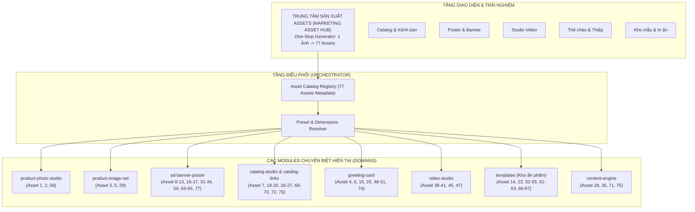

# BÁO CÁO ÁNH XẠ VÀ CHECKLIST ĐỐI CHIẾU 77 MARKETING & SALES ASSETS TRÊN SMEOS

> **Ngày thực hiện:** 01/11/2026  
> **Nhánh:** `Nangcap_danhsach_congcu`  
> **Nguồn đối chiếu:** 
> 1. `docs/kien-truc/Nâng cấp tasks/SMEOS_Business_growth_Architecture/Danh sách các sản phẩm marketing & sale assets` (77 assets)
> 2. `docs/nâng cấp chức năng cho cửa hàng/FloraOS_48_cong_cu_v3.md` (48 công cụ chuẩn)
> 3. Codebase thực tế tại `src/modules/*` & `workers/*` (Hạ tầng Single-Call AI, Template Engine, Media Workers, Greeting Card, Catalog Studio, Ad Banner Poster, Landing Page).

---

## 1. TỔNG KẾT MỨC ĐỘ KHẢ THI VÀ SẴN SÀNG

Qua rà soát thực tế từng dòng code, module domain, template preset và worker AI trong smeOS:

| Phân loại trạng thái | Số lượng (trên 77) | Tỷ lệ (%) | Ý nghĩa kỹ thuật & vận hành |
|---|:---:|:---:|---|
| 🟢 **SẴN SÀNG ỨNG DỤNG NGAY (READY / PROD)** | **33 / 77** | **42.9%** | Đã có đầy đủ UI, Domain, Use-case, Template hoặc AI pipeline. Cửa hàng có thể đưa ảnh vào và xuất kết quả sử dụng ngay lập tức. |
| 🟡 **CÓ NỀN TẢNG KỸ THUẬT, CẦN BỔ SUNG TEMPLATE / PRESET (EXTENDABLE)** | **28 / 77** | **36.4%** | Công nghệ cốt lõi đã có (HTML canvas, SVG, PDF generator, Banner presets, BOM pricing, Voucher engine...), chỉ cần thêm Layout preset, kích thước đầu ra hoặc cấu hình form là chạy được ngay mà không cần viết lại kiến trúc. |
| 🔴 **CHƯA CÓ, CẦN XÂY DỰNG MỚI (PLANNED / NEW)** | **16 / 77** | **20.7%** | Cần xây dựng use-case, giao diện hoặc luồng xử lý độc lập mới (ví dụ: Video trước/sau, Trình dựng Form khảo sát, Hệ thống thẻ thành viên loyalty tích điểm). |

> 🎯 **Kết luận:** **79.3% (61/77 assets)** đã có công nghệ nền tảng sẵn trong smeOS và có thể kích hoạt/mở rộng đưa vào sản xuất ngay lập tức.

---

## 2. MA TRẬN CHECKLIST CHI TIẾT 77 ASSETS ĐỐI CHIẾU VỚI CÔNG CỤ HIỆN CÓ

### Ký hiệu đánh giá:
- 🟢 **READY**: Đã có công cụ chạy thực tế, ứng dụng được ngay.
- 🟡 **EXTEND**: Đã có module & engine, chỉ cần đăng ký thêm Template/Preset/Kích thước.
- 🔴 **NEW**: Cần phát triển UI / Flow chuyên biệt mới.

---

### NHÓM 1: PRODUCT IDENTITY – VẬT PHẨM NHẬN DIỆN VÀ GIỚI THIỆU SẢN PHẨM (7 Assets)
*Mục đích: Chuẩn hóa hình ảnh và thông tin sản phẩm trên website, mạng xã hội, catalog.*

| STT | Tên Asset | Trạng thái | Công cụ & Module hiện có trong smeOS | Công nghệ áp dụng & Khả năng sản xuất ngay | Việc cần bổ sung |
|:---:|---|:---:|---|---|---|
| 1 | **Product Cover** | 🟢 READY | Công cụ 01 (`product-photo-studio`, `/cong-cu/anh-san-pham`) | **Ứng dụng luôn**. AI Single-Call Studio (`openai_enhancer.py`, fal/gemini) xóa phông, tạo nền ánh sáng studio chuẩn. | Không |
| 2 | **Product Thumbnail** | 🟢 READY | Công cụ 01 & 02 (`product-image-set`, `assets`) | **Ứng dụng luôn**. Hệ thống tự sinh các kích thước thumbnail vuông/chuẩn khi tải ảnh lên. | Không |
| 3 | **Product Image Gallery** | 🟢 READY | Công cụ 02 (`product-image-set`, `/cong-cu/bo-anh-san-pham`) | **Ứng dụng luôn**. Sinh 4-6 biến thể góc chụp, tỉ lệ (1:1, 4:5, 9:16) và phong cách từ 1 ảnh gốc. | Không |
| 4 | **Product Information Card** | 🟢 READY | Công cụ 03 (`greeting-card` / Thẻ chào, `/the-chao`) | **Ứng dụng luôn**. Thẻ chào định dạng A6 / 1:1 ghép ảnh + tên + giá + mô tả + QR đặt hàng. | Không |
| 5 | **Product Showcase** | 🟢 READY | Công cụ 02 & 03 (`product-image-set`, `greeting-card`) | **Ứng dụng luôn**. Trình diễn ảnh chụp nghệ thuật cao cấp + thẻ chào VIP. | Không |
| 6 | **Product Comparison Sheet** | 🟡 EXTEND | Công cụ 03 (`greeting-card/use-cases/catalog-collage.ts`) | Engine ghép ảnh dạng Collage nhiều sản phẩm đã có. Cần thêm layout so sánh 3 cột (Ảnh, Giá, Ưu điểm). | Bổ sung Preset layout so sánh trong `catalog-collage`. |
| 7 | **Product Collection Sheet** | 🟢 READY | Công cụ 09 (`catalog-studio`, `/catalog`) | **Ứng dụng luôn**. Xuất bản bảng tổng hợp bộ sưu tập theo mùa hoặc chủ đề. | Không |

---

### NHÓM 2: ADVERTISING MATERIALS – VẬT PHẨM QUẢNG CÁO (10 Assets)
*Mục đích: Thu hút sự chú ý, quảng bá chương trình ưu đãi đa kích thước.*

| STT | Tên Asset | Trạng thái | Công cụ & Module hiện có trong smeOS | Công nghệ áp dụng & Khả năng sản xuất ngay | Việc cần bổ sung |
|:---:|---|:---:|---|---|---|
| 8 | **Poster** | 🟢 READY | Công cụ 05 (`ad-banner-poster`, `/cong-cu/poster-banner`) | **Ứng dụng luôn**. Định dạng khổ `A4` (Printable), 5 style presets (Modern Minimal, Luxury...), sinh AI Single-Call hoặc Template. | Không |
| 9 | **Promotional Poster** | 🟢 READY | Công cụ 05 (`ad-banner-poster`, `/cong-cu/poster-banner`) | **Ứng dụng luôn**. Preset `VIBRANT_SALE`, tự ghép badge giảm giá %, headline chương trình. | Không |
| 10 | **Sale Banner** | 🟢 READY | Công cụ 05 (`ad-banner-poster`) | **Ứng dụng luôn**. Tỷ lệ `1:1` và `4:5` có gắn khung Flash Sale và nút CTA. | Không |
| 11 | **Website Banner** | 🟢 READY | Công cụ 05 (`ad-banner-poster`, khổ `16:9`) | **Ứng dụng luôn**. Tỷ lệ `16:9` (1920x1080 px) chuyên cho header web/landing page. | Không |
| 12 | **Facebook Banner** | 🟢 READY | Công cụ 05 (`ad-banner-poster`, khổ `16:9`) | **Ứng dụng luôn**. Tỷ lệ `16:9` tối ưu cho ảnh bìa Facebook Fanpage/Event. | Không |
| 13 | **Social Media Banner** | 🟢 READY | Công cụ 05 (`ad-banner-poster`, tỉ lệ `1:1`, `4:5`) | **Ứng dụng luôn**. Sinh tự động banner đa tỉ lệ từ ảnh sản phẩm. | Không |
| 14 | **Flyer** | 🟡 EXTEND | Công cụ 04 (`templates`, `ad-banner-poster`) | Khung A4/A5 đã hỗ trợ. Cần bổ sung layout tờ rơi 2 mặt (Mặt trước ảnh + ưu đãi, mặt sau menu + địa chỉ). | Thêm template Flyer A5 2 mặt trong `templates`. |
| 15 | **Brochure** | 🟡 EXTEND | Công cụ 03 & 04 (`greeting-card`, `templates`) | Có sẵn engine xuất Brochure A6/A4 gấp 2, gấp 3. Đã có `brochure-quote.ts`. | Bổ sung giao diện xuất bản PDF brochure gấp 3 tại `/kho-templates`. |
| 16 | **Standee** | 🟡 EXTEND | Công cụ 05 (`ad-banner-poster`) | Đã có pipeline sinh ảnh độ phân giải cao vector/canvas. Cần thêm preset tỷ lệ `60x160cm` và `80x180cm` (tỉ lệ 1:2.67 / 1:2.25). | Thêm tỷ lệ Standee vào `BANNER_FORMATS`. |
| 17 | **Digital Billboard** | 🟢 READY | Công cụ 05 (`ad-banner-poster`, khổ `16:9` 4K) | **Ứng dụng luôn**. Tỉ lệ 16:9 xuất PNG/JPG chất lượng cao cho màn hình LED. | Không |

---

### NHÓM 3: SALES MATERIALS – VẬT PHẨM BÁN HÀNG & TƯ VẤN (10 Assets)
*Mục đích: Hỗ trợ nhân viên báo giá, tư vấn, giúp khách chốt đơn nhanh.*

| STT | Tên Asset | Trạng thái | Công cụ & Module hiện có trong smeOS | Công nghệ áp dụng & Khả năng sản xuất ngay | Việc cần bổ sung |
|:---:|---|:---:|---|---|---|
| 18 | **Product Catalog** | 🟢 READY | Công cụ 09 (`catalog-studio`, `catalog-links`, `/catalog`) | **Ứng dụng luôn**. Showroom số hóa, link chia sẻ, bộ lọc danh mục và giỏ hàng. | Không |
| 19 | **Mini Catalog** | 🟢 READY | Công cụ 14 (`greeting-card?quick=true`) | **Ứng dụng luôn**. Tạo nhanh BST 3-5 mẫu theo ngân sách trong < 10 giây gửi Zalo. | Không |
| 20 | **Digital Lookbook** | 🟢 READY | Công cụ 09 (`catalog-studio`, giao diện tạp chí) | **Ứng dụng luôn**. Chế độ xem Lookbook ảnh lớn nghệ thuật theo phong cách. | Không |
| 21 | **Price List** | 🟢 READY | Công cụ 10 & 34 (`pricing`, `costing`, `/tinh-gia/gia-ban`) | **Ứng dụng luôn**. Xuất bảng giá niêm yết theo nhóm sản phẩm, có chiết khấu. | Không |
| 22 | **Product Menu** | 🟢 READY | Công cụ 04 (`templates`, `industries/fnb.ts`, `floral.ts`) | **Ứng dụng luôn**. Menu sản phẩm chuẩn A4/A5 để bàn hoặc xem trên mobile. | Không |
| 23 | **Product Presentation** | 🟡 EXTEND | Công cụ 09 & 05 (`catalog-studio`, `ad-banner-poster`) | Đã có dữ liệu sản phẩm + ảnh studio. Cần tính năng xuất Slide PDF/Web view trình chiếu. | Thêm view Export Slide trình chiếu cho VIP. |
| 24 | **Product Quotation** | 🟡 EXTEND | Công cụ 15 & 16 (`costing`, `orders`) | Đã có công thức tính BOM + lợi nhuận. Cần thêm mẫu phiếu báo giá gửi khách (PDF/Zalo). | Thêm UI xuất bản phiếu báo giá nhiều hạng mục. |
| 25 | **Product Selection Sheet** | 🟢 READY | Công cụ 14 (`greeting-card`, quick quote) | **Ứng dụng luôn**. Gửi bảng phân 3 mức ngân sách (Tiết kiệm, Tiêu chuẩn, Cao cấp). | Không |
| 26 | **Gift Collection** | 🟢 READY | Công cụ 09 (`catalog-studio`, filter dịp tặng) | **Ứng dụng luôn**. Gom các mẫu quà tặng theo dịp (Sinh nhật, Kỷ niệm, 8/3, Valentine). | Không |
| 27 | **Event Collection** | 🟢 READY | Công cụ 09 (`catalog-studio`, filter sự kiện) | **Ứng dụng luôn**. Gom các mẫu sự kiện (Khai trương, Hội nghị, Tiệc cưới). | Không |

---

### NHÓM 4: SOCIAL MEDIA CONTENT – VẬT PHẨM MẠNG XÃ HỘI (10 Assets)
*Mục đích: Duy trì tương tác đa nền tảng, phủ sóng thương hiệu hàng ngày.*

| STT | Tên Asset | Trạng thái | Công cụ & Module hiện có trong smeOS | Công nghệ áp dụng & Khả năng sản xuất ngay | Việc cần bổ sung |
|:---:|---|:---:|---|---|---|
| 28 | **Facebook Post Image** | 🟢 READY | Công cụ 01, 04, 05 (`ad-banner-poster`, `content-engine`) | **Ứng dụng luôn**. Sinh ảnh vuông/dọc kèm bài viết caption + hashtag chuẩn Facebook. | Không |
| 29 | **Instagram Post** | 🟢 READY | Công cụ 01, 05 (`product-photo-studio`, tỷ lệ 1:1 hoặc 4:5) | **Ứng dụng luôn**. Ảnh phong cách sang trọng, tối giản, chuẩn feed Instagram. | Không |
| 30 | **Instagram Carousel** | 🟡 EXTEND | Công cụ 02 (`product-image-set`) + Công cụ 05 | Đã có pipeline sinh chuỗi 5 ảnh. Cần ghép template carousel liền mạch (swipeable). | Thêm preset Carousel layout (slide 1 $\to$ 5). |
| 31 | **Instagram Story** | 🟢 READY | Công cụ 05 (`ad-banner-poster`, tỷ lệ `9:16`) | **Ứng dụng luôn**. Khung dọc 1080x1920 px, chừa khoảng an toàn cho thanh header Story. | Không |
| 32 | **Facebook Story** | 🟢 READY | Công cụ 05 (`ad-banner-poster`, tỷ lệ `9:16`) | **Ứng dụng luôn**. Tối ưu hiển thị 9:16 trên Facebook. | Không |
| 33 | **TikTok Photo Post** | 🟢 READY | Công cụ 05 & 02 (khổ dọc `9:16`) | **Ứng dụng luôn**. Bộ ảnh dọc kích thước chuẩn TikTok kèm caption ngắn gợi cảm xúc. | Không |
| 34 | **Pinterest Pin** | 🟢 READY | Công cụ 05 (`ad-banner-poster`, tỉ lệ `4:5` hoặc `2:3`) | **Ứng dụng luôn**. Định dạng ảnh dọc tối ưu cho thuật toán Pinterest. | Không |
| 35 | **Social Media Carousel** | 🟡 EXTEND | Công cụ 04 (`content-engine`) + `ad-banner-poster` | Sinh kịch bản 5 trang (Trang bìa, Vấn đề, 3 Gợi ý sản phẩm, Kêu gọi mua). Cần ghép bộ. | Tích hợp tự động kết xuất chuỗi ảnh từ kịch bản M04. |
| 36 | **Social Media Album** | 🟢 READY | Công cụ 09 (`catalog-studio`) + `product-image-set` | **Ứng dụng luôn**. Xuất gói ảnh tuần kèm tiêu đề đồng bộ. | Không |
| 37 | **Social Media Cover** | 🟢 READY | Công cụ 05 (`ad-banner-poster`, khổ `16:9` / Cover) | **Ứng dụng luôn**. Ảnh bìa trang theo mùa (Tết, Valentine, 8/3, 20/10). | Không |

---

### NHÓM 5: VIDEO & MOTION CONTENT – VẬT PHẨM VIDEO VÀ CHUYỂN ĐỘNG (10 Assets)
*Mục đích: Thu hút người xem trên Reels, TikTok, Story bằng video chuyển động.*

| STT | Tên Asset | Trạng thái | Công cụ & Module hiện có trong smeOS | Công nghệ áp dụng & Khả năng sản xuất ngay | Việc cần bổ sung |
|:---:|---|:---:|---|---|---|
| 38 | **Product Slideshow** | 🟢 READY | Công cụ 06 (`video-studio`, `workers/media_ai/video/`) | **Ứng dụng luôn**. Worker MoviePy ghép chuỗi ảnh, hiệu ứng chuyển cảnh và nhạc nền. | Không |
| 39 | **Product Reel** | 🟢 READY | Công cụ 06 (`video-studio`, khung 9:16, 15s) | **Ứng dụng luôn**. Video 9:16 thời lượng 15s có nhạc hot trend và text overlay. | Không |
| 40 | **TikTok Product Video** | 🟢 READY | Công cụ 06 (`video-studio`) | **Ứng dụng luôn**. Video nhịp điệu nhanh, text nhấp nháy thu hút Gen Z. | Không |
| 41 | **Product Showcase Video** | 🟢 READY | Công cụ 06 (`video-studio`, zoom/pan effect) | **Ứng dụng luôn**. Hiệu ứng Ken Burns lướt cận cảnh chi tiết bông hoa, chất liệu. | Không |
| 42 | **Promotional Video** | 🟡 EXTEND | Công cụ 06 (`video-studio`) | Video có sẵn, cần ghép thêm banner giảm giá động (motion sticker đếm ngược hoặc badge sale). | Bổ sung overlay template khuyến mãi vào video worker. |
| 43 | **Animated Product Poster** | 🟡 EXTEND | Công cụ 06 (`video-studio`) | Chuyển poster tĩnh thành video ngắn 5 giây có hiệu ứng ánh sáng lấp lánh hoặc tuyết/hoa rơi. | Thêm preset short-loop video 5s từ ảnh poster. |
| 44 | **Product Story Video** | 🟡 EXTEND | Công cụ 06 (`video-studio`) + `content-engine` | Lời bình AI (ElevenLabs voice đã tích hợp ở `audio-studio`) đọc câu chuyện sản phẩm. | Nối audio voice TTS vào video pipeline. |
| 45 | **Video Catalog** | 🟢 READY | Công cụ 06 (`video-studio`) | **Ứng dụng luôn**. Video tổng hợp lật từng trang sản phẩm để gửi Zalo/Messenger. | Không |
| 46 | **Before & After Video** | 🔴 NEW | Chưa có luồng riêng | Cần luồng nạp 2 ảnh (nguyên liệu thô $\to$ sản phẩm hoàn thiện) và hiệu ứng quét wipe/slider. | Phát triển preset Before-After motion trong `video-studio`. |
| 47 | **Seasonal Collection Video**| 🟢 READY | Công cụ 06 (`video-studio`, theme Tết/Valentine) | **Ứng dụng luôn**. Template video theo mùa với nhạc lễ hội và khung trang trí. | Không |

---

### NHÓM 6: CUSTOMER ENGAGEMENT – VẬT PHẨM CHĂM SÓC KHÁCH HÀNG (10 Assets)
*Mục đích: Tạo kết nối cảm xúc, giữ chân khách cũ, gia tăng trải nghiệm.*

| STT | Tên Asset | Trạng thái | Công cụ & Module hiện có trong smeOS | Công nghệ áp dụng & Khả năng sản xuất ngay | Việc cần bổ sung |
|:---:|---|:---:|---|---|---|
| 48 | **Greeting Card** | 🟢 READY | Công cụ 07 & 03 (`greeting-card`, `/the-chao`) | **Ứng dụng luôn**. Thiệp chúc mừng A6 cá nhân hóa theo lời nhắn của khách. | Không |
| 49 | **Thank You Card** | 🟢 READY | Công cụ 04 & 07 (`templates`, `greeting-card`) | **Ứng dụng luôn**. Mẫu thiệp cảm ơn đính kèm đơn hàng có logo tiệm và QR đánh giá. | Không |
| 50 | **Birthday Card** | 🟢 READY | Công cụ 07 (`greeting-card`, catalog dịp BIRTHDAY) | **Ứng dụng luôn**. Mẫu thiệp sinh nhật sang trọng kèm câu chúc tự sinh bằng AI. | Không |
| 51 | **Anniversary Card** | 🟢 READY | Công cụ 07 (`greeting-card`, catalog dịp LOVE) | **Ứng dụng luôn**. Mẫu thiệp kỷ niệm ngày cưới/yêu nhau lãng mạn. | Không |
| 52 | **Gift Card** | 🟡 EXTEND | Công cụ 04 (`templates`) + `promotions` | Có voucher code, cần mẫu thiết kế thẻ quà tặng mệnh giá (500k, 1000k) có QR nạp tiền. | Thêm template thiết kế Gift Card vật lý/digital. |
| 53 | **Voucher** | 🟢 READY | Công cụ 04 (`templates`) & module `promotions` (`voucher-batch.ts`) | **Ứng dụng luôn**. Sinh mã voucher giảm giá, in ấn hoặc gửi ảnh qua Zalo. | Không |
| 54 | **Discount Coupon** | 🟢 READY | Module `promotions` & `ad-banner-poster` | **Ứng dụng luôn**. Phiếu giảm giá % hoặc tiền mặt trong các đợt chiến dịch. | Không |
| 55 | **Care Instruction Card** | 🟢 READY | Công cụ 04 (`templates`, `industries/floral.ts` CARE_GUIDE) | **Ứng dụng luôn**. Đã có SSOT `CARE_GUIDE` (hướng dẫn cắt gốc 45 độ, thay nước, dưỡng hoa). | Không |
| 56 | **Delivery Confirmation Card**| 🟡 EXTEND | Module `orders` (POD Proof of delivery) | Đã có luồng chụp ảnh giao hàng thành công. Cần đóng gói thành ảnh card đẹp gửi khách xác nhận. | Thêm template card xác nhận giao hoa hoàn tất. |
| 57 | **Review Request Card** | 🟡 EXTEND | Công cụ 04 (`templates`) & module `shop-reviews` | Đã có QR code và link đánh giá. Cần mẫu card A6/Namecard "Đánh giá nhận ưu đãi" kèm QR. | Thêm template Review Card vào kho ấn phẩm. |

---

### NHÓM 7: PRINT & DISPLAY MATERIALS – VẬT PHẨM IN ẤN VÀ TRƯNG BÀY (10 Assets)
*Mục đích: Vật phẩm vật lý phục vụ bán lẻ trực tiếp tại cửa hàng.*

| STT | Tên Asset | Trạng thái | Công cụ & Module hiện có trong smeOS | Công nghệ áp dụng & Khả năng sản xuất ngay | Việc cần bổ sung |
|:---:|---|:---:|---|---|---|
| 58 | **Product Photo Print** | 🟢 READY | Công cụ 01 & 04 (`product-photo-studio`, xuất PDF/JPG 300DPI) | **Ứng dụng luôn**. Xuất ảnh độ phân giải cao phục vụ in ấn ảnh tham khảo tại quầy. | Không |
| 59 | **Product Poster Print** | 🟢 READY | Công cụ 05 (`ad-banner-poster`, khổ `A4` printable) | **Ứng dụng luôn**. Xuất file in vector/PDF chất lượng in offset/laser. | Không |
| 60 | **Product Catalog Print** | 🟡 EXTEND | Công cụ 09 (`catalog-studio`) & `templates` | Đã có cấu trúc trang và ảnh catalog. Cần nút xuất toàn bộ catalog ra file PDF dạng sách lật (Booklet). | Thêm tính năng Export PDF Printable Catalog. |
| 61 | **Product Menu Print** | 🟢 READY | Công cụ 04 (`templates`, `industries/floral.ts`, `fnb.ts`) | **Ứng dụng luôn**. Menu chuẩn in ấn A4/A5 để bàn tiếp khách. | Không |
| 62 | **Counter Display** | 🟡 EXTEND | Công cụ 05 (`ad-banner-poster`) | Kích thước A5 ngang/đứng để quầy thanh toán. Cần bổ sung preset kích thước mica để bàn. | Thêm preset khổ để bàn (15x21cm). |
| 63 | **Table Tent** | 🟡 EXTEND | Công cụ 04 & 12 (`templates`, QR Code) | Khung tam giác để bàn có QR xem catalog và ưu đãi. | Bổ sung template Table Tent gấp đôi/gấp ba. |
| 64 | **Window Display Poster**| 🟢 READY | Công cụ 05 (`ad-banner-poster`, khổ dọc A3/A2) | **Ứng dụng luôn**. Poster cỡ lớn dán cửa kính chào mùa lễ hội. | Không |
| 65 | **Wall Poster** | 🟢 READY | Công cụ 05 (`ad-banner-poster`) | **Ứng dụng luôn**. Ảnh tranh treo tường trang trí tiệm nghệ thuật. | Không |
| 66 | **Product Tag** | 🟢 READY | Công cụ 04 (`templates`, `industries/floral.ts` printables `TAG`) | **Ứng dụng luôn**. Đã có quy chuẩn thẻ treo sản phẩm (tên mẫu, giá, mã SKU, ngày hoàn thành). | Không |
| 67 | **Packaging Sticker** | 🟡 EXTEND | Công cụ 04 (`templates`) & Brand Library (`/ho-so`) | Đã có logo + brand color. Cần template dàn trang in tem decal tròn (đường kính 4cm, 5cm) lên khổ A4. | Bổ sung template dàn trang Decal sticker hàng loạt. |

---

### NHÓM 8: DIGITAL COMMERCE ASSETS – VẬT PHẨM BÁN HÀNG TRỰC TUYẾN (10 Assets)
*Mục đích: Chuyển đổi trực tuyến, chia sẻ link, đặt hàng và chốt đơn 24/7.*

| STT | Tên Asset | Trạng thái | Công cụ & Module hiện có trong smeOS | Công nghệ áp dụng & Khả năng sản xuất ngay | Việc cần bổ sung |
|:---:|---|:---:|---|---|---|
| 68 | **Product Landing Page** | 🟢 READY | Công cụ 08 (`landing-page`, `/landing-page`) | **Ứng dụng luôn**. Trang đích bán hàng cho từng sản phẩm nổi bật, có nút đặt mua và hotline. | Không |
| 69 | **Collection Landing Page**| 🟢 READY | Công cụ 08 & 09 (`landing-page`, `catalog-studio`) | **Ứng dụng luôn**. Trang giới thiệu bộ sưu tập chiến dịch (VD: 20 mẫu Valentine). | Không |
| 70 | **Digital Product Page** | 🟢 READY | Công cụ 09 & `catalog-links` (`/c/[slug]`) | **Ứng dụng luôn**. Trang chi tiết sản phẩm chuẩn SEO/Social Share, xem giá, nguyên liệu, đặt hàng. | Không |
| 71 | **Facebook Product Album** | 🟡 EXTEND | Công cụ 09 & 04 (`catalog-studio`, `content-engine`) | Đã có bộ ảnh và caption. Cần nút "Xuất gói đăng Facebook Album" (tải zip ảnh đánh số 01, 02... kèm text từng ảnh). | Bổ sung tính năng Bundle Download cho Facebook Album. |
| 72 | **Online Catalog Link** | 🟢 READY | Công cụ 01 (`catalog-links`, `/c/[slug]`) | **Ứng dụng luôn**. Tạo link rút gọn gửi Zalo/Messenger, có theo dõi số lượt click và đặt hàng. | Không |
| 73 | **QR Product Page** | 🟢 READY | Công cụ 12 & 25 (`thu-hut-khach`, QR Engine) | **Ứng dụng luôn**. Sinh mã QR động in lên bảng để khách quét mở ngay trang sản phẩm. | Không |
| 74 | **Zalo Product Card** | 🟢 READY | Công cụ 03 (`greeting-card`, Zalo Script Generator) | **Ứng dụng luôn**. Sinh thẻ ảnh sản phẩm chuẩn tỉ lệ Zalo kèm tin nhắn mẫu chốt đơn 1 chạm. | Không |
| 75 | **Email Product Newsletter**| 🟡 EXTEND | Module `content-engine` & `ad-banner-poster` | Đã có nội dung email và banner. Cần template dàn trang HTML Email hoặc xuất ảnh dài cho Email. | Thêm mẫu Email HTML/Image Newsletter. |
| 76 | **Digital Product Collection**| 🟢 READY | Công cụ 09 (`catalog-studio`) | **Ứng dụng luôn**. Trang tổng hợp các mẫu số hóa theo danh mục. | Không |
| 77 | **Social Commerce Creative**| 🟢 READY | Công cụ 05 (`ad-banner-poster`, preset `VIBRANT_SALE`) | **Ứng dụng luôn**. Ảnh quảng cáo tích hợp giá, ưu đãi và CTA đặt hàng nhanh. | Không |

---

## 3. ĐÁNH GIÁ VÀ ĐỀ XUẤT PHÂN BỔ KIẾN TRÚC

Theo định hướng của dự án:
> *"Cần xác định xem assets nào đã có và assets nào chưa có cũng như phân bổ các assets này theo đúng các modules hiện tại hay phân bổ lại theo nhóm mới ?"*

Dựa trên nguyên tắc **Clean Architecture, Single Responsibility Principle (SRP < 350 dòng)** và cấu trúc hiện tại của `smeOS`:

### ❌ KHÔNG NÊN: Tạo 77 modules rời rạc hoặc xáo trộn đập đi xây lại
Nếu tạo 77 modules mới, hệ thống sẽ bị phân mảnh, trùng lặp code render ảnh/canvas, phá vỡ cấu trúc module chuẩn hiện có.

### ✅ NÊN: Mô hình 2 Tầng — "Domain Modules Chuyên Sâu" + "Unified Generator Hub"

### Chi tiết phân bổ 77 Assets vào 8 Modules Domain cốt lõi:

1. **`product-photo-studio` (Chuyên gia công ảnh sản phẩm gốc)**:
   - Phụ trách: `Product Cover` (1), `Product Thumbnail` (2), `Product Photo Print` (58).
2. **`product-image-set` (Chuyên sinh bộ ảnh và góc chụp đa tỉ lệ)**:
   - Phụ trách: `Product Image Gallery` (3), `Product Showcase` (5), `Instagram Post` (29), `TikTok Photo Post` (33), `Pinterest Pin` (34).
3. **`ad-banner-poster` (Chuyên banner quảng cáo và poster in ấn đa tỉ lệ)**:
   - Phụ trách: `Poster` (8), `Promotional Poster` (9), `Sale Banner` (10), `Website Banner` (11), `Facebook Banner` (12), `Social Media Banner` (13), `Standee` (16), `Digital Billboard` (17), `Instagram Story` (31), `Facebook Story` (32), `Social Media Cover` (37), `Product Poster Print` (59), `Window Display Poster` (64), `Wall Poster` (65), `Social Commerce Creative` (77).
4. **`catalog-studio` & `catalog-links` (Chuyên gom bộ sưu tập, catalog và link bán hàng)**:
   - Phụ trách: `Product Collection Sheet` (7), `Product Catalog` (18), `Digital Lookbook` (20), `Price List` (21), `Gift Collection` (26), `Event Collection` (27), `Product Landing Page` (68), `Collection Landing Page` (69), `Digital Product Page` (70), `Online Catalog Link` (72), `Digital Product Collection` (76).
5. **`greeting-card` (Chuyên thẻ chào sản phẩm, thiệp chúc và tư vấn chốt đơn Zalo)**:
   - Phụ trách: `Product Information Card` (4), `Product Comparison Sheet` (6), `Brochure` (15), `Mini Catalog` (19), `Product Selection Sheet` (25), `Greeting Card` (48), `Thank You Card` (49), `Birthday Card` (50), `Anniversary Card` (51), `Zalo Product Card` (74).
6. **`video-studio` (Chuyên video marketing và chuyển động)**:
   - Phụ trách: `Product Slideshow` (38), `Product Reel` (39), `TikTok Product Video` (40), `Product Showcase Video` (41), `Promotional Video` (42), `Animated Product Poster` (43), `Product Story Video` (44), `Video Catalog` (45), `Before & After Video` (46), `Seasonal Collection Video` (47).
7. **`templates` & `promotions` (Kho mẫu ấn phẩm vật lý & voucher)**:
   - Phụ trách: `Flyer` (14), `Product Menu` (22), `Gift Card` (52), `Voucher` (53), `Discount Coupon` (54), `Care Instruction Card` (55), `Product Menu Print` (61), `Counter Display` (62), `Table Tent` (63), `Product Tag` (66), `Packaging Sticker` (67).
8. **`content-engine` & `crm` / `orders` (Nội dung marketing, chăm sóc và báo giá)**:
   - Phụ trách: `Product Quotation` (24), `Product Presentation` (23), `Facebook Post Image` (28), `Instagram Carousel` (30), `Social Media Carousel` (35), `Social Media Album` (36), `Delivery Confirmation Card` (56), `Review Request Card` (57), `Facebook Product Album` (71), `Email Product Newsletter` (75).

---

## 4. KẾ HOẠCH HÀNH ĐỘNG ĐỀ XUẤT (NEXT STEPS)

1. **Bước 1**: Đăng ký Registry SSOT cho 77 assets tại `src/modules/toolkit/domain/marketing-assets-catalog.ts` để chuẩn hóa ID, mã code, danh mục, tỷ lệ khung hình và module phụ trách.
2. **Bước 2 (Hoàn thiện 28 Extendable Assets)**:
   - Thêm các tỷ lệ còn thiếu vào `BANNER_FORMATS` trong `ad-banner-poster`: Standee (`1:2.5`), Counter Display (`15x21cm`).
   - Đăng ký thêm các template ấn phẩm còn thiếu vào `src/modules/templates/` (Flyer A5, Decal Sticker tròn dàn trang A4, Thẻ Gift Card).
3. **Bước 3 (Xây dựng Generator Hub)**:
   - Triển khai màn hình Generator tổng hợp: cho phép chọn 1 ảnh sản phẩm $\to$ chọn danh sách assets cần sinh $\to$ hệ thống tự động gọi các engine tương ứng để xuất ra trọn bộ tài liệu marketing & sales.

