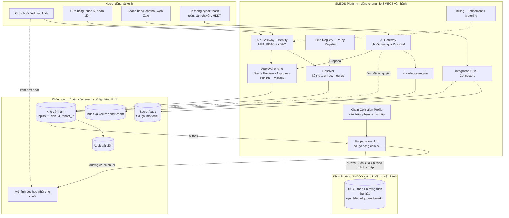
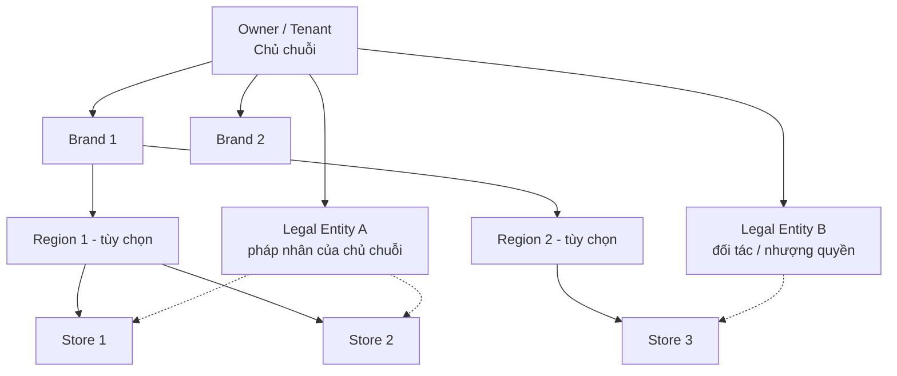
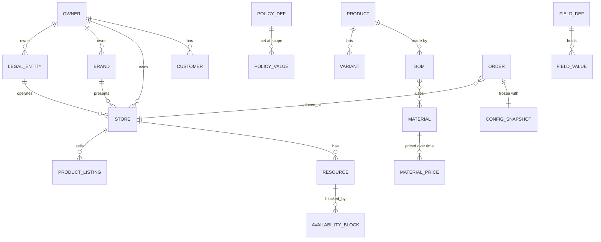
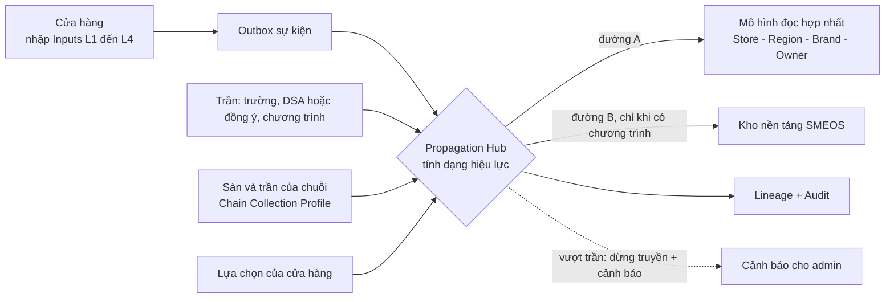
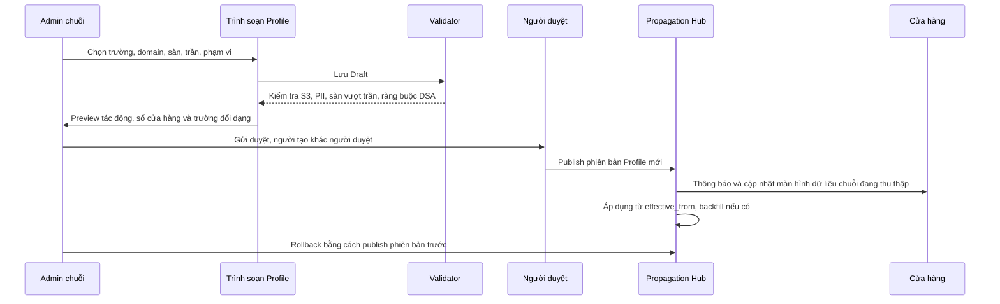

# SMEOS — Kiến trúc hệ thống Inputs

**Phiên bản v2.1 Final — Production & Commercial Ready (bản hoàn chỉnh để phê duyệt)**
*Kế thừa v1.0 (rewrite từ FloraOS) và v2.0. Ngày hoàn thiện: 24/10/2026.*

*Bổ sung ở v2.1: sơ đồ kiến trúc (4.1.1, 9.5.0); **Danh mục thu thập của chuỗi** để admin chuỗi chọn dữ liệu thu thập từ cửa hàng (9.5.8); làm rõ nơi lưu Inputs và phạm vi "nền vận hành" (9.1, 9.5.1); định hướng mở rộng sang đơn hàng/doanh thu (9.5.9). Các quyết định D-06 đến D-21 ở mục 18.2 vẫn ở trạng thái **Đề xuất – chờ chốt** cho đến khi chủ sở hữu sản phẩm phê duyệt.*

## 0. Trạng thái và phạm vi tài liệu

### 0.1 Mục đích

Tài liệu này là **đặc tả kiến trúc nền cho lớp Inputs của SMEOS**: dữ liệu và cấu hình mà tổ chức sử dụng (tenant) khai báo, cùng các cơ chế bảo đảm dữ liệu đó an toàn, nhất quán, truy vết được và dùng được cho vận hành, tự động hóa và AI. Bản v2.0 nâng cấp v1.0 theo hai tiêu chí:

- **Production ready:** đủ chặt để đội kỹ thuật triển khai không phải đoán ý: định nghĩa thuật toán, ràng buộc, mô hình bảo mật, yêu cầu phi chức năng, kiểm thử và tiêu chí nghiệm thu.
- **Commercial ready:** đủ để bán và vận hành như một sản phẩm: gói dịch vụ, entitlement, vòng đời tenant, onboarding/migration, tuân thủ pháp lý Việt Nam, hỗ trợ, di chuyển dữ liệu và rủi ro thương mại.

### 0.2 Trong và ngoài phạm vi

| Trong phạm vi | Ngoài phạm vi (có tài liệu riêng) |
| --- | --- |
| Phân loại dữ liệu, Field Registry, kế thừa/ghi đè/hiệu lực | Thiết kế chi tiết giao diện (UI/UX) |
| Mô hình sở hữu và đa tenant, bảo mật, quyền riêng tư | Đặc tả từng module nghiệp vụ (đơn hàng, kho, CRM…) |
| Onboarding, readiness, import/migration | Thiết kế mô hình AI/LLM và prompt cụ thể |
| Ràng buộc cho AI khi đọc Inputs, quy trình đề xuất–duyệt | Kế toán đầy đủ (sổ sách, báo cáo tài chính) |
| Mô hình thương mại ở mức cấu trúc (gói, entitlement, metering) | Mức giá cụ thể, chính sách khuyến mãi bán hàng |
| Yêu cầu phi chức năng, vận hành, lộ trình, checklist go-live | Hạ tầng cloud chi tiết, lựa chọn nhà cung cấp |

### 0.3 Quy ước

- **Bắt buộc (MUST)**, **nên (SHOULD)**, **có thể (MAY)** dùng theo nghĩa thông thường của đặc tả kỹ thuật.
- Con số trong các bảng yêu cầu phi chức năng và ngưỡng chất lượng là **mục tiêu đề xuất**, phải được xác nhận bằng đo đạc thực tế (load test, pilot) trước khi cam kết với khách hàng.
- Mọi viện dẫn pháp lý ở mục 9 là **bản đồ tuân thủ để pháp chế xác nhận**, không phải ý kiến pháp lý.
- Quyết định mới đề xuất có mã `D-xx` và trạng thái **Đề xuất – chờ chốt** tại mục 18.

### 0.4 Tóm tắt thay đổi so với v1.0

| Nhóm | Thay đổi chính |
| --- | --- |
| Sửa lỗi thiết kế | Sửa thuật toán gộp chính sách (lỗi ở kiểu *Restrictive*), sửa phân lớp Domain Khách hàng, tách *Availability* khỏi Inputs, thống nhất mâu thuẫn giữa cô lập tenant và dữ liệu benchmark |
| Mô hình sở hữu | Thêm **Pháp nhân (Legal Entity)** thành chiều riêng; xử lý mạng lưới đối tác/nhượng quyền |
| Truyền dữ liệu lên | Cơ chế **Data Propagation**: Inputs đi lên chuỗi và lên SMEOS theo thang dạng chia sẻ, trần/sàn, chương trình thu thập do SMEOS cài đặt (9.5) |
| Bổ sung v2.1 | Sơ đồ kiến trúc tổng thể và luồng dữ liệu (4.1.1, 9.5.0); **Danh mục thu thập của chuỗi (Chain Collection Profile)**: admin chuỗi chọn trường/domain, sàn, trần và phạm vi thu thập từ cửa hàng (9.5.8); làm rõ Inputs lưu ở đâu và phạm vi "nền vận hành" (9.1, 9.5.1); định hướng mở rộng cơ chế sang đơn hàng/doanh thu (9.5.9) |
| Registry | Thêm versioning, custom field theo tenant, đơn vị/tiền tệ/múi giờ, vòng đời `deprecated`, quyền AI theo đối tượng |
| Domain | 15 → **16 domain** (thêm *Tài nguyên & lịch*), dùng `domain_key` ổn định thay số thứ tự |
| Vận hành cấu hình | Quy trình Draft → Preview → Approve → Publish → Rollback; snapshot bất biến cho đơn hàng |
| Mới hoàn toàn | Bảo mật & tuân thủ (mục 9), AI governance (10), API & tích hợp (11), NFR (12), mô hình thương mại (13), vận hành & kiểm thử (14), rủi ro (15), checklist go-live (17) |
| Lộ trình | Dời Secret Vault, Audit, PII governance lên **trước** Giai đoạn 1; thêm mốc Alpha/Beta/GA và tiêu chí thoát |

---

## 1. Kết quả review v1.0

### 1.1 Điểm mạnh nên giữ

- Tư duy **nhiều chiều phân loại độc lập** thay vì một danh sách phẳng.
- **Kế thừa và ghi đè có kiểm soát** theo cấp quản lý; bốn kiểu gộp (Override, Restrictive, Bounded, Additive).
- Tách **dữ liệu có cấu trúc** khỏi **Knowledge Base**.
- **Onboarding theo giai đoạn** và nguyên tắc "không bắt nhập lại thứ hệ thống tự tính được".
- **Field Registry** làm nguồn sinh màn hình nhập liệu, import, validation và spec cho AI.
- Phân tách **Input** và **Generated**; tách **Core** khỏi **Vertical Pack**; quyết định "AI chỉ đề xuất".

### 1.2 Phát hiện cần sửa

Mức độ: **Nghiêm trọng** = chặn đưa vào production hoặc gây rủi ro pháp lý/an toàn dữ liệu; **Cao** = gây lỗi thiết kế hoặc cản trở bán hàng khi mở rộng; **Trung bình** = thiếu chặt chẽ, dễ gây hiểu sai.

| ID | Mức | Phát hiện trong v1.0 | Cách xử lý ở v2.0 | Mục |
| --- | --- | --- | --- | --- |
| F-01 | Nghiêm trọng | **Thuật toán gộp theo cây đối tượng sai với kiểu Restrictive**: bước 2 "lấy giá trị đầu tiên được đặt" cho phép cấp mẫu đặt *giảm giá tối đa* cao hơn cấp cửa hàng, tức là nới lỏng thay vì siết chặt. | Định nghĩa thuật toán riêng cho từng kiểu gộp, kèm bộ test mẫu. | 6.2–6.3 |
| F-02 | Nghiêm trọng | **Secret Vault, PII governance, audit xếp ở bước 5–6 của lộ trình** trong khi Giai đoạn 1 đã nhập số tài khoản nhận tiền (S2) và khóa cổng thanh toán/kênh nhận đơn (S3). | Đưa nền tảng bảo mật lên Phase 0, trước khi mở G1. | 9, 16 |
| F-03 | Nghiêm trọng | **AI access không phân biệt đối tượng**: trường S1 như giá vốn "AI được đọc theo vai trò" nhưng chatbot đối ngoại có thể làm lộ giá vốn/biên lợi nhuận cho khách. Không có biện pháp chống prompt injection từ tin nhắn khách hoặc nội dung KB. | `ai_access` theo ba đối tượng (đối ngoại, nội bộ, phân tích); quy tắc truy xuất và guardrail. | 3.D, 7.1, 10 |
| F-04 | Nghiêm trọng | **Mâu thuẫn quy tắc cô lập tenant**: mục 6 v1.0 nói "chỉ Platform và Vertical Pack được chia sẻ", nhưng quyết định chốt số 5 cho phép chia sẻ dữ liệu ẩn danh giữa tenant. | Thay bằng cơ chế *Data Propagation* có trần theo độ nhạy và chương trình thu thập do SMEOS khai báo; benchmark chỉ là một chương trình opt-in. | 9.5 |
| F-05 | Nghiêm trọng | **Rủi ro thương mại về thuế và hóa đơn**: Domain 7 liệt kê "hóa đơn, kỳ kế toán" nhưng quyết định chốt loại ra khỏi phạm vi. Từ 2026 hộ kinh doanh bỏ thuế khoán, doanh thu trên 1 tỷ đồng/năm bắt buộc dùng hóa đơn điện tử, và phải thông báo tài khoản ngân hàng dùng cho kinh doanh (mục 9.6). Khách SME sẽ hỏi ngay. | Không tự làm kế toán/HĐĐT, nhưng **bắt buộc có điểm tích hợp nhà cung cấp HĐĐT** và trường dữ liệu tương ứng; làm rõ phạm vi Domain 7. | 5.1, 9.6 |
| F-06 | Nghiêm trọng | **Domain Khách hàng gán L1+L5** trong khi v1.0 khẳng định "chỉ L1–L4 là Inputs". | Hồ sơ khách (L1), đồng ý (L2); lịch sử mua và hành vi là L5/L6 sinh ra. | 5.1 |
| F-07 | Cao | **Thiếu chiều Pháp nhân.** Quyết định "một chủ sở hữu, nhiều thương hiệu, nhiều pháp nhân" không khớp cây Tenant → Thương hiệu → Khu vực → Cửa hàng. Chưa xử lý mạng lưới đối tác/nhượng quyền (cửa hàng thuộc pháp nhân khác chủ chuỗi). | Mô hình sở hữu mới: Owner, Legal Entity, Brand, Store độc lập nhau. | 4.3 |
| F-08 | Cao | **Thiếu khái niệm Tài nguyên & lịch ở danh mục domain** dù Homestay đã được chọn làm pack thứ hai; đồng thời "lịch trống" bị liệt là input trong khi là dữ liệu dẫn xuất. | Thêm domain *Tài nguyên & lịch*; chỉ *quy tắc* và *chặn lịch* là input; availability là L6 có khóa giao dịch. | 4.6, 5.1, 5.4 |
| F-09 | Cao | **Pháp lý chung chung** ("quy định hiện hành"). Từ 2026 có Luật Bảo vệ dữ liệu cá nhân (91/2025/QH15) và Luật Trí tuệ nhân tạo (134/2025/QH15). | Bản đồ tuân thủ cụ thể, vai trò bên kiểm soát/bên xử lý, yêu cầu kỹ thuật tương ứng. | 9.6 |
| F-10 | Cao | **Readiness score chỉ được nhắc, chưa định nghĩa**; gate "100% trường bắt buộc" không đo chất lượng; AI bị khóa toàn bộ đến G3. | Công thức readiness 5 thành phần; gate theo năng lực (capability). | 8.2–8.3 |
| F-11 | Cao | **Registry thiếu quản trị tiến hóa**: không có versioning, deprecate, custom field của tenant, đơn vị đo, tiền tệ, làm tròn, múi giờ. | Registry v2 và quy trình thay đổi. | 7 |
| F-12 | Cao | **Không có yêu cầu phi chức năng**: SLA, RPO/RTO, hiệu năng resolve cấu hình, quy mô, quan sát, kiểm thử. | Mục 12 và 14. | 12, 14 |
| F-13 | Cao | **Không có mô hình thương mại**: gói, entitlement, metering, vòng đời tenant, offboarding, portability, hỗ trợ. | Mục 13. | 13 |
| F-14 | Cao | **Thiếu import/migration**: SME thường có sẵn dữ liệu trong Excel, Zalo, phần mềm bán hàng. Onboarding "nhập tay từng trường" sẽ gây rớt khách. | Import có dry-run, mapping, rollback; sandbox. | 8.4–8.5 |
| F-15 | Cao | **Không có quy trình thay đổi cấu hình an toàn**: thay đổi chính sách ở cấp cao có thể ảnh hưởng hàng loạt cửa hàng. | Draft → Preview tác động → Duyệt → Publish → Rollback. | 6.4 |
| F-16 | Cao | **Domain 3 (cấu trúc chuỗi & phân quyền) và Domain 10 (nhân sự, quyền) trùng lặp** phần quyền. | Phân quyền thuộc một domain; nhân sự chỉ gắn người với vai trò. | 5.1 |
| F-17 | Trung bình | Hai câu hỏi mở của v1.0 (ma trận cấp được ghi đè; xử lý giá trị ngoài giới hạn Bounded) chưa chốt. | Đề xuất chốt `D-06`, `D-07`. | 6.6–6.7, 18 |
| F-18 | Trung bình | `ai_access` thiếu giá trị "đọc có che", mâu thuẫn với mức S2 "đọc có che dữ liệu". | Bổ sung `read_masked` và `mask_rule`. | 7.1 |
| F-19 | Trung bình | Dùng lẫn "Tenant" và "Tổ chức". | Thuật ngữ thống nhất ở phụ lục A. | A |
| F-20 | Trung bình | Snapshot đơn hàng chỉ nhắc chính sách, thiếu giá, thuế, định mức, phiên bản registry. | Snapshot bất biến đầy đủ. | 6.5 |
| F-21 | Trung bình | Domain đánh số thứ tự (1–15) không ổn định khi thêm/bớt. | Dùng `domain_key`; số thứ tự chỉ để hiển thị. | 5.1 |
| F-22 | Trung bình | Không có tiêu chí hoàn thành cho một Vertical Pack mới. | Pack manifest và Pack Definition of Done. | 4.4 |
| F-23 | Trung bình | Lộ trình không có tiêu chí thoát và mốc phát hành. | Mục 16–17. | 16, 17 |
| F-24 | Cao | **Chưa có cơ chế truyền Inputs lên chuỗi và lên SMEOS.** v1.0 chỉ có kế thừa chiều xuống và chia sẻ ẩn danh hạn chế; chuỗi và SMEOS không có đường chính thức nhận dữ liệu từ cửa hàng. | Data Propagation: thang dạng chia sẻ, trần/sàn, Chương trình thu thập, DSA, lineage, thu hồi. | 9.5 |

---

## 2. Nguyên tắc thiết kế

1. **Khai báo một lần, dùng nhiều nơi.** Mỗi dữ kiện có đúng một nguồn sự thật (single source of truth).
2. **Core trung lập ngành, ngành là gói mở rộng.** Không đưa khái niệm riêng của một ngành vào Core.
3. **Registry-driven.** Màn hình nhập, import, validation, API và spec cho AI đều sinh từ Field Registry.
4. **Chỉ yêu cầu những gì cần cho giai đoạn hiện tại.** Mỗi trường có mức bắt buộc theo giai đoạn.
5. **Tự tính được thì không bắt nhập.** Dữ liệu dẫn xuất không bao giờ là input.
6. **Mọi thay đổi truy vết được và đảo ngược được**: ai, khi nào, giá trị cũ/mới, ai duyệt, và có đường quay lại.
7. **Cấu hình là dữ liệu có phiên bản bất biến.** Không sửa tại chỗ; mỗi thay đổi tạo phiên bản mới.
8. **An toàn khi lỗi (fail-safe).** Khi không giải được giá trị hoặc vi phạm giới hạn, hệ thống chọn phương án chặt nhất và chặn hành động rủi ro, không đoán.
9. **Đặc quyền tối thiểu theo mặc định.** Dữ liệu mới mặc định `ai_access = deny` cho đối tượng đối ngoại, quyền tối thiểu cho mọi vai trò.
10. **Cô lập tenant tuyệt đối ở tầng dữ liệu**, không chỉ ở tầng ứng dụng.
11. **Thiết kế cho SME Việt Nam:** ưu tiên điện thoại, nhập nhanh, import từ Excel/Zalo/phần mềm sẵn có, tiền VND, múi giờ Việt Nam, tuân thủ pháp luật Việt Nam.
12. **Đo được.** Mỗi mục tiêu (readiness, thời gian đến đơn đầu tiên, tỷ lệ AI đề xuất được duyệt) có chỉ số và nguồn đo.

---

## 3. Mô hình phân loại: 4 trục độc lập

Mỗi trường dữ liệu được định vị bằng bốn trục. Tổ hợp của bốn trục quyết định ai nhập, nhập khi nào, ai thấy, AI được đọc đến đâu.

### Trục A — Phạm vi sở hữu (Scope)

Có **hai cây** (xem 4.3 và 6.1):

- **Cây tổ chức (ai đặt):** Platform → Vertical Pack → Owner (tenant) → Brand / Legal Entity → Khu vực → Cửa hàng.
- **Cây đối tượng (đặt cho cái gì):** Cửa hàng → Chức năng → Bộ sưu tập → Mẫu/Sản phẩm → Biến thể → Dòng đơn hàng.

### Trục B — Bản chất dữ liệu (Layer)

| Layer | Tên | Ai tạo | Ví dụ |
| --- | --- | --- | --- |
| L1 | **Master** — thực thể nền | Tenant khai báo | Cửa hàng, thương hiệu, pháp nhân, sản phẩm, vật tư, nhân sự, nhà cung cấp, tài nguyên, hồ sơ khách |
| L2 | **Configuration** — quy tắc | Tenant thiết lập | Chính sách, quy trình, phân quyền, quy tắc giá, SLA, đồng ý của khách, mục tiêu và ngưỡng |
| L3 | **Operational State** — trạng thái biến động | Nhập, import hoặc đồng bộ | Giá nhập, tồn kho, giá bán, lịch làm việc, khuyến mãi đang chạy, chặn lịch phòng |
| L4 | **Knowledge** — tri thức | Tenant biên soạn, duyệt | SOP, hướng dẫn, FAQ, kịch bản tư vấn |
| L5 | **Transactional** — phát sinh | Hệ thống tạo từ nghiệp vụ | Đơn hàng, đặt phòng, báo giá, thanh toán, phiếu kho, khiếu nại, lịch sử mua |
| L6 | **Derived & Predictive** — dẫn xuất | Hệ thống tính hoặc AI đề xuất | KPI, giá vốn thực tế, availability, dự báo nhu cầu, đề xuất đặt hàng |

**Chỉ L1–L4 là Inputs.** L5 và L6 là Generated. Tenant chỉ nhập *mục tiêu và ngưỡng* cho chúng (thuộc L2). Quy tắc kiểm tra: một trường không thể có `data_layer` L5/L6 và `source_type = manual` cùng lúc, trừ thao tác hiệu chỉnh có duyệt (ví dụ điều chỉnh tồn kho kiểm kê), được ghi nhận thành bút toán điều chỉnh chứ không sửa trực tiếp.

### Trục C — Vòng đời và nguồn (Lifecycle & Source)

- **Vòng đời:** cố định tương đối · thay đổi hiếm · có hiệu lực theo thời gian (effective dating) · biến động thường xuyên · phát sinh theo giao dịch.
- **Nguồn:** `manual` · `import` · `sync` (đồng bộ hệ thống ngoài) · `computed` · `ai_proposed` (luôn cần duyệt).
- **Độ tươi:** `stale_after` (ví dụ giá nhập quá 3 ngày thì cảnh báo; slogan không cần).
- **Độ tin cậy:** `confidence` do hệ thống gán theo nguồn (nhập tay có xác nhận > sync > import chưa kiểm > AI đề xuất chưa duyệt).

### Trục D — Độ nhạy và quyền AI (Sensitivity)

| Mức | Ý nghĩa | Ví dụ | AI đối ngoại (khách) | AI nội bộ (nhân viên) | AI phân tích |
| --- | --- | --- | --- | --- | --- |
| **S0 Public** | Hiển thị công khai | Tên thương hiệu, giá niêm yết, chính sách đổi trả | Đọc | Đọc | Đọc |
| **S1 Internal** | Nội bộ tổ chức | SOP, giá vốn, biên lợi nhuận, KPI | **Không** (mặc định) | Đọc theo vai trò người dùng | Đọc |
| **S2 Confidential** | Nhạy cảm, có thể là dữ liệu cá nhân | Dữ liệu khách hàng, lương, hợp đồng nhà cung cấp, số tài khoản | Chỉ dữ liệu của chính khách đang hội thoại, đã xác thực | Đọc có che (`read_masked`) khi được cấp quyền rõ ràng | Chỉ dạng ẩn danh/tổng hợp |
| **S3 Secret** | Khóa và thông tin xác thực | API key, token, mật khẩu, khóa ký webhook | **Không bao giờ** | **Không bao giờ** | **Không bao giờ** |

Quy tắc bổ sung:

1. Quyền AI **không bao giờ vượt quá quyền của người dùng đang đại diện** (với AI nội bộ) và không vượt quá mức của đối tượng AI (với AI đối ngoại).
2. Nội dung do khách hàng gửi vào hội thoại luôn là **dữ liệu không tin cậy**, không bao giờ được coi là chỉ thị (xem 10.4).
3. S3 chỉ tồn tại trong Secret Vault; các nơi khác chỉ giữ tham chiếu `secret://…`.

---

## 4. Kiến trúc tổng thể: Platform + Core + Vertical Pack + Tenant

### 4.1 Các lớp

```
SMEOS Platform (do SMEOS vận hành, dùng chung)
  Field Registry · Policy Registry · Resolver (kế thừa/ghi đè/hiệu lực)
  Identity & Access (RBAC + ABAC) · Audit · Secret Vault · Approval engine
  Knowledge engine · AI Gateway · Integration Hub · Propagation Hub · Billing & Entitlement
│
├── Core Domains (dùng cho mọi SME, trung lập ngành)
│
├── Vertical Packs (mở rộng theo ngành, có phiên bản)
│     Flower · Homestay · F&B · Retail · Spa/Dịch vụ · …
│     mỗi pack: trường bổ sung, template, workflow mẫu, KB mẫu, KPI mẫu
│
└── Tenant (tổ chức sử dụng, cô lập dữ liệu)
      Owner → Legal Entity · Brand → Khu vực → Cửa hàng → Giao dịch
```

### 4.1.1 Sơ đồ kiến trúc

**Hình 1 — Kiến trúc tổng thể.** Mọi Inputs của tenant nằm trong không gian dữ liệu cô lập của tenant; dữ liệu chỉ rời không gian này qua Propagation Hub (đường A lên chuỗi, đường B lên SMEOS). Secret Vault tách riêng, AI chỉ đọc qua lớp lọc quyền và chỉ đề xuất.



**Hình 2 — Mô hình sở hữu và chuỗi cửa hàng.** Brand và Legal Entity là hai chiều độc lập; mỗi Store thuộc đúng một Brand và đúng một Legal Entity. Nét đứt biểu thị Legal Entity sở hữu Store.




### 4.2 Core, Pack và cách mở rộng

Pack **chỉ được thêm** trường, template, workflow, KB và KPI; **không được sửa hoặc xóa** trường Core. Khi cần khái niệm mới dùng chung nhiều ngành (như *Tài nguyên & lịch*), khái niệm đó được nâng vào Core thông qua quy trình thay đổi registry (7.3).

### 4.3 Mô hình sở hữu (thay thế cây tuyến tính của v1.0)

Quyết định đã chốt: *một chủ sở hữu có nhiều thương hiệu, nhiều pháp nhân*. Thương hiệu và pháp nhân là **hai chiều độc lập**, không lồng nhau.

| Thực thể | Ý nghĩa | Quan hệ |
| --- | --- | --- |
| **Owner (Tenant)** | Tổ chức/chủ sở hữu sử dụng SMEOS; ranh giới cô lập dữ liệu và ranh giới hợp đồng/thanh toán với SMEOS | 1 Owner có nhiều Legal Entity, Brand |
| **Legal Entity** | Pháp nhân hoặc hộ kinh doanh: mã số thuế, tài khoản nhận tiền, hóa đơn, nghĩa vụ thuế | Mỗi Store thuộc **đúng một** Legal Entity |
| **Brand** | Thương hiệu hiển thị với khách: nhận diện, giọng điệu, danh mục | Mỗi Store thuộc **đúng một** Brand; một Brand có thể có Store ở nhiều Legal Entity |
| **Region** | Nhóm cửa hàng theo địa lý/quản lý | Tùy chọn |
| **Store** | Điểm bán/vận hành; nơi phát sinh đơn | Thuộc 1 Brand + 1 Legal Entity (+ tùy chọn Region) |

Hệ quả:

- Thông tin pháp lý, thuế, tài khoản nhận tiền, mẫu hóa đơn **gắn ở Legal Entity**, không gắn ở Brand.
- Báo cáo hợp nhất **theo Owner, theo Legal Entity, theo Brand** là ba góc nhìn hợp lệ, được tính từ cùng dữ liệu.
- Cây kế thừa của chính sách vẫn là chuỗi Platform → Pack → Owner → Brand → Region → Store; Legal Entity cung cấp các giá trị pháp lý/tài chính và **không tham gia chuỗi ghi đè** của chính sách bán hàng (chỉ cung cấp ràng buộc, ví dụ thuế suất áp dụng).

**Mạng lưới đối tác / nhượng quyền (partner network).** Nhiều SME vận hành mô hình chuỗi mà cửa hàng thuộc pháp nhân khác chủ thương hiệu. Có hai cách mô hình hóa, chọn mặc định ở `D-08`:

| Phương án | Mô tả | Khi dùng |
| --- | --- | --- |
| **(a) Store đối tác trong cùng Owner** | Store thuộc Legal Entity của đối tác, nằm trong tenant của chủ chuỗi; quyền xem được giới hạn bằng ABAC theo Legal Entity | Chủ chuỗi quản lý tập trung (nhận đơn, điều phối, hoa hồng); đối tác không cần hệ thống riêng |
| **(b) Tenant riêng liên kết (Network Link)** | Đối tác là Owner độc lập; chủ chuỗi và đối tác ký *thỏa thuận chia sẻ dữ liệu* ở mức trường (chỉ S0/S1 đã chọn) | Đối tác tự dùng SMEOS cho phần việc của mình |

Trong cả hai phương án: dữ liệu S2 của đối tác (khách của đối tác, lương, tài khoản riêng) **không mặc định hiển thị** cho chủ chuỗi; việc chia sẻ phải được khai báo rõ, có mục đích và ghi audit. Vai trò bên kiểm soát/bên xử lý dữ liệu cá nhân giữa các bên cần pháp chế xác nhận (9.6).

### 4.4 Pack manifest và vòng đời Pack

Mỗi Pack là một gói có phiên bản, mô tả bằng manifest:

```yaml
pack: flower
version: 1.3.0            # semver
core_compat: ">=2.0 <3.0" # dải phiên bản Core tương thích
adds:
  fields:     [flower.occasion, flower.freshness_grade, flower.wastage_rate, ...]
  templates:  [product.bouquet, product.basket, ...]
  workflows:  [order.make_to_order_flower]
  kb_seeds:   [care_guides, color_meaning, ...]
  kpis:       [wastage_by_flower, on_time_delivery, ...]
requires_capabilities: [bom, inventory, delivery]
migrations: [1.2.0->1.3.0.up.json, 1.2.0->1.3.0.dry_run.json]
deprecations: [{field: flower.old_size, remove_in: "2.0.0"}]
```

Quy tắc phiên bản và nâng cấp cho tenant:

| Loại thay đổi | Ví dụ | Cách áp dụng cho tenant |
| --- | --- | --- |
| Patch | Sửa nhãn, sửa validation nhẹ | Tự động |
| Minor | Thêm trường tùy chọn, thêm template | Tự động, tenant thấy thông báo |
| Major | Đổi cấu trúc, bỏ trường | **Opt-in** có bản xem trước khác biệt (diff), có dry-run, có đường quay lại; hỗ trợ song song phiên bản cũ tối thiểu 2 chu kỳ phát hành hoặc 6 tháng (lấy mốc dài hơn) |

**Pack Definition of Done** (mọi Pack mới phải đạt trước khi bán):

- [ ] Manifest hợp lệ, qua lint registry (7.3).
- [ ] Mọi trường có đủ thuộc tính bắt buộc, `sensitivity` và `ai_access` đã rà soát.
- [ ] Có template sản phẩm/dịch vụ, workflow mẫu, KB mẫu đã duyệt, KPI mẫu.
- [ ] Có dữ liệu demo để chạy sandbox, và bộ tình huống kiểm thử AI riêng cho ngành.
- [ ] Có migration + dry-run cho nâng cấp từ phiên bản trước.
- [ ] Qua kiểm thử hợp đồng (contract test) với Core và với ít nhất 3 tenant pilot.
- [ ] Có tài liệu hướng dẫn thiết lập và checklist onboarding cho ngành.

### 4.5 Flower Pack (Pack đầu tiên)

| Khái niệm Core | Mở rộng trong Flower Pack |
| --- | --- |
| Sản phẩm / dịch vụ | Mẫu hoa, kiểu dáng, dịp tặng, ý nghĩa |
| Biến thể | Size S/M/L, mức ngân sách |
| Định mức (BOM) | Công thức bó hoa: loại hoa, số cành, giấy gói, ruy băng |
| Vật tư | Hoa, lá, phụ kiện; hạn dùng ngắn, phân hạng chất lượng, lô nhập |
| Hao hụt | Tỷ lệ hao hụt theo loại hoa và mùa |
| Quy tắc thay thế | Hoa thay thế được, điều kiện và người duyệt |
| Workflow đơn | Xác nhận → Đang làm hoa → Chờ duyệt ảnh → Sẵn sàng giao → Đang giao → Đã giao |
| Năng lực sản xuất | Số bó/giờ theo thợ, kỹ năng từng thợ |

### 4.6 Homestay Pack (Pack thứ hai, kiểm chứng Core)

Homestay bán **tài nguyên có lịch** thay vì sản phẩm làm từ vật tư, nên Core phải có khái niệm *Tài nguyên & lịch khả dụng* (phòng, bàn, thợ, xe…).

| Khái niệm Core | Mở rộng trong Homestay Pack |
| --- | --- |
| Sản phẩm / dịch vụ | Loại phòng, nguyên căn, dịch vụ đi kèm (ăn sáng, đưa đón, trải nghiệm) |
| Biến thể | Số khách, loại giường, hướng nhìn |
| Tài nguyên | Phòng/căn; **input** là quy tắc (số đêm tối thiểu, giờ nhận/trả) và chặn lịch (bảo trì, chủ dùng) |
| Giá | Giá theo đêm, theo mùa/cuối tuần/lễ, phụ thu thêm khách, phí dọn phòng |
| Vật tư & định mức | Đồ dùng buồng phòng, đồ ăn sáng; định mức tiêu hao mỗi lượt ở |
| Chính sách | Nhận/trả phòng, đặt cọc, hủy theo mốc thời gian, nội quy, đền bù hư hại |
| Workflow | Đặt phòng → Xác nhận → Check-in → Đang ở → Check-out → Dọn phòng → Sẵn sàng |
| Năng lực | Số phòng, nhân viên dọn phòng, thời gian dọn mỗi phòng |
| Knowledge Base | Hướng dẫn check-in, FAQ khách lưu trú, quy trình dọn phòng, giới thiệu địa phương |
| CRM | Ngôn ngữ khách, yêu cầu đặc biệt, lịch sử lưu trú |

Ràng buộc kỹ thuật riêng cho tài nguyên có lịch:

1. **Availability là L6 (dẫn xuất)**: `availability = quy tắc − chặn lịch − đặt chỗ đang giữ/đã xác nhận`. Không có trường "lịch trống" nhập tay.
2. **Chống đặt trùng (double booking):** giữ chỗ có thời hạn (hold với TTL), khóa theo tài nguyên và khoảng ngày khi xác nhận; thao tác đặt phải idempotent.
3. **Đồng bộ kênh ngoài (OTA, iCal):** định nghĩa nguồn thắng khi xung đột, độ trễ đồng bộ tối đa chấp nhận được, và cảnh báo khi đồng bộ lỗi (mục 11).
4. **Giá theo mùa/lễ** dùng cơ chế hiệu lực theo thời gian (6.1), không tạo bản sao sản phẩm.
5. Đơn vị thời gian (đêm, giờ, buổi) là thuộc tính của tài nguyên, đi kèm múi giờ của Store.

---

## 5. Danh mục 16 domain Inputs

Mỗi domain có `domain_key` ổn định (dùng trong registry, API, phân quyền). Số thứ tự chỉ dùng để hiển thị. Giai đoạn: **G1** Bắt đầu bán hàng · **G2** Vận hành đầy đủ · **G3** AI & tự động hóa.

### 5.1 Bảng domain

| # | `domain_key` | Domain | Layer | Nội dung Core | Ví dụ mở rộng theo pack | Giai đoạn |
| --- | --- | --- | --- | --- | --- | --- |
| 1 | `org_legal` | **Tổ chức & pháp nhân** | L1 | Owner, Legal Entity (tên, loại hình, mã số thuế, địa chỉ, người đại diện), Store (địa chỉ, liên hệ, giờ hoạt động, múi giờ, quy mô) | Địa chỉ kho hoa; năng lực xử lý đơn/ngày | G1 |
| 2 | `brand` | **Thương hiệu** | L1+L2 | Tên, logo, slogan, màu, font, phong cách, giọng điệu, thông điệp, mẫu hóa đơn/báo giá | Mẫu thiệp chúc mừng | G1 |
| 3 | `structure_access` | **Cấu trúc chuỗi & phân quyền** | L1+L2 | Sơ đồ Brand/Region/Store, **vai trò và quyền (nguồn duy nhất)**, phạm vi dùng chung/riêng, quy tắc điều chuyển, quyền duyệt | Điều chuyển hoa/nguyên liệu giữa chi nhánh | G1 (cơ bản), G2 (đầy đủ) |
| 4 | `catalog` | **Danh mục sản phẩm / dịch vụ** | L1+L3 | Mã, tên, danh mục, ảnh, mô tả, biến thể, giá niêm yết, trạng thái, kênh phân phối | Mẫu hoa, dịp tặng, phong cách | G1 |
| 5 | `supply_inventory` | **Vật tư, nhà cung cấp, tồn kho** | L1+L3 | Danh mục vật tư, đơn vị tính, nhà cung cấp, giá nhập (có lịch sử), tồn kho, ngưỡng cảnh báo, hao hụt | Phân hạng hoa, hạn dùng, lô nhập | G2 |
| 6 | `resource_schedule` *(mới)* | **Tài nguyên & lịch khả dụng** | L1+L2+L3 | Tài nguyên (phòng, bàn, xe, thợ…), quy tắc đặt (tối thiểu, đệm giữa lượt, giờ làm), chặn lịch | Homestay: loại phòng, số đêm tối thiểu | G2 (G1 với ngành bán lịch) |
| 7 | `pricing_cost` | **Giá, chi phí, lợi nhuận** | L2+L3 | Công thức giá, định mức (BOM), nhân công, bao bì, phí vận chuyển/nền tảng, biên lợi nhuận tối thiểu, làm tròn, giá sỉ/đối tác, phụ thu | Công thức bó hoa, phụ thu dịp lễ/giao gấp | G1 (giá bán), G2 (định mức, biên) |
| 8 | `finance_tax_payment` | **Thuế, thanh toán, hóa đơn (phạm vi giới hạn)** | L1+L2 | Thuế suất áp vào giá (có hiệu lực theo thời gian), phương thức thanh toán, tài khoản nhận tiền, đối soát chuyển khoản cơ bản, **kết nối nhà cung cấp hóa đơn điện tử** | — | G1 (thanh toán), G2 (thuế, đối soát, HĐĐT) |
| 9 | `sales_policy` | **Chính sách bán hàng & dịch vụ** | L2+L4 | Đặt hàng, thanh toán, giao hàng, hủy, hoàn tiền, đổi trả, khiếu nại, cam kết chất lượng, chăm sóc sau bán | Chính sách thay thế hoa, ảnh trước khi giao | G1 (cơ bản), G2 (đầy đủ) |
| 10 | `process_sla` | **Quy trình & tiêu chuẩn dịch vụ** | L2+L4 | Workflow trạng thái đơn, điều kiện chuyển bước, người chịu trách nhiệm, SLA, checklist chất lượng | Quy trình duyệt ảnh, đóng gói bàn giao shipper | G2 |
| 11 | `people_capacity` | **Nhân sự & năng lực** | L1+L3 | Nhân viên, chức danh, **gán vai trò (không định nghĩa quyền)**, kỹ năng, lịch làm việc, năng lực xử lý, định mức thời gian | Kỹ năng từng thợ hoa | G2 |
| 12 | `customer_crm` | **Khách hàng & CRM** | **L1+L2** | Hồ sơ, địa chỉ, sở thích, ngân sách, hạng thành viên; **đồng ý marketing và quy tắc lưu trữ dữ liệu cá nhân (L2)**. Lịch sử mua và hành vi là L5/L6 (sinh ra) | Ngày kỷ niệm, màu/loại hoa yêu thích | G2 |
| 13 | `channels_integration` | **Kênh bán hàng & tích hợp** | L2 (+ Secret Vault) | Kênh bán, cấu hình nhận đơn, đơn vị vận chuyển, cổng thanh toán, mẫu thông báo, quy tắc đồng bộ | — | G1 (kênh nhận đơn cơ bản), G3 (API, webhook) |
| 14 | `marketing_promo` | **Marketing & khuyến mãi** | L2+L3 | Chương trình, mã giảm giá, thời gian, phạm vi, điều kiện, cộng dồn, ngân sách, nhóm khách mục tiêu | — | G2 |
| 15 | `knowledge_base` | **Knowledge Base** | L4 | Kiến thức sản phẩm/vật tư, kỹ thuật vận hành, tư vấn bán hàng, SOP, đào tạo | Ý nghĩa hoa, bảo quản, phối màu, kỹ thuật cắm | G3 (có thể bắt đầu sớm) |
| 16 | `ai_automation` | **AI, tự động hóa & ngưỡng cảnh báo** | L2 | Vai trò AI, nguồn dữ liệu được dùng, hành động được/không được làm, quy tắc chuyển người thật, trigger tự động hóa, mục tiêu và ngưỡng KPI | — | G3 |

**Output (không phải input): Insights.** Doanh thu, lợi nhuận gộp theo sản phẩm, tỷ lệ chuyển đổi, hủy đơn, giao trễ, hao hụt, availability, dự báo… đều là L6.

**Phạm vi `finance_tax_payment` (thu hẹp có chủ đích, theo quyết định D-03):**

| SMEOS làm | SMEOS **không** làm trong v2.0 | SMEOS **phải có điểm tích hợp** |
| --- | --- | --- |
| Thuế suất áp vào giá, phương thức thanh toán, tài khoản nhận tiền, đối soát chuyển khoản cơ bản, giá vốn và biên | Sổ sách kế toán, báo cáo tài chính, kê khai thuế | Nhà cung cấp hóa đơn điện tử (phát hành từ đơn đã chốt), cổng thanh toán, xuất dữ liệu cho phần mềm kế toán |

### 5.2 Ánh xạ từ v1.0 sang v2.0

| v1.0 | v2.0 | Ghi chú |
| --- | --- | --- |
| 1 Hồ sơ tổ chức & pháp lý | `org_legal` | Tách rõ Legal Entity |
| 2 Thương hiệu | `brand` | — |
| 3 Cấu trúc chuỗi & phân quyền | `structure_access` | Giữ quyền ở đây |
| 4 Danh mục SP/DV | `catalog` | — |
| 5 Vật tư, NCC, tồn kho | `supply_inventory` | — |
| (chưa có) | `resource_schedule` | Mới |
| 6 Giá, chi phí, lợi nhuận | `pricing_cost` | — |
| 7 Tài chính, thuế, thanh toán | `finance_tax_payment` | Thu hẹp, thêm điểm tích hợp HĐĐT |
| 8 Chính sách | `sales_policy` | — |
| 9 Quy trình & tiêu chuẩn | `process_sla` | — |
| 10 Nhân sự & năng lực | `people_capacity` | Bỏ phần định nghĩa quyền |
| 11 Khách hàng & CRM | `customer_crm` | L1+L5 → L1+L2 |
| 12 Kênh & tích hợp | `channels_integration` | — |
| 13 Marketing & khuyến mãi | `marketing_promo` | — |
| 14 Knowledge Base | `knowledge_base` | — |
| 15 AI, tự động hóa, ngưỡng | `ai_automation` | — |

### 5.3 Mô hình thực thể chính



**Bốn thực thể phải tách riêng** (giữ từ v1.0, khái quát hóa): mẫu thiết kế/template ≠ sản phẩm bán (SKU/biến thể) ≠ công thức/định mức (BOM) ≠ giá bán.

### 5.4 Quy tắc dữ liệu bắt buộc

1. **Giá vật tư lưu theo thời điểm** (nhà cung cấp, quy cách, chất lượng, lô, hiệu lực từ–đến), không chỉ "giá hiện tại". Giá vốn tính lại khi giá nhập đổi; cảnh báo khi biên dưới ngưỡng.
2. **Tiền tệ:** lưu số nguyên theo đơn vị nhỏ nhất kèm mã tiền tệ (mặc định VND, không có phần thập phân); quy tắc làm tròn là cấu hình L2 theo Legal Entity; cờ giá đã/chưa gồm thuế rõ ràng ở từng bảng giá. Không dùng số thực dấu phẩy động cho tiền.
3. **Thời gian:** lưu UTC; hiển thị và tính hiệu lực theo múi giờ của Store (mặc định Asia/Ho_Chi_Minh). Hiệu lực `effective_from/to` tính theo múi giờ Store.
4. **Đơn vị đo:** mỗi vật tư có đơn vị gốc và bảng quy đổi; không cho phép trộn đơn vị khi tính định mức.
5. **Xóa:** chỉ xóa mềm cho thực thể đã được đơn hàng tham chiếu; xóa vật lý chỉ qua quy trình xóa dữ liệu cá nhân hoặc chấm dứt hợp đồng (9.4).
6. **Định danh:** mọi thực thể có ID bất biến do hệ thống cấp (không dùng mã người dùng nhập làm khóa chính); mã người dùng nhập là thuộc tính duy nhất trong phạm vi tenant.

---

## 6. Cơ chế kế thừa, ghi đè và hiệu lực

Một cài đặt chỉ được định nghĩa **một lần** trong Policy Registry; mọi màn hình cài đặt chỉ là các góc nhìn của cùng một chính sách, không lưu bản riêng.

### 6.1 Hai cây phân cấp cắt nhau

- **Cây tổ chức (ai đặt):** Platform → Vertical Pack → Owner → Brand → Region → Store.
- **Cây đối tượng (đặt cho cái gì):** Store → Chức năng → Bộ sưu tập → Mẫu/Sản phẩm → Biến thể → Dòng đơn hàng.

**Hiệu lực theo thời gian:** mỗi giá trị có `effective_from/to` (theo múi giờ Store); tại một thời điểm, giá trị đang hiệu lực của cấp gần nhất được chọn. Hai giá trị cùng cấp, cùng đối tượng không được chồng lấn hiệu lực; hệ thống chặn khi lưu.

**Thuộc tính của mỗi chính sách trong registry:**

| Thuộc tính | Ý nghĩa |
| --- | --- |
| `allowed_scopes` | Cấp đối tượng được phép đặt chính sách này |
| `merge_mode` | `override`, `restrictive`, `bounded`, `additive` |
| `restrict_direction` | Với `restrictive`: thế nào là "chặt hơn" (số nhỏ hơn, số lớn hơn, tập con) |
| `constraints` | Ràng buộc từ cấp trên: min/max, danh sách cho phép; áp được cho cả `override` |
| `locked_at` | Cấp bắt đầu khóa; cấp dưới không ghi đè được |
| `risk_class` | R1 tài chính/pháp lý · R2 vận hành · R3 trình bày/chi tiết (xem 6.6) |

### 6.2 Thuật toán tính giá trị hiệu lực

Đầu vào: chính sách P, Store s, đường đối tượng o (ví dụ Biến thể → Mẫu → Bộ sưu tập → Chức năng → Store), thời điểm t.

**Bước 1 — Theo cây tổ chức** (từ Platform xuống Store), thu các giá trị khai báo hiệu lực tại t và tính **giá trị cấp Store** `V_store` cùng tập ràng buộc `C` và khóa:

| Kiểu | Quy tắc theo cây tổ chức |
| --- | --- |
| `override` | Giá trị của cấp gần nhất; nếu có `locked_at` ở cấp trên thì giá trị của cấp khóa thắng, khai báo ở cấp dưới bị bỏ qua và gắn cờ cảnh báo |
| `restrictive` | Giá trị **chặt nhất** trong mọi cấp theo `restrict_direction` (ví dụ giảm giá tối đa: lấy số nhỏ nhất) |
| `bounded` | `C` = giao của mọi giới hạn từ các cấp trên; giá trị = khai báo của cấp gần nhất, **kẹp (clamp)** vào `C` |
| `additive` | Hợp của giá trị mọi cấp, trừ các mục bị cấp trên đưa vào danh sách cấm |

**Bước 2 — Theo cây đối tượng** (trong phạm vi Store s), chỉ xét các cấp nằm trong `allowed_scopes`:

| Kiểu | Quy tắc theo cây đối tượng |
| --- | --- |
| `override` | Giá trị của cấp **cụ thể nhất** có khai báo; sau đó kiểm tra thỏa `C`, không thỏa thì không cho lưu |
| `restrictive` | Giá trị **chặt nhất** trong `V_store` và mọi khai báo ở các cấp đối tượng (cấp cụ thể hơn **không** được nới lỏng hơn cấp rộng hơn) |
| `bounded` | Giá trị của cấp cụ thể nhất, phải nằm trong `C` |
| `additive` | Hợp các mục thêm ở các cấp đối tượng, giới hạn trong tập cho phép của cấp tổ chức |

**Bước 3 — Ràng buộc và nguồn gốc:** khóa và giới hạn của cấp tổ chức luôn thắng cài đặt cấp đối tượng. Kết quả trả về gồm: giá trị, **nguồn gốc (provenance)** từng thành phần (cấp nào, phiên bản nào), và `policy_version`.

**Fail-safe:** nếu resolver lỗi, dữ liệu thiếu, hoặc phát hiện giá trị ngoài giới hạn khi chạy: dùng giá trị chặt nhất hợp lệ (kẹp vào giới hạn), chặn các hành động tài chính phụ thuộc giá trị đó (hoàn tiền, đổi giá, xác nhận đơn đặc biệt), ghi cảnh báo và tạo việc cho người có quyền duyệt.

### 6.3 Bộ ca kiểm thử bắt buộc cho resolver

| Ca | Cấu hình | Kết quả đúng |
| --- | --- | --- |
| T1 (sửa F-01) | `restrictive` giảm giá tối đa: chuỗi 30%, cửa hàng 20%, **mẫu 25%** | **20%** (mẫu không được nới lên 25%) |
| T2 | `override` đặt trước tối thiểu: cửa hàng 4h, bộ sưu tập "Hoa cưới" 48h, mẫu "Giỏ khai trương" 72h; chuỗi giới hạn tối đa 96h | 72h cho mẫu đó; nếu mẫu đặt 120h thì **không cho lưu** |
| T3 | `bounded` phí giao: chuỗi cho 20.000–40.000đ; chi nhánh đặt 15.000đ | Không cho lưu; nếu đã lưu trước khi chuỗi đổi giới hạn thì xử lý theo 6.7 |
| T4 | `additive` phương thức thanh toán: chuỗi cấm "COD" | Cửa hàng không thể thêm "COD" |
| T5 | `locked_at = Brand` cho chính sách hoàn tiền | Cấp Store/đối tượng không ghi đè được; khai báo cũ bị bỏ qua và gắn cờ |
| T6 | Hai giá trị cùng cấp có hiệu lực chồng lấn | Từ chối khi lưu |
| T7 | Giá trị hết hạn hiệu lực lúc 23:59 giờ Store | Dùng giá trị kế tiếp/mặc định tại 00:00 giờ Store |

Các ca trên chạy trong CI dưới dạng kiểm thử theo thuộc tính (property-based): với mọi tổ hợp cấu hình sinh ngẫu nhiên, kết quả của `restrictive` không bao giờ lỏng hơn giá trị cấp cha, và `bounded` không bao giờ ngoài `C`.

### 6.4 Quy trình thay đổi cấu hình an toàn

```
Draft → Validate → Preview tác động → Approve → Publish (có effective_from) → Monitor → Rollback
```

| Bước | Yêu cầu |
| --- | --- |
| Draft | Chỉnh sửa trên bản nháp; không ảnh hưởng vận hành |
| Validate | Kiểm tra registry (kiểu, bắt buộc), giới hạn và khóa, phụ thuộc (`depends_on`), xung đột hiệu lực |
| Preview | Hiển thị **số Store/sản phẩm/đơn đang mở bị ảnh hưởng** và danh sách giá trị đổi; chặn nếu vi phạm giới hạn cấp trên |
| Approve | Theo `approval_rule`; thay đổi ảnh hưởng nhiều hơn một ngưỡng (ví dụ 20% cửa hàng) cần người duyệt cấp cao |
| Publish | Có thể đặt lịch; phiên bản bất biến; cache của resolver bị vô hiệu hóa theo phiên bản |
| Monitor | Theo dõi lỗi, tỷ lệ đơn bị chặn, cảnh báo sau thay đổi |
| Rollback | Tạo phiên bản mới có nội dung của phiên bản trước (không xóa lịch sử); có **nút dừng khẩn (freeze)** cho thay đổi hàng loạt |

### 6.5 Snapshot cấu hình gắn với đơn hàng

Khi tạo đơn/đặt chỗ, hệ thống lưu **snapshot bất biến** gồm: giá bán và thành phần giá, thuế suất và phiên bản, giá trị chính sách hiệu lực (kèm provenance), phiên bản BOM/định mức, phiên bản registry, và các đề xuất AI đã được duyệt áp vào đơn. Snapshot có mã băm để phát hiện sửa đổi; thời hạn lưu theo yêu cầu chứng từ/thuế và hợp đồng, do pháp chế xác nhận. Đổi cấu hình sau này **không bao giờ** làm thay đổi đơn cũ.

### 6.6 Ma trận cấp được phép đặt (đề xuất chốt — `D-06`)

Nguyên tắc: **rủi ro càng cao, cấp đặt càng cao.**

| `risk_class` | Ý nghĩa | Cấp đối tượng được đặt mặc định |
| --- | --- | --- |
| R1 | Tài chính/pháp lý | Chỉ **Store trở lên** (không xuống Bộ sưu tập, Mẫu) |
| R2 | Vận hành | Đến **Bộ sưu tập** |
| R3 | Trình bày, chi tiết sản phẩm | Đến **Mẫu/Biến thể** |

| Chính sách | Store | Chức năng | Bộ sưu tập | Mẫu | Kiểu gộp | Risk |
| --- | --- | --- | --- | --- | --- | --- |
| Thời gian đặt trước tối thiểu | Có | Có | Có | Có | Override (+ giới hạn) | R3 |
| Giảm giá tối đa | Có | Có | Có | Không | Restrictive | R2 |
| Phí giao hàng | Có | Không | Có | Không | Bounded | R2 |
| Điều kiện hủy | Có | Có | Có | Không | Restrictive | R2 |
| **Hoàn tiền (mức/thời hạn)** | Có | Không | Không | Không | Restrictive | R1 |
| Quy tắc thay thế nguyên liệu | Có | Có | Có | Có | Override | R3 |
| Phương thức thanh toán | Có | Không | Không | Không | Additive | R1 |
| **Thuế suất áp dụng** | Legal Entity/Store | Không | Không | Không | Override (theo hiệu lực) | R1 |
| Quyền AI được dùng | Có | Có | Không | Không | Restrictive | R1 |

Chính sách mới được thêm vào registry **bắt buộc khai báo** `risk_class` và `allowed_scopes`; lint chặn nếu R1 cho phép xuống cấp mẫu.

### 6.7 Xử lý khi cấp trên đổi giới hạn sau khi cấp dưới đã đặt (đề xuất chốt — `D-07`)

Áp dụng cho `bounded` và `override` có ràng buộc, thay cho câu hỏi mở của v1.0:

1. **Preview bắt buộc** liệt kê mọi giá trị cấp dưới sẽ ngoài giới hạn mới; cần duyệt nếu vượt ngưỡng ảnh hưởng.
2. Khi publish: giá trị hiệu lực **được kẹp ngay lập tức** vào giới hạn mới (an toàn tức thời); giá trị gốc của cấp dưới **được giữ nguyên**, gắn cờ `out_of_bounds`.
3. Hệ thống tạo **việc xác nhận** cho người duyệt của cấp dưới và thông báo; thời hạn mặc định 7 ngày.
4. Hết hạn mà chưa xử lý: giá trị đã kẹp trở thành giá trị lưu chính thức, có audit "tự điều chỉnh do thay đổi giới hạn".
5. Không bao giờ để giá trị ngoài giới hạn có hiệu lực trong bất kỳ khoảng thời gian nào.

---

## 7. Field Registry v2 — bộ thuộc tính chuẩn của mỗi trường

Mọi màn hình nhập, import, validation, API, spec cho AI và bản đồ dữ liệu cá nhân đều sinh từ registry.

### 7.1 Thuộc tính

| Nhóm | Thuộc tính | Ý nghĩa | Bắt buộc |
| --- | --- | --- | --- |
| Định danh | `field_key` | Mã duy nhất, ổn định, có không gian tên (`core.catalog.price`, `flower.wastage_rate`, `tenant.<id>.x`) | ✔ |
|  | `field_name` (i18n) | Tên hiển thị đa ngôn ngữ (tối thiểu vi, en) | ✔ |
|  | `domain` | Một `domain_key` trong 16 domain | ✔ |
|  | `vertical_pack` | `core` hoặc tên pack | ✔ |
|  | `status` | `draft`, `active`, `deprecated`, `removed`; kèm `since_version`, `remove_in` | ✔ |
| Phân loại | `data_layer` | L1–L4 (input) hoặc L5–L6 (generated) | ✔ |
|  | `owner_scope` | Platform, owner, brand, legal_entity, region, store, record | ✔ |
|  | `data_type` | Text, số, tiền tệ, ngày, danh sách, tham chiếu thực thể, file, tài liệu | ✔ |
|  | `unit` / `currency` | Đơn vị đo, mã tiền tệ khi là tiền | khi áp dụng |
|  | `sensitivity` | S0–S3 | ✔ |
|  | `is_pii` / `pii_category` | Có phải dữ liệu cá nhân; loại (thường, nhạy cảm) | ✔ |
| Nhập liệu | `required_stage` | Bắt buộc từ G1/G2/G3 hoặc tùy chọn | ✔ |
|  | `default_value`, `validation` | Mặc định; định dạng, khoảng giá trị | khi áp dụng |
|  | `source_type`, `confidence_rule` | manual, import, sync, computed, ai_proposed | ✔ |
|  | `stale_after` | Thời gian cần nhắc cập nhật | khi áp dụng |
| Kế thừa | `inheritable`, `overridable`, `locked_at` | Điều khiển kế thừa/ghi đè | khi áp dụng |
|  | `effective_from/to` | Hiệu lực theo thời gian | khi áp dụng |
| Quản trị | `approval_rule`, `access_policy` | Ai duyệt, ngưỡng; ai xem/sửa | khi áp dụng |
|  | `version`, `history` | Phiên bản và lịch sử | tự động |
| AI | `ai_access` | Theo đối tượng: `{customer_facing, staff_facing, analytics}` mỗi giá trị `deny` · `read_masked` · `read` · `read_approved_only` | ✔ |
|  | `mask_rule` | Cách che (che giữa, băm, làm tròn…) khi `read_masked` | khi áp dụng |
|  | `ai_may_propose` | AI có được đề xuất giá trị (luôn cần duyệt) | ✔ |
| Truyền dữ liệu lên | `propagation.to_chain`, `propagation.to_platform`, `propagation.ceiling`, `propagation.programs` | Dạng chia sẻ mặc định, trần, và chương trình thu thập được phép (9.5.2) | ✔ |
|  | `propagation.chain_selectable`, `propagation.chain_default` | Trường có nằm trong danh sách để admin chuỗi chọn thu thập hay không; trạng thái mặc định khi chuỗi chưa chọn (9.5.8) | ✔ (`selectable = true` với S0–S2, `false` với S3) |
| Dữ liệu cá nhân | `purpose`, `legal_basis`, `retention`, `erasure_mode` | Mục đích xử lý, căn cứ (đồng ý/hợp đồng/nghĩa vụ pháp lý), thời hạn lưu, xóa hay ẩn danh | bắt buộc khi `is_pii` |
| Dùng và phụ thuộc | `used_by`, `depends_on` | Chức năng dùng trường này; trường nó phụ thuộc | khuyến nghị |
| Xuất dữ liệu | `exportable` | Có nằm trong gói xuất dữ liệu của tenant | ✔ (mặc định true) |

### 7.2 Quy tắc lint (chạy trong CI, chặn merge)

1. `field_key` duy nhất, đúng quy ước không gian tên.
2. Trường S3 bắt buộc `ai_access = deny` ở cả ba đối tượng và lưu trong Vault.
3. Trường S2 hoặc `is_pii` bắt buộc có `purpose`, `legal_basis`, `retention`; `ai_access` không được là `read` cho `customer_facing` (chỉ `read_masked` hoặc `deny`, trừ dữ liệu của chính khách đã xác thực).
4. Trường S1 nhạy thương mại (giá vốn, biên, giá nhập) mặc định `customer_facing = deny`.
5. Trường L5/L6 không được `source_type = manual`.
6. Chính sách R1 không được `allowed_scopes` xuống Mẫu/Biến thể.
7. Trường `deprecated` phải có `remove_in` và trường thay thế.
8. Mọi trường `required_stage = G1` phải có `validation` và `default_value` hoặc ví dụ nhập.
9. Trường S3: `propagation` = `none` cho cả hai đích. Trường S2/PII: `to_platform` không được là `raw`.
10. Không trường nào có `propagation` mặc định vượt `propagation.ceiling`; mọi trường phải khai báo `propagation` (mặc định `none`).
11. Trường S3 bắt buộc `chain_selectable = false`. Trường S2/PII có `chain_selectable = true` phải khai báo `propagation.ceiling.to_chain` tường minh, không dùng trần mặc định.

Ví dụ hai mục registry:

```yaml
- field_key: core.supply.unit_cost
  field_name: {vi: "Giá nhập", en: "Purchase cost"}
  domain: supply_inventory
  vertical_pack: core
  status: active
  data_layer: L3
  owner_scope: store
  data_type: money
  currency: VND
  sensitivity: S1
  is_pii: false
  required_stage: G2
  source_type: [manual, import, sync]
  stale_after: P3D
  effective_dating: true
  ai_access: {customer_facing: deny, staff_facing: read, analytics: read}
  ai_may_propose: false
  depends_on: [core.supply.unit, core.supply.supplier]
  used_by: [pricing.cost, alerts.margin]

- field_key: core.crm.phone
  field_name: {vi: "Số điện thoại khách", en: "Customer phone"}
  domain: customer_crm
  vertical_pack: core
  status: active
  data_layer: L1
  owner_scope: record
  data_type: text
  sensitivity: S2
  is_pii: true
  pii_category: standard
  purpose: "Liên hệ giao hàng và chăm sóc đơn"
  legal_basis: contract
  retention: "theo chính sách lưu trữ của tenant; mặc định đề xuất xóa/ẩn danh sau khi hết mục đích"
  erasure_mode: anonymize
  required_stage: G1
  validation: "vn_phone"
  ai_access: {customer_facing: read_masked, staff_facing: read_masked, analytics: deny}
  mask_rule: "keep_last_3"
  ai_may_propose: false
```

### 7.3 Quản trị và tiến hóa registry

- **Thay đổi registry là thay đổi có kiểm soát:** đề xuất → rà soát (an ninh, pháp lý với trường PII, sản phẩm) → lint → kiểm thử tương thích → phát hành theo phiên bản.
- **Tương thích ngược:** thêm trường tùy chọn là minor; đổi kiểu/ý nghĩa, đổi `sensitivity` thấp xuống, bỏ trường là major.
- **Hạ độ nhạy** (ví dụ S2 → S1) cần duyệt của phụ trách bảo mật/pháp chế; **nâng độ nhạy** có hiệu lực ngay và kích hoạt rà soát quyền truy cập hiện có.
- **Đổi tên trường** giữ `field_key` cũ làm alias ít nhất một chu kỳ phát hành.
- **Deprecation:** thông báo trước tối thiểu 2 chu kỳ phát hành hoặc 6 tháng; dữ liệu cũ được migration, không bị xóa âm thầm.

### 7.4 Trường tùy chỉnh của tenant (custom fields)

Tenant được thêm trường riêng (không gian tên `tenant.<id>.*`) trong giới hạn gói dịch vụ. Trường tùy chỉnh **bắt buộc khai báo** `sensitivity`, `is_pii` và `ai_access` ngay khi tạo (mặc định S2, `deny` cho mọi đối tượng AI cho đến khi tenant chủ động mở); không được dùng làm khóa của quy tắc hệ thống; không đi vào benchmark (9.5).

### 7.5 Chuẩn cho tài liệu Knowledge Base

| Trường | Mục đích |
| --- | --- |
| Tên, loại kiến thức | Sản phẩm, kỹ thuật, tư vấn, vận hành |
| Nội dung/file | Văn bản, ảnh, PDF, video |
| Phạm vi áp dụng | Toàn hệ thống, thương hiệu, chi nhánh (dùng cùng cơ chế kế thừa) |
| Chủ sở hữu và người chịu trách nhiệm | Truy trách nhiệm nội dung |
| Phiên bản, ngày hiệu lực, **ngày rà soát tiếp theo** | Tránh dùng nội dung lỗi thời; tài liệu quá hạn rà soát bị gắn cờ và AI không dùng cho tư vấn đối ngoại |
| Trạng thái duyệt | Nháp, đã duyệt, hết hiệu lực |
| `sensitivity`, `ai_access` theo đối tượng | Ai và AI nào được dùng |
| Tags/từ khóa, ngôn ngữ | Truy xuất |
| Nguồn trích dẫn | Để AI có thể trích nguồn khi trả lời |

**Quy tắc cho AI:** chỉ dùng tài liệu *đã duyệt, còn hiệu lực, đúng phạm vi và đúng quyền*; khi trả lời phải kết hợp dữ liệu có cấu trúc hiện hành (giá, tồn kho, lịch) với KB thay vì chỉ dựa vào prompt tĩnh; kiểm tra quyền thực hiện **ở thời điểm truy xuất**, không dựa vào prompt (10.3).

---

## 8. Onboarding, readiness và import

Mỗi giai đoạn chỉ liệt kê **phần bổ sung** so với giai đoạn trước. Nút "Xây dựng đặc tả Inputs cho giai đoạn này" sinh spec bằng cách lọc Field Registry theo `required_stage`.

### 8.1 Ba giai đoạn

**Giai đoạn 1 — Bắt đầu bán hàng.** Mục tiêu: nhận đơn đầu tiên trong một buổi thiết lập (chỉ số: *time-to-first-order*).

- **Pháp nhân & cửa hàng** (`org_legal`): tên, địa chỉ, điện thoại, giờ mở cửa, mã số thuế/loại hình
- **Thương hiệu cơ bản** (`brand`): logo, slogan, ảnh đại diện
- **Sản phẩm/dịch vụ** (`catalog`): ảnh, tên, giá bán, biến thể
- **Giao hàng & thanh toán** (`pricing_cost`, `finance_tax_payment`): phạm vi, phí, phương thức, tài khoản nhận tiền
- **Chính sách cơ bản** (`sales_policy`): đặt hàng, hủy, đổi trả
- **Kênh nhận đơn** (`channels_integration`): website hoặc kênh đang dùng (kết nối cơ bản)
- **Tài khoản và vai trò tối thiểu** (`structure_access`): chủ shop, nhân viên

**Giai đoạn 2 — Vận hành đầy đủ.** Mục tiêu: kiểm soát giá vốn, tồn kho, năng lực, chất lượng, thuế.

- **Hoàn thiện dữ liệu nền:** pháp lý, thuế, cấu trúc chi nhánh, kết nối hóa đơn điện tử (khi thuộc diện)
- **Vật tư & nhà cung cấp** (`supply_inventory`), **tài nguyên & lịch** (`resource_schedule`)
- **Định mức & giá vốn** (`pricing_cost`): vật tư theo sản phẩm, chi phí, thời gian, biên tối thiểu
- **Nhân sự & phân quyền đầy đủ** (`people_capacity`, `structure_access`)
- **Quy trình vận hành** (`process_sla`): workflow trạng thái, SLA, checklist chất lượng
- **Khách hàng & khuyến mãi** (`customer_crm`, `marketing_promo`), kèm **cơ chế đồng ý** của khách
- **Mục tiêu & ngưỡng cảnh báo:** mục tiêu doanh thu/biên, ngưỡng tồn kho. Báo cáo do hệ thống tự tạo.

**Giai đoạn 3 — AI & tự động hóa.** Mục tiêu: AI chạy an toàn trên dữ liệu đã chuẩn hóa, ở chế độ chỉ đề xuất.

- **Knowledge Base** đã duyệt; **giọng điệu thương hiệu**
- **Quy tắc AI** (`ai_automation`): nguồn dữ liệu, hành động được phép, việc cần duyệt, điều kiện chuyển người thật
- **Tự động hóa:** điều kiện kích hoạt, hành động, người duyệt
- **Kết nối nâng cao:** API, webhook, kênh nhắn tin (khóa trong Secret Vault)
- **Đánh giá chất lượng AI:** bộ tình huống kiểm thử, tiêu chí đúng/sai, ngưỡng đạt

### 8.2 Readiness score (định nghĩa cụ thể)

Điểm từ 0–100 cho mỗi giai đoạn, tính từ registry, gồm năm thành phần:

| Thành phần | Trọng số | Cách đo |
| --- | --- | --- |
| Đầy đủ (completeness) | 40 | % trường `required_stage ≤ giai đoạn` đã có giá trị hợp lệ |
| Hợp lệ (validity) | 20 | % giá trị qua validation, không có lỗi định dạng/phạm vi |
| Còn tươi (freshness) | 15 | % trường có `stale_after` còn trong hạn |
| Nhất quán (consistency) | 15 | Không vi phạm ràng buộc chéo (giá bán < giá vốn, sản phẩm không có định mức, tài nguyên không có quy tắc đặt, tham chiếu mồ côi) |
| Đã duyệt (approval) | 10 | % mục cần duyệt (chính sách R1, KB, quy tắc AI) đã được duyệt |

Điểm chỉ là chỉ báo; **điều kiện chặn** (hard gate) là các kiểm tra cụ thể ở 8.3.

### 8.3 Điều kiện chuyển giai đoạn và gate theo năng lực

| Chuyển sang | Điều kiện bắt buộc | Điểm tối thiểu đề xuất |
| --- | --- | --- |
| G2 | 100% trường bắt buộc G1; **một đơn thử đi hết luồng** (đặt → xác nhận → giao → thanh toán); tài khoản nhận tiền đã xác minh | ≥ 90 |
| G3 | 100% trường bắt buộc G2; giá nhập trong hạn `stale_after`; mọi sản phẩm bán có định mức hợp lệ; ít nhất một bộ KB đã duyệt; workflow đơn chạy ổn định (đề xuất: tối thiểu 30 đơn thật hoặc 14 ngày, lấy mốc đến trước) | ≥ 90 |

**Gate theo năng lực (capability gate):** thay vì khóa toàn bộ AI đến G3, mỗi năng lực AI khai báo tập trường/KB bắt buộc. Ví dụ: "AI trả lời FAQ" cần KB FAQ đã duyệt + chính sách cơ bản (có thể sớm hơn G3); "AI đề xuất đặt hàng nguyên liệu" cần G2 đầy đủ + lịch sử đơn. Mọi năng lực vẫn ở chế độ **chỉ đề xuất** (D-04) và phải qua bộ kiểm thử (10.5).

### 8.4 Import và di chuyển dữ liệu

| Yêu cầu | Chi tiết |
| --- | --- |
| Nguồn | Mẫu Excel/CSV sinh từ registry; kết nối phần mềm bán hàng/kênh đang dùng qua connector (ví dụ các phần mềm bán hàng, website thương mại điện tử, kênh nhắn tin phổ biến tại Việt Nam, khi có connector) |
| Quy trình | Tải lên → ánh xạ cột (gợi ý tự động, có lưu mẫu ánh xạ) → **dry-run** báo lỗi từng dòng → sửa → áp dụng theo lô |
| An toàn | Import có `import_batch_id`; **hoàn tác theo lô** trong thời hạn quy định; không ghi đè dữ liệu đã duyệt nếu không xác nhận; giá trị import có `source_type = import` và `confidence` thấp cho đến khi được xác nhận |
| Dữ liệu cá nhân | Import khách hàng yêu cầu tenant xác nhận có căn cứ hợp pháp; ghi nhận nguồn và mục đích |
| Hiệu năng | Mục tiêu: 10.000 dòng sản phẩm/khách hoàn tất dry-run trong vài phút, chạy nền, có tiến độ |

### 8.5 Sandbox và dữ liệu mẫu

Mỗi tenant mới có **không gian thử** (sandbox) với dữ liệu mẫu của Pack: thao tác thử không phát sinh đơn thật, không gửi thông báo thật, không tính vào metering. Chuyển từ sandbox sang live yêu cầu qua gate G1.

---

## 9. Bảo mật, quyền riêng tư và tuân thủ

### 9.1 Cô lập tenant

| Lớp | Yêu cầu |
| --- | --- |
| Nơi lưu Inputs | Toàn bộ Inputs (L1–L4) do tenant nhập, import hoặc đồng bộ được lưu trong **kho vận hành của SMEOS thuộc tenant đó** (mọi bảng có `tenant_id`, RLS), riêng S3 chỉ nằm trong Secret Vault. Lưu để vận hành **không** đồng nghĩa SMEOS được xem hay dùng nội dung dữ liệu: dữ liệu chỉ rời không gian tenant qua cơ chế ở 9.5 |
| Dữ liệu | Mặc định mô hình **dùng chung hạ tầng, cô lập logic**: mọi bảng có `tenant_id` bắt buộc; **row-level security ở tầng cơ sở dữ liệu**, không chỉ ở ứng dụng. Gói Enterprise có tùy chọn cơ sở dữ liệu/schema riêng và lựa chọn vùng lưu trữ (`D-09`) |
| Khóa mã hóa | Mã hóa lưu trữ toàn bộ; dữ liệu S2/S3 dùng **envelope encryption với khóa dữ liệu riêng từng tenant**, khóa gốc trong KMS; hủy khóa = xóa mật mã (crypto-shred) khi chấm dứt |
| Index tìm kiếm / vector / cache | Namespace riêng từng tenant; truy vấn bắt buộc kèm bộ lọc tenant ở tầng dịch vụ truy xuất |
| Kiểm thử | Bộ **kiểm thử xuyên tenant tự động** chạy mỗi lần phát hành: thử đọc/ghi/liệt kê dữ liệu tenant khác qua mọi API, kênh export, webhook, tìm kiếm, AI |
| Nhân viên SMEOS | Không truy cập mặc định. Hỗ trợ qua **truy cập có thời hạn, có sự đồng ý của tenant, che S2/S3, ghi audit**; có quy trình khẩn cấp (break-glass) được rà soát sau |

### 9.2 Danh tính và phân quyền

- Xác thực: đăng nhập an toàn, **MFA bắt buộc cho vai trò quản trị** và bất kỳ ai xem S2; SSO cho gói cao; phiên và thiết bị quản lý được.
- Phân quyền: **RBAC + ABAC** (vai trò + thuộc tính: Store, Brand, Legal Entity, độ nhạy). Vai trò mẫu: Chủ sở hữu, Quản trị, Quản lý cửa hàng, Nhân viên, Kế toán, Kỹ thuật tích hợp, **AI agent** (là một chủ thể có quyền riêng, không kế thừa quyền quản trị).
- Quyền API theo **scope gắn độ nhạy** (ví dụ `read:S1`), mặc định không có S2/S3.
- Phân tách nhiệm vụ: người tạo thay đổi R1 không được tự duyệt.

### 9.3 Secret Vault

| Yêu cầu | Chi tiết |
| --- | --- |
| Lưu trữ | API key, token, khóa ký webhook, thông tin xác thực nằm **chỉ trong Vault**; các nơi khác giữ tham chiếu `secret://…` |
| Hiển thị | **Ghi một chiều (write-only)**: sau khi lưu chỉ hiện dạng che; muốn đổi thì thay mới |
| Sử dụng | Dịch vụ tích hợp gọi Vault để lấy tại thời điểm dùng; không ghi vào log, không đưa vào prompt AI, không xuất trong gói export |
| Vòng đời | Hỗ trợ xoay khóa, thu hồi, hết hạn, phát hiện rò rỉ (quét log/repo/tin nhắn tìm mẫu khóa) |
| Truy cập | Theo vai trò, ghi audit từng lần đọc |

### 9.4 Dữ liệu cá nhân (PII) trong vòng đời

- **Bản đồ dữ liệu** sinh tự động từ registry (`is_pii`, `purpose`, `legal_basis`, `retention`).
- **Đồng ý và căn cứ xử lý:** ghi nhận đồng ý marketing có thời điểm, phạm vi, kênh, phiên bản nội dung; hỗ trợ **rút lại đồng ý** có hiệu lực tức thời với mọi kênh.
- **Quyền của chủ thể dữ liệu:** quy trình tiếp nhận và xử lý yêu cầu truy cập, chỉnh sửa, xóa, hạn chế xử lý; có thời hạn xử lý nội bộ và nhật ký.
- **Lưu trữ và xóa:** chạy tự động theo `retention`; `erasure_mode` = xóa hoặc ẩn danh; dữ liệu nhân sự có quy tắc xóa/hạn chế khi chấm dứt hợp đồng, trừ nghĩa vụ lưu giữ theo luật.
- **Sự cố dữ liệu:** quy trình phát hiện, đánh giá, thông báo cơ quan và người bị ảnh hưởng theo thời hạn pháp luật; thử diễn tập tối thiểu một lần mỗi năm.
- **Chuyển dữ liệu ra nước ngoài, bên xử lý phụ (sub-processor):** danh mục công khai, ký thỏa thuận xử lý dữ liệu (DPA), đánh giá trước khi dùng; riêng dịch vụ AI/LLM bên ngoài cần rà soát riêng.

### 9.5 Truyền dữ liệu lên chuỗi và lên SMEOS (Data Propagation)

Mục này thay thế "ba kênh chia sẻ" của v1.0 (sửa F-04 và F-24). Yêu cầu: dữ liệu Inputs khai báo ở cửa hàng được truyền **lên chuỗi**, và **lên SMEOS** (công ty vận hành SaaS) khi SMEOS cài đặt chương trình thu thập tương ứng, trong khi vẫn giữ cô lập tuyệt đối giữa các tenant.

#### 9.5.0 Sơ đồ tổng quan

Mọi dữ liệu rời kho vận hành của tenant đều đi qua **một** Propagation Hub, nơi tính *dạng hiệu lực* từ trần (trường, thỏa thuận/đồng ý, chương trình), sàn và trần do chuỗi đặt (Chain Collection Profile, 9.5.8) và lựa chọn của cửa hàng.




#### 9.5.1 Hai đường lên và nguyên tắc

| Đường | Đi từ → đến | Bản chất |
| --- | --- | --- |
| **A. Roll-up trong tenant** | Store → Region → Brand / Legal Entity → Owner (chuỗi) | Cùng một tenant. Ưu tiên **hợp nhất qua view + phân quyền**, không sao chép vật lý khi không cần |
| **B. Lên SMEOS** | Tenant → SMEOS (Platform operator) | **Chuyển sang một bên khác**; chịu ràng buộc hợp đồng, DPA và pháp luật bảo vệ dữ liệu cá nhân; chỉ qua **Chương trình thu thập** (9.5.4) |

Nguyên tắc:

1. **Mặc định cấp trên chỉ thấy phần được khai báo là chia sẻ.** Riêng **"nền vận hành" của SMEOS** là điều kiện của dịch vụ và là một **danh mục đóng, được công bố**, gồm: (i) định danh tenant, gói dịch vụ, trạng thái vòng đời và số liệu metering; (ii) thông tin lập hóa đơn dịch vụ lấy từ `org_legal`; (iii) metadata bảo mật và audit của hệ thống; (iv) sự kiện hỗ trợ và `ops_telemetry`. Không mục nào chứa nội dung Inputs. Mở rộng danh mục này phải thông báo trước tối thiểu 30 ngày (như 9.5.4).
2. **Trần và sàn.** Mỗi trường có **trần** (mức chia sẻ tối đa được phép, do độ nhạy, pháp luật và thỏa thuận quyết định). Cấp trên có thể đặt **sàn** (mức tối thiểu yêu cầu cấp dưới chia sẻ), nhưng **không bao giờ vượt trần**.
3. **Mọi lần truyền đều có nguồn gốc (lineage) và nhật ký**, thu hồi được.
4. **Dữ liệu của tenant này không đi sang tenant khác.** SMEOS chỉ phát hành chỉ số tổng hợp ẩn danh.
5. Phạm vi mục này là L1–L4 (Inputs). Cùng cơ chế được thiết kế để mở rộng cho L5/L6 (đơn hàng, doanh thu…); định hướng ở 9.5.9.

#### 9.5.2 Thang dạng chia sẻ và thuộc tính registry

Một thang chung cho cả hai đích, từ chặt đến lỏng:

`none` < `metadata` < `aggregate` < `masked` < `raw`

| Dạng | Ý nghĩa |
| --- | --- |
| `none` | Không chia sẻ |
| `metadata` | Chỉ biết có/không, số lượng, trạng thái; không có nội dung |
| `aggregate` | Chỉ số tổng hợp (tổng, trung bình, phân bố), không truy ngược được bản ghi |
| `masked` | Từng bản ghi nhưng đã che/giả danh theo `mask_rule` |
| `raw` | Nguyên bản |

Thuộc tính mới trong Field Registry (7.1):

| Thuộc tính | Ý nghĩa |
| --- | --- |
| `propagation.to_chain` | Dạng mặc định lên chuỗi |
| `propagation.to_platform` | Dạng mặc định lên SMEOS |
| `propagation.ceiling` | Trần cho từng đích, do registry/pháp chế đặt |
| `propagation.programs` | Danh sách chương trình thu thập được phép lấy trường này |

**Trần mặc định theo độ nhạy (đề xuất):**

| Độ nhạy | Trần lên chuỗi | Trần lên SMEOS |
| --- | --- | --- |
| S0 Public | `raw` | `raw` |
| S1 Internal | `raw` | `aggregate` |
| S2 Confidential / PII | `masked` (`raw` chỉ khi có căn cứ và thỏa thuận được ghi nhận: cùng bên kiểm soát, hoặc chủ thể dữ liệu đồng ý) | `aggregate` (`masked` chỉ trong chương trình có DPA và căn cứ riêng; `raw` bị cấm) |
| S3 Secret | `none` | `none` |

**Công thức hiệu lực** (cùng nguyên tắc "chặt hơn thắng" của resolver 6.2):

```
trần_hiệu_lực = min( trần_trường , phạm_vi_chương_trình , phạm_vi_thỏa_thuận_hoặc_đồng_ý )
dạng_hiệu_lực = min( trần_hiệu_lực , max( sàn_do_cấp_trên_đặt , lựa_chọn_của_cấp_dưới ) )
```

Nếu `sàn > trần_hiệu_lực` thì cấu hình **không được publish** (báo lỗi ở bước Validate, 6.4). Cấp trên không thể ép chia sẻ vượt quá những gì pháp luật hoặc thỏa thuận cho phép.

#### 9.5.3 Roll-up lên chuỗi (đường A)

- Chuỗi (Owner) thấy dữ liệu cửa hàng qua **mô hình đọc hợp nhất (consolidated read model)** có RLS/ABAC theo phạm vi; che dữ liệu **tại thời điểm truy vấn** theo dạng hiệu lực.
- Chuỗi/thương hiệu đặt **sàn** cho các Store thuộc mình (ví dụ bắt buộc chia sẻ giá bán và trạng thái sản phẩm ở dạng `raw`).
- **Store thuộc pháp nhân khác Owner** (đối tác, xem 4.3): trần bị giới hạn bởi **Thỏa thuận chia sẻ dữ liệu (Data Sharing Agreement, DSA)** ghi trong hệ thống. Mặc định đề xuất: dữ liệu thương mại nhạy (giá vốn, nhà cung cấp) ở `aggregate`; dữ liệu cá nhân của khách đối tác ở `masked` hoặc `aggregate` trừ khi DSA và căn cứ pháp lý nói khác.
- Khi Store rời chuỗi hoặc DSA chấm dứt: **ngừng truyền ngay**; phần đã truyền được xóa/ẩn danh trong thời hạn thỏa thuận (đề xuất 30 ngày), trừ dữ liệu pháp luật hoặc hợp đồng buộc lưu (ví dụ đối soát hoa hồng).

#### 9.5.4 Chương trình thu thập của SMEOS (đường B — "khi SaaS cài đặt")

SMEOS khai báo các **Chương trình thu thập (Collection Program)** trong Platform Registry. Chỉ dữ liệu thuộc một chương trình đang bật mới được lên SMEOS, ngoài nền vận hành.

| Thuộc tính chương trình | Ý nghĩa |
| --- | --- |
| `program_id`, mục đích | Mã và mục đích xử lý cụ thể (một mục đích, không dùng chung chung) |
| Trường và dạng | Danh sách trường, dạng tối đa cho từng trường (không vượt trần) |
| Căn cứ pháp lý | Hợp đồng, đồng ý, hoặc căn cứ khác do pháp chế xác định |
| Tính chất | **Bắt buộc theo hợp đồng** hay **opt-in** |
| Thời hạn lưu, quyền xem | Lưu bao lâu; tenant xem được gì đã chia sẻ |
| Entitlement | Gói dịch vụ nào tham gia (13.1) |
| Ngưỡng ẩn danh | Số tenant/cửa hàng tối thiểu trong mỗi nhóm so sánh (đề xuất ≥ 10 tenant, mỗi ô ≥ 5 cửa hàng) |
| Người duyệt | Chủ chương trình ở SMEOS + pháp chế/bảo mật |

Chương trình mẫu (đề xuất):

| Chương trình | Tính chất | Dạng tối đa | Ghi chú |
| --- | --- | --- | --- |
| `ops_telemetry` | Bắt buộc theo hợp đồng | `metadata` | Sức khỏe hệ thống, lỗi, mức dùng; không chứa nội dung Inputs |
| `benchmark` | Opt-in | `aggregate` | So sánh ngành ẩn danh; loại trừ S2/S3, PII, trường tùy chỉnh |
| `product_improvement` | Opt-in | `masked` (không PII) | Cải tiến registry, template, chất lượng import |
| `pack_contribution` | Opt-in, từng lần | `raw` (do tenant chọn) | Tenant tự nguyện đóng góp KB/template cho Pack, có duyệt và chuyển quyền rõ ràng |

Điều khiển cho tenant: màn hình **"Dữ liệu đang chia sẻ với SMEOS"** liệt kê chương trình, trường, dạng, mục đích, trạng thái; opt-in có thể rút bất kỳ lúc nào; chương trình bắt buộc theo hợp đồng chỉ gồm `ops_telemetry` ở phiên bản này. Thêm chương trình mới hoặc **mở rộng trường/dạng** phải **thông báo trước tối thiểu 30 ngày** và cần đồng ý lại nếu vượt phạm vi hợp đồng hiện có.

#### 9.5.5 Mặc định theo domain (đề xuất, có thể chỉnh trong registry)

Cột **"Lên SMEOS"** là **trần mặc định** nếu có một Chương trình thu thập cần trường đó, không phải luồng đang chạy. Ở phiên bản này chỉ `ops_telemetry` chạy theo hợp đồng (`D-16`); các chương trình khác chỉ chạy khi tenant opt-in. Cột **"Lên chuỗi"** là mặc định ban đầu; admin chuỗi điều chỉnh bằng Danh mục thu thập (9.5.8) trong giới hạn trần.


| `domain_key` | Lên chuỗi | Lên SMEOS |
| --- | --- | --- |
| `org_legal` | `raw` (trừ phần S2) | `metadata` (thông tin lập hóa đơn dịch vụ thuộc nền vận hành) |
| `brand` | `raw` | `raw` (dữ liệu công khai, nếu chương trình cần) |
| `structure_access` | `raw` | `metadata` (số cửa hàng, số vai trò) |
| `catalog` | `raw` | `aggregate` (benchmark giá, danh mục) |
| `supply_inventory` | `raw` (Store cùng pháp nhân); `aggregate` (đối tác) | `aggregate` |
| `resource_schedule` | `raw` | `aggregate` (công suất, tỷ lệ lấp đầy) |
| `pricing_cost` | Giá bán `raw`; giá vốn/biên `raw` hoặc `aggregate` theo pháp nhân (như trên) | `aggregate` |
| `finance_tax_payment` | Phương thức `raw`; số tài khoản `masked` | `none` (trừ `metadata` sức khỏe connector) |
| `sales_policy`, `process_sla`, `marketing_promo` | `raw` | `aggregate` |
| `people_capacity` | `aggregate` (số người, năng lực); `raw` trong cùng pháp nhân | `none` |
| `customer_crm` | `masked`/`aggregate` theo thỏa thuận và đồng ý | `aggregate` (chỉ số lượng, không PII) |
| `channels_integration` | Cấu hình `raw` (không gồm bí mật) | `metadata` |
| `knowledge_base` | `raw` trong phạm vi thương hiệu | `none` (trừ chương trình `pack_contribution`) |
| `ai_automation` | `raw` | `aggregate` (thống kê chất lượng, tỷ lệ duyệt) |

#### 9.5.6 Cơ chế kỹ thuật

- **Propagation Hub:** sự kiện thay đổi đi qua outbox (11) → bộ lọc theo dạng hiệu lực → kho đích. Không có đường nào đẩy dữ liệu mà bỏ qua bộ lọc.
- **Kho dữ liệu nền tảng của SMEOS tách biệt kho vận hành**: định danh tenant được giả danh, truy cập chặt và ghi audit, mã hóa, thời hạn lưu theo chương trình.
- **Lineage** cho mỗi bản ghi truyền đi: nguồn (scope, trường, phiên bản registry), chương trình, căn cứ/DSA/đồng ý, thời điểm.
- **Độ trễ mục tiêu (đề xuất):** lên chuỗi p95 ≤ 5 phút; lên SMEOS theo lô hằng ngày.
- **Thay đổi trần:** nâng độ nhạy của trường hoặc thu hẹp DSA/đồng ý thì **dừng truyền tự động** phần vượt trần và thông báo.
- **Không dùng dữ liệu tenant để huấn luyện/tinh chỉnh mô hình phục vụ tenant khác** trừ chương trình opt-in nói rõ mục đích đó. Benchmark tổng hợp không phải dữ liệu huấn luyện.

#### 9.5.7 Ca kiểm thử bắt buộc cho propagation

| Ca | Tình huống | Kết quả đúng |
| --- | --- | --- |
| P1 | Trường S3 cấu hình `to_chain: raw` | Lint chặn merge |
| P2 | Chuỗi đặt sàn `raw` cho giá vốn của Store đối tác, DSA chỉ cho `aggregate` | Không publish; báo xung đột trần/sàn |
| P3 | Tenant rút khỏi `benchmark` | Ngừng truyền ngay; xóa/ẩn danh phần đã truyền trong hạn |
| P4 | Nhóm so sánh dưới ngưỡng ẩn danh | Không phát hành chỉ số |
| P5 | Kiểm thử xuyên tenant: tenant A thử đọc dữ liệu đã truyền của tenant B qua mọi API/export/benchmark | Bị chặn hoàn toàn |
| P6 | Trường PII cấu hình `to_platform: raw` | Lint chặn merge |
| P7 | Chuỗi chọn `core.supply.unit_cost` với sàn `raw` cho Store đối tác có DSA chỉ cho `aggregate` | Validate báo xung đột sàn/trần; Preview nêu rõ Store bị ảnh hưởng; không publish |
| P8 | Chuỗi đặt `max_form = aggregate` cho giá vốn, cửa hàng chọn chia sẻ `raw` | Chuỗi chỉ nhận `aggregate` |
| P9 | Brand đặt sàn thấp hơn sàn Owner đã đặt cho cùng trường | Bị bỏ qua; sàn hiệu lực giữ mức của Owner |
| P10 | Admin cố chọn trường S3 vào Profile (qua giao diện hoặc API) | Không có trong danh sách chọn; API từ chối |
| P11 | Cửa hàng mới gia nhập chuỗi | Tự nhận các rule `mandatory_for_new_store`, hiển thị ở bước xác nhận onboarding; chỉ truyền từ thời điểm gia nhập có hiệu lực |
| P12 | Admin giảm sàn hoặc kết thúc một rule, sau đó rollback | Ngừng truyền ngay khi giảm; rollback khôi phục đúng phiên bản Profile trước đó; mọi bước có audit |

#### 9.5.8 Danh mục thu thập của chuỗi (Chain Collection Profile)

Mục này cho phép **admin chuỗi chọn dữ liệu nào chuỗi thu thập từ cửa hàng thành viên** trong một danh sách chuẩn, thay vì lấy mặc định tất cả hoặc cấu hình thủ công từng trường. Đây là phần điều khiển của **đường A** (9.5.3). Đường B (lên SMEOS) vẫn chỉ do Chương trình thu thập của SMEOS quyết định (9.5.4); chuỗi không có quyền thay đổi.

**a) Danh sách có thể chọn (Collectable Catalog).** Sinh tự động từ Field Registry: mọi trường L1–L4 có `propagation.chain_selectable = true`, nhóm theo `domain_key`. Mỗi mục hiển thị tên trường, domain, độ nhạy, trần lên chuỗi, dạng sàn và trần chuỗi đang chọn, số cửa hàng bị ảnh hưởng. Trường S3 không bao giờ xuất hiện. Ví dụ minh họa (tên trường là ví dụ):

| Domain | Trường (ví dụ) | Độ nhạy | Trần lên chuỗi (cùng pháp nhân / đối tác) | Mặc định khi chưa chọn |
| --- | --- | --- | --- | --- |
| `catalog` | `core.catalog.price` | S0 | `raw` / `raw` | `raw` |
| `supply_inventory` | `core.supply.unit_cost` | S1 | `raw` / `aggregate` (hoặc theo DSA) | `aggregate` |
| `customer_crm` | `core.crm.phone` | S2, PII | `masked` / `aggregate` (hoặc theo DSA và đồng ý) | `none` |
| `finance_tax_payment` | `core.finance.bank_account` | S2 | `masked` / `masked` | `none` |
| `channels_integration` | khóa API, token cổng thanh toán | S3 | `none` | không chọn được |

**b) Quy tắc thu thập (Collection Rule).** Profile là tập các rule có phiên bản:

| Thuộc tính | Ý nghĩa |
| --- | --- |
| `rule_id`, `profile_version` | Định danh rule; phiên bản Profile (bất biến, rollback bằng phiên bản mới, theo `D-14`) |
| `selector` | Chọn theo `field_key`, theo `domain_key` hoặc theo nhãn (ví dụ `pricing`, `inventory`) |
| `min_form` (sàn) | Dạng tối thiểu cửa hàng phải chia sẻ lên chuỗi; `none` nghĩa là không yêu cầu |
| `max_form` (trần của chuỗi, tùy chọn) | Dạng tối đa chuỗi muốn nhận; nếu cửa hàng chia sẻ nhiều hơn, chuỗi vẫn chỉ nhận đến mức này (giảm thiểu dữ liệu). Bỏ trống thì lấy trần của trường |
| `purpose` | Mục đích sử dụng của chuỗi, bắt buộc với trường S2/PII |
| `scope` | Áp dụng cho Brand, Region, Legal Entity hoặc một tập Store |
| `effective_from`, `backfill` | Ngày hiệu lực; `none` / `from_effective` (mặc định) / `full` |
| `mandatory_for_new_store` | Cửa hàng mới gia nhập tự nhận rule này |
| `status` | `draft`, `active`, `paused`, `ended` |

**c) Mẫu theo Pack (đề xuất).** Mỗi Pack cung cấp ba mẫu để chuỗi bắt đầu nhanh, mọi mẫu đều nằm trong trần:

| Mẫu | Nội dung (ví dụ Flower Pack) |
| --- | --- |
| **Cơ bản** | `catalog` (giá bán, trạng thái sản phẩm), `marketing_promo`, `sales_policy`, ở dạng `raw` |
| **Vận hành** | Cơ bản + `supply_inventory` (tồn kho), `process_sla`, `resource_schedule` (nếu có) |
| **Quản trị** | Vận hành + `pricing_cost` (giá vốn, biên, theo trần pháp nhân), `people_capacity` (`aggregate`), `customer_crm` (`aggregate` hoặc `masked` theo thỏa thuận và đồng ý) |

**d) Kế thừa và công thức.** Rule đặt ở Owner được kế thừa xuống Brand, Region, Store. Cấp dưới chỉ được **nâng sàn** và **thu hẹp trần chuỗi**, không được hạ sàn hay nới trần của cấp trên. Với đích là chuỗi, công thức ở 9.5.2 được mở rộng như sau (thang `none < metadata < aggregate < masked < raw`):

```
trần_hiệu_lực = min( trần_trường , phạm_vi_thỏa_thuận_hoặc_đồng_ý , max_form_hiệu_lực )
sàn_hiệu_lực  = max( min_form của mọi rule áp dụng, theo cây Owner → Brand → Region → Store )
dạng_hiệu_lực = min( trần_hiệu_lực , max( sàn_hiệu_lực , lựa_chọn_của_cửa_hàng ) )
```

Nếu `sàn_hiệu_lực > trần_hiệu_lực` thì Profile **không được publish** (báo ở bước Validate). Cửa hàng luôn được quyền chia sẻ nhiều hơn sàn (đến trần), nhưng không được thấp hơn sàn.

**e) Quy trình thay đổi.** Thay đổi Profile theo cùng khung ở 6.4 và được coi là thay đổi rủi ro cao (`R1`) khi tăng dạng chia sẻ của trường S2/PII hoặc áp dụng cho Store thuộc pháp nhân khác; còn lại là `R2`. Người tạo không được tự duyệt (9.2).



Thông báo cho cửa hàng: Store cùng pháp nhân có hiệu lực ngay sau publish (hoặc theo `effective_from`); Store đối tác phải được thông báo trước theo DSA (đề xuất ≥ 14 ngày) và phần vượt DSA bị chặn tự động, không phụ thuộc vào việc đối tác có phản đối hay không.

**f) Backfill, cửa hàng mới, cửa hàng rời chuỗi.**

- `from_effective` (mặc định): chỉ thu thập dữ liệu từ ngày hiệu lực. `full` chỉ dùng được với Store cùng pháp nhân hoặc khi DSA cho phép; chạy nền theo lô, lineage đánh dấu `backfill = true`, không ảnh hưởng hiệu năng ghi (mục 12).
- Giảm sàn, `paused` hoặc `ended`: **ngừng thu thập ngay**. Với view hợp nhất, chuỗi không còn thấy phần đó; với bản sao đã tạo (ví dụ kho báo cáo), xóa hoặc ẩn danh theo 9.5.3.
- Cửa hàng mới gia nhập: tự nhận các rule `mandatory_for_new_store`, xem trước ở bước xác nhận trong onboarding. Cửa hàng rời chuỗi: ngừng truyền ngay, theo 9.5.3.

**g) Minh bạch cho cửa hàng và quan sát cho chuỗi.**

- Cửa hàng có màn hình **"Dữ liệu chuỗi đang thu thập từ cửa hàng"**: trường, dạng, mục đích, từ khi nào, ai được xem, lịch sử thay đổi.
- Admin chuỗi có màn hình **Danh mục thu thập**: cây theo domain, chọn trường, đặt sàn/trần, xem xung đột, lịch sử phiên bản, và chỉ số **độ phủ** (tỷ lệ cửa hàng đã cung cấp đủ dữ liệu theo rule, độ tươi theo `stale_after`). Cửa hàng thiếu dữ liệu được nhắc nhập, gắn với readiness (8.2).

**h) Phân quyền.** Chỉ Chủ sở hữu và Quản trị chuỗi có MFA mới sửa được Profile; xem Profile cho phép thêm vai trò đọc. Mọi thay đổi ghi audit với danh tính, phiên bản cũ/mới và người duyệt. Số lượng Profile (theo Brand/Region) là entitlement theo gói (13.1).

Ca kiểm thử bắt buộc: P7–P12 ở 9.5.7.

#### 9.5.9 Định hướng mở rộng sang đơn hàng và doanh thu (L5/L6)

Cơ chế ở 9.5 hiện chỉ phủ Inputs (L1–L4). Với chuỗi, nhu cầu tiếp theo là nhận dữ liệu phát sinh từ cửa hàng (đơn hàng, doanh thu, thanh toán, đặt phòng, khiếu nại). Chain Collection Profile được thiết kế để `selector` mở rộng sang các **luồng sự kiện** này (`object_stream`), dùng cùng thang dạng chia sẻ (ví dụ `aggregate` theo Store/ngày/kênh, hoặc `masked` theo từng đơn) và cùng công thức trần/sàn. **Chưa đặc tả chi tiết ở v2.1**; các điểm cần chốt trước khi triển khai: đơn vị tổng hợp, độ trễ, đối soát hoa hồng với Store đối tác, và xử lý PII trong đơn (số điện thoại, địa chỉ). Xem câu hỏi mở số 11 ở mục 18.3.


### 9.6 Bản đồ tuân thủ pháp lý Việt Nam (để pháp chế xác nhận)

Thông tin dưới đây được tổng hợp ngày 24/10/2026 từ nguồn tin pháp luật; **cần pháp chế/luật sư xác nhận văn bản hiện hành và văn bản hướng dẫn trước khi cam kết với khách hàng.**

| Lĩnh vực | Căn cứ chính (theo thông tin tổng hợp) | Hàm ý cho kiến trúc |
| --- | --- | --- |
| Bảo vệ dữ liệu cá nhân | Luật Bảo vệ dữ liệu cá nhân số 91/2025/QH15 (hiệu lực 01/01/2026): quyền được biết, đồng ý, truy cập, chỉnh sửa, yêu cầu xóa; nghĩa vụ thông báo vi phạm; cấm mua bán dữ liệu cá nhân. Doanh nghiệp nhỏ, khởi nghiệp được lựa chọn không thực hiện một số điều (như đánh giá tác động) trong 5 năm, hộ kinh doanh và doanh nghiệp siêu nhỏ được miễn các điều đó, **trừ khi xử lý dữ liệu nhạy cảm, số lượng lớn hoặc cung cấp dịch vụ xử lý dữ liệu**. Nghị định 13/2023/NĐ-CP được nhắc là còn áp dụng trong giai đoạn chuyển tiếp: cần kiểm tra văn bản hướng dẫn mới | SMEOS là **nền tảng xử lý dữ liệu cho hàng nghìn tenant**, nên khả năng cao **không được hưởng miễn trừ dành cho doanh nghiệp nhỏ** với vai trò bên xử lý. Cần: xác định vai trò (tenant là bên kiểm soát; SMEOS là bên xử lý), DPA mẫu, đánh giá tác động, người phụ trách bảo vệ dữ liệu, quy trình quyền chủ thể và thông báo sự cố (9.4). **Lưu ý:** khi SMEOS dùng dữ liệu cho mục đích riêng (benchmark, cải tiến sản phẩm) thì vai trò đối với phần đó có thể chuyển sang bên kiểm soát hoặc đồng kiểm soát; pháp chế cần xác định trước khi bật chương trình (9.5.4) |
| Trí tuệ nhân tạo | Luật Trí tuệ nhân tạo số 134/2025/QH15 (hiệu lực 01/03/2026) và Nghị định 142/2026/NĐ-CP (hiệu lực 01/05/2026): phân loại rủi ro ba mức (nhà cung cấp tự phân loại, thông báo với mức trung bình và cao), nghĩa vụ gắn nhãn nội dung ảnh/video do AI tạo, thời gian chuyển tiếp 12–18 tháng cho hệ thống đã vận hành | Làm hồ sơ **phân loại rủi ro cho từng năng lực AI**; gắn nhãn ảnh/video AI tạo trong marketing; thông báo cho khách khi đang trò chuyện với AI (nên có); lưu hồ sơ kiểm thử và nhật ký (10.5–10.6) |
| Thuế và hóa đơn của hộ kinh doanh | Từ 01/01/2026 bỏ thuế khoán, chuyển sang tự kê khai (Nghị quyết 198/2025/QH15, Nghị định 68/2026/NĐ-CP, sửa đổi bởi Nghị định 141/2026/NĐ-CP); hộ kinh doanh doanh thu trên 1 tỷ đồng/năm bắt buộc dùng hóa đơn điện tử; phải thông báo cho cơ quan thuế các tài khoản ngân hàng/ví điện tử dùng cho kinh doanh | Domain `finance_tax_payment` cần: loại hình thuế và ngưỡng doanh thu là dữ liệu có hiệu lực theo thời gian, **điểm tích hợp HĐĐT**, nhắc nhở tài khoản nhận tiền; dữ liệu tài khoản nhận tiền là S2 |
| Các lĩnh vực cần rà soát thêm (chưa xác minh trong lần review này) | Thương mại điện tử và bảo vệ người tiêu dùng; an ninh mạng và các yêu cầu lưu trữ dữ liệu trong nước; lưu trữ chứng từ kế toán | Quyết định `D-09` về vùng lưu trữ; thời hạn lưu của snapshot đơn và audit |

---

## 10. AI governance

### 10.1 Mô hình "đề xuất – duyệt" (Proposal)

AI **không ghi trực tiếp** vào dữ liệu hay thực hiện hành động; AI tạo **Proposal**:

| Trường | Nội dung |
| --- | --- |
| `proposal_id`, `capability` | Định danh; năng lực AI tạo ra |
| `target` | Đối tượng/trường bị đề xuất thay đổi, hoặc bản nháp tin nhắn/hành động |
| `diff` | Giá trị cũ → mới |
| `rationale`, `sources` | Lý do; dữ liệu và tài liệu KB đã dùng (có phiên bản) |
| `confidence`, `risk_class` | Độ tin cậy; mức rủi ro của hành động |
| `approver_rule`, `expires_at` | Ai duyệt; hết hạn tự hủy |
| `status` | `pending`, `approved`, `rejected`, `expired`, `applied` |

Mọi Proposal được duyệt tạo một thay đổi đi qua cùng quy trình ở 6.4 và ghi audit với danh tính người duyệt. Danh sách hành động **luôn cần duyệt**: hoàn tiền, đổi giá, hủy đơn, cam kết ngoài chính sách, gửi thông báo hàng loạt, thay đổi quyền.

### 10.2 Quyền AI theo đối tượng

Áp dụng bảng ở mục 3.D. Quy tắc: `quyền AI = giao của (ai_access của trường, quyền người dùng đại diện, quyền của đối tượng AI, chính sách R1 "Quyền AI được dùng")`.

### 10.3 Truy xuất (retrieval) và ngữ cảnh

1. **Lọc quyền ở thời điểm truy xuất**, trước khi đưa vào ngữ cảnh mô hình; không dựa vào lời dặn trong prompt để ngăn lộ dữ liệu.
2. Chỉ lấy tài liệu KB `đã duyệt`, `còn hiệu lực`, `đúng phạm vi (brand/store)`, `đúng ngôn ngữ`, chưa quá hạn rà soát.
3. Dữ liệu có cấu trúc (giá, tồn, lịch) lấy trực tiếp từ nguồn sự thật tại thời điểm trả lời, kèm dấu thời gian; nếu quá `stale_after` thì AI phải nói rõ hoặc chuyển người thật.
4. Mỗi câu trả lời ghi lại **bộ nguồn đã dùng** để truy vết.
5. Index và vector riêng từng tenant (9.1).

### 10.4 Chống tấn công qua nội dung (prompt injection) và rò rỉ

- Tin nhắn khách, nội dung web, tệp đính kèm, và **cả nội dung KB do nhân viên nhập** được coi là **dữ liệu**, không phải chỉ thị; công cụ (tool) AI được gọi theo **danh sách cho phép** và mỗi công cụ có phạm vi quyền riêng.
- Bộ lọc đầu ra chặn mẫu dữ liệu S2/S3 (số tài khoản, khóa, số điện thoại đầy đủ ngoài phạm vi khách đang hội thoại).
- Giới hạn tốc độ, giới hạn độ dài hội thoại, phát hiện lặp/lạm dụng.
- Kiểm thử đối kháng (red team) trước mỗi phát hành lớn và khi đổi mô hình.

### 10.5 Đánh giá chất lượng và an toàn

| Hạng mục | Yêu cầu đề xuất (xác nhận bằng pilot) |
| --- | --- |
| Bộ tình huống vàng (golden set) theo Pack | Tối thiểu vài trăm tình huống thực tế đã ẩn danh, gồm cả tình huống bẫy (đòi giá vốn, đòi dữ liệu khách khác, yêu cầu ngoài chính sách) |
| An toàn | **0** lần lộ S2/S3 trong bộ kiểm thử; 100% hành động nhạy cảm đi qua Proposal |
| Chất lượng nghiệp vụ | Đạt ngưỡng đúng/đủ do tenant và SMEOS thống nhất (ví dụ ≥ 90% đúng chính sách ở bộ tình huống chuẩn) |
| Hồi quy | Mỗi lần đổi mô hình, prompt, KB mẫu hoặc registry đều chạy lại bộ tình huống; không đạt thì không phát hành |
| Giám sát sau triển khai | Tỷ lệ đề xuất được duyệt/bác, tỷ lệ chuyển người thật, khiếu nại liên quan AI, phản hồi 👍/👎 |

### 10.6 Nhật ký, chi phí, minh bạch

- Ghi audit mọi truy xuất, đề xuất, duyệt; **che PII trong nhật ký prompt**; thời hạn lưu theo chính sách và pháp luật.
- Hạn mức chi phí AI theo tenant/gói, cảnh báo khi gần chạm; khi hết hạn mức thì hạ cấp (chỉ KB tĩnh) thay vì lỗi.
- Minh bạch với khách đối ngoại: nêu rõ đang trò chuyện với AI; gắn nhãn nội dung ảnh/video AI sinh ra theo quy định (9.6).
- Quản lý phiên bản prompt/cấu hình AI như cấu hình (6.4): có duyệt, rollback.

---

## 11. Tích hợp và API

| Hạng mục | Yêu cầu |
| --- | --- |
| API công khai | REST có tài liệu OpenAPI; phiên bản trong đường dẫn (`/v1`); **không phá vỡ tương thích trong cùng phiên bản**; thông báo ngừng hỗ trợ tối thiểu 6 tháng |
| API Registry/Config | Đọc Field/Policy Registry; **API giá trị hiệu lực** (`GET /effective?store=&object=&policy=`) trả giá trị, nguồn gốc, `policy_version` |
| API Danh mục thu thập của chuỗi | `GET/PUT /v1/chain/collection-profile`, `POST /v1/chain/collection-profile/preview` (tính tác động trước khi duyệt), `GET /v1/stores/{id}/collected-data` (cửa hàng xem chuỗi đang thu thập gì). Quyền theo scope gắn độ nhạy (9.2); thay đổi đi qua quy trình ở 9.5.8 |
| Xác thực | OAuth2/khóa API theo tenant; scope gắn độ nhạy (9.2); xoay khóa |
| Giới hạn tốc độ | Theo tenant và gói; phản hồi 429 kèm thời gian thử lại |
| Webhook / sự kiện | Ký **HMAC** với dấu thời gian chống phát lại; **thử lại theo cấp số nhân**, hàng đợi lỗi (dead-letter), **phát lại thủ công**; mỗi sự kiện có `event_id` duy nhất để bên nhận khử trùng lặp |
| Idempotency | Mọi thao tác ghi quan trọng (tạo đơn, giữ chỗ, thanh toán) nhận khóa idempotency |
| Outbox | Sự kiện phát từ cùng giao dịch ghi dữ liệu (transactional outbox) để không mất sự kiện |
| Danh mục sự kiện (tối thiểu) | `config.published`, `price.changed`, `stock.low`, `order.created/changed`, `booking.held/confirmed`, `proposal.created/approved`, `consent.changed`, `data.export_ready` |
| Connector | Cổng thanh toán, vận chuyển, nhà cung cấp hóa đơn điện tử, kênh nhắn tin, phần mềm bán hàng; mỗi connector có kiểm thử hợp đồng, chỉ báo sức khỏe, và cơ chế **degradation** (lỗi bên thứ ba không làm sập luồng chính) |
| Đồng bộ hai chiều | Khai báo nguồn thắng khi xung đột, độ trễ tối đa, và cảnh báo lệch |

---

## 12. Yêu cầu phi chức năng (NFR)

Mọi con số là **mục tiêu đề xuất**, cần xác nhận bằng load test và pilot.

| Nhóm | Yêu cầu |
| --- | --- |
| Sẵn sàng | SLA đề xuất 99,5% (gói chuẩn) và 99,9% (Enterprise) theo tháng, không tính bảo trì có báo trước; trang trạng thái công khai |
| Khôi phục thảm họa | **RPO ≤ 15 phút, RTO ≤ 4 giờ** cho dữ liệu giao dịch và cấu hình; sao lưu tự động, mã hóa, **kiểm thử khôi phục hằng quý** |
| Hiệu năng | Resolver cấu hình: p95 < 50 ms khi có cache, < 300 ms khi không; tải màn hình nhập: p95 < 2 s trên mạng di động trung bình; thao tác ghi: p95 < 500 ms |
| Quy mô | Thiết kế ban đầu cho hàng nghìn tenant, mỗi tenant tới hàng chục cửa hàng và hàng chục nghìn sản phẩm/khách; cô lập "hàng xóm ồn ào" bằng hạn mức theo tenant |
| Cache | Vô hiệu hóa theo phiên bản cấu hình (6.4); không phục vụ giá trị cũ quá một khoảng ngắn sau khi publish (đề xuất < 60 giây) |
| Danh mục thu thập | Validate + Preview p95 < 5 giây với chuỗi tới 200 Store; Profile mới có hiệu lực trong p95 ≤ 5 phút sau Publish (khớp độ trễ lên chuỗi, 9.5.6); backfill chạy nền theo lô, không làm tăng p95 thao tác ghi |
| Quan sát | Log có cấu trúc (che PII), metric, trace phân tán, SLO và cảnh báo; bảng theo dõi thay đổi cấu hình |
| Bảo mật | Kiểm thử xâm nhập độc lập trước GA và hằng năm; quét lỗ hổng phụ thuộc; quản lý bí mật; mã hóa khi truyền và lưu |
| Khả dụng trên di động | Màn hình nhập tối ưu điện thoại; chịu mạng chập chờn (lưu nháp cục bộ, gửi lại an toàn) |
| Đa ngôn ngữ | Tiếng Việt là mặc định; i18n sẵn sàng cho tiếng Anh; định dạng ngày, tiền theo Việt Nam |
| Khả năng tiếp cận | Mục tiêu tuân thủ mức cơ bản của hướng dẫn tiếp cận web (WCAG AA) ở các luồng onboarding chính |
| Bảo trì | Triển khai không downtime với thay đổi tương thích; migration có dry-run và đảo ngược được |

---

## 13. Mô hình thương mại (cấu trúc, chưa gồm giá)

### 13.1 Gói dịch vụ và entitlement (đề xuất)

Giá và chính sách khuyến mãi do bộ phận kinh doanh quyết định; kiến trúc phải **hỗ trợ cấu hình entitlement không cần sửa mã**.

| Hạng mục | Starter | Growth | Scale | Enterprise |
| --- | --- | --- | --- | --- |
| Giai đoạn mở khóa | G1 | G1–G2 | G1–G3 | G1–G3 + tùy biến |
| Số Store / Brand / Legal Entity | Thấp | Trung bình | Cao | Theo hợp đồng |
| Người dùng | Thấp | Trung bình | Cao | Theo hợp đồng |
| Custom field của tenant | Ít | Vừa | Nhiều | Theo hợp đồng |
| Pack | 1 | 1–2 | Nhiều | Nhiều + pack riêng |
| AI (hạn mức tín dụng AI/tháng) | Không | Giới hạn | Cao | Theo hợp đồng |
| Benchmark | Không | Có (opt-in) | Có | Có |
| SSO, audit nâng cao, API/webhook mở rộng | Không | Giới hạn | Có | Có |
| Cô lập dữ liệu riêng, vùng lưu trữ | Không | Không | Không | Tùy chọn |
| Hỗ trợ | Cộng đồng/email | Email + chat | Ưu tiên | Quản lý tài khoản, SLA |

### 13.2 Metering và hóa đơn

- **Đơn vị đo (usage events):** số đơn, số Store hoạt động, người dùng hoạt động, tín dụng AI, dung lượng lưu trữ, lượt gọi API.
- Metering **độc lập với ứng dụng nghiệp vụ**, bất biến, có đối soát; sandbox không tính phí.
- Hóa đơn bằng VND, có VAT theo quy định; chu kỳ tháng/năm; nhắc thanh toán (dunning) trước khi hạn chế; quy trình hoàn tiền và nâng/hạ gói giữa kỳ.

### 13.3 Vòng đời tenant

```
Đăng ký → Sandbox/Trial → Active → Past_due → Suspended (chỉ đọc) → Terminated (cửa sổ xuất dữ liệu) → Deleted
```

| Trạng thái | Hành vi |
| --- | --- |
| Trial | Đầy đủ tính năng theo gói thử; nhắc chuyển đổi; không dữ liệu khách thật nếu chưa đồng ý điều khoản |
| Past_due | Nhắc, vẫn hoạt động trong thời gian ân hạn |
| Suspended | **Chỉ đọc**, không nhận đơn mới; tenant vẫn xuất được dữ liệu |
| Terminated | Giữ trong **cửa sổ xuất dữ liệu** (đề xuất 30 ngày) để tenant tải về |
| Deleted | Xóa dữ liệu hoạt động; hủy khóa tenant (crypto-shred); bản sao lưu tự hết hạn trong chu kỳ đã công bố; giữ lại phần pháp luật bắt buộc |

### 13.4 Di chuyển dữ liệu và tránh khóa chặt (portability)

- **Tự phục vụ xuất toàn bộ** dữ liệu L1–L5 và KB ở định dạng mở (CSV/JSON + tệp đính kèm) kèm lược đồ registry; loại trừ S3. Trường có `exportable = false` phải có lý do.
- Xuất dữ liệu là quyền của tenant ở mọi gói trong thời gian hợp đồng và trong cửa sổ chấm dứt.

### 13.5 Pack như sản phẩm

- Pack có thể **đi kèm gói** hoặc **mua thêm**; pack do đối tác phát triển (tương lai) phải qua *Pack Definition of Done* (4.4), rà soát bảo mật, và ký thỏa thuận chia sẻ doanh thu.
- Pack có chỉ số thành công riêng: tỷ lệ tenant hoàn tất G1, time-to-first-order, mức dùng KB mẫu, tỷ lệ giữ chân.

### 13.6 Hỗ trợ khách hàng và vận hành thương mại

- Kênh hỗ trợ và mục tiêu phản hồi theo gói; **chẩn đoán cấu hình**: nhân viên hỗ trợ xem được "vì sao giá trị này" (provenance) mà không cần xem dữ liệu S2.
- Nội dung đào tạo, hướng dẫn thiết lập theo Pack, cập nhật thông báo phát hành (changelog) cho tenant.
- Điều khoản: hợp đồng dịch vụ, chính sách quyền riêng tư, DPA, danh mục bên xử lý phụ, chính sách sử dụng chấp nhận được (AUP), SLA.

### 13.7 Chỉ số sản phẩm (north-star và dẫn dắt)

| Chỉ số | Ý nghĩa |
| --- | --- |
| Time-to-first-order | Từ đăng ký đến đơn thật đầu tiên |
| Tỷ lệ hoàn tất G1/G2/G3 theo tuần | Hiệu quả onboarding |
| Readiness trung bình | Chất lượng dữ liệu |
| Tỷ lệ đơn bị chặn do cấu hình sai | Chất lượng registry/validation |
| Tỷ lệ Proposal AI được duyệt | Giá trị AI |
| Tỷ lệ giữ chân 90 ngày, NPS | Thương mại |

---

## 14. Vận hành và đảm bảo chất lượng

| Hạng mục | Yêu cầu |
| --- | --- |
| Kiểm thử registry | Lint 7.2 trong CI; kiểm thử hợp đồng giữa Core và từng Pack |
| Kiểm thử resolver | Bộ ca T1–T7 + property-based (6.3) |
| Kiểm thử bảo mật | Kiểm thử xuyên tenant tự động (9.1); SAST/DAST; kiểm thử xâm nhập định kỳ |
| Kiểm thử migration | Dry-run + kiểm thử đảo ngược trên dữ liệu mẫu quy mô lớn |
| Kiểm thử tải | Theo NFR; kịch bản đỉnh dịp lễ (đặc thù hoa, quà tặng, du lịch) |
| Kiểm thử AI | Bộ vàng, đối kháng, hồi quy (10.5) |
| Phát hành | Canary, feature flag, phát hành theo vòng (nội bộ → pilot → toàn bộ), rollback nhanh |
| Ứng phó sự cố | Quy trình phân loại mức độ, trực, thông báo tenant, hậu kiểm (postmortem) không đổ lỗi |
| Thay đổi cấu hình khẩn | Nút freeze, quy trình khẩn cấp có duyệt sau |
| Diễn tập | Khôi phục dữ liệu hằng quý; diễn tập sự cố dữ liệu hằng năm |

---

## 15. Rủi ro và giảm thiểu

| ID | Rủi ro | Khả năng / Tác động | Giảm thiểu |
| --- | --- | --- | --- |
| R-01 | Rò rỉ dữ liệu giữa tenant | Thấp / Rất cao | RLS ở DB, khóa mã hóa riêng, kiểm thử xuyên tenant tự động, pen-test |
| R-02 | AI lộ giá vốn/dữ liệu khách cho người ngoài | Trung bình / Cao | `ai_access` theo đối tượng, lọc quyền khi truy xuất, bộ kiểm thử bẫy, Proposal |
| R-03 | Thay đổi chính sách cấp cao gây lỗi hàng loạt | Trung bình / Cao | Preview tác động, duyệt theo ngưỡng, freeze, rollback |
| R-04 | Không tuân thủ luật bảo vệ dữ liệu/AI/thuế | Trung bình / Cao | Bản đồ 9.6, DPA, rà soát pháp chế định kỳ theo thay đổi luật |
| R-05 | Onboarding quá nặng, khách rớt trước đơn đầu tiên | Cao / Cao | Import, sandbox, gate theo năng lực, đo time-to-first-order |
| R-06 | Pack thứ hai làm vỡ Core | Trung bình / Cao | Homestay làm pack kiểm chứng sớm, contract test, quy tắc chỉ-thêm |
| R-07 | Registry phình, mất nhất quán | Trung bình / Trung bình | Quy trình thay đổi, lint, owner cho từng domain |
| R-08 | Phụ thuộc bên thứ ba (cổng thanh toán, HĐĐT, LLM) | Cao / Trung bình | Connector có degradation, nhà cung cấp dự phòng, hợp đồng SLA |
| R-09 | Chi phí AI vượt kiểm soát | Trung bình / Trung bình | Hạn mức theo tenant, hạ cấp có kiểm soát, giám sát chi phí |
| R-10 | Xung đột lợi ích trong mạng lưới đối tác (dữ liệu khách, giá) | Trung bình / Cao | Chia sẻ theo trường có thỏa thuận, ABAC theo pháp nhân, audit |
| R-11 | Đặt trùng phòng/lịch (Homestay) | Trung bình / Cao | Giữ chỗ TTL, khóa theo tài nguyên, đồng bộ kênh ngoài có cảnh báo |
| R-12 | Thay đổi pháp luật nhanh (thuế, AI, dữ liệu) | Cao / Trung bình | Dữ liệu pháp lý là cấu hình có hiệu lực theo thời gian; theo dõi pháp luật; pack tuân thủ cập nhật được nhanh |
| R-13 | Phụ thuộc vào một vài người nắm registry | Trung bình / Trung bình | Tài liệu, owner theo domain, rà soát chéo |
| R-14 | Chuỗi cấu hình thu thập vượt mức cần thiết, hoặc xung đột với DSA của Store đối tác | Trung bình / Cao | Validate + Preview tác động, `max_form` giảm thiểu dữ liệu, trần mặc định theo độ nhạy, màn hình minh bạch cho cửa hàng, audit, ca kiểm thử P7–P12 |

---

## 16. Lộ trình triển khai (sửa thứ tự theo F-02) và tiêu chí thoát

| Phase | Nội dung | Tiêu chí thoát |
| --- | --- | --- |
| **0. Nền tảng an toàn** | Tenancy + RLS + khóa riêng; Identity (MFA, RBAC/ABAC); **Audit bất biến**; **Secret Vault**; Approval engine; khung PII (`is_pii`, consent); Field/Policy Registry cơ bản + lint | Kiểm thử xuyên tenant đạt; pen-test nội bộ vòng 1 không lỗi nghiêm trọng; audit và Vault hoạt động |
| **1. Core G1 + Flower Pack (Alpha)** | Registry Core G1 (`org_legal`, `brand`, `catalog`, giá bán, thanh toán cơ bản, chính sách cơ bản, kênh nhận đơn, truy cập cơ bản); Resolver + snapshot đơn; màn hình sinh từ registry; sandbox; import cơ bản; roll-up cơ bản lên chuỗi (view hợp nhất theo phân quyền); **Danh mục thu thập của chuỗi mức cơ bản** (chọn trường S0/S1, sàn/trần, màn hình minh bạch cho cửa hàng) | Bộ ca resolver T1–T7 đạt; time-to-first-order trung bình trong mục tiêu ở 5 tenant nội bộ/đối tác thân thiết |
| **2. Core G2 (Beta)** | Vật tư, tồn kho, định mức, giá vốn, nhân sự, workflow, ngưỡng cảnh báo, thuế và **tích hợp HĐĐT**, CRM + consent; quy trình thay đổi cấu hình (6.4); pilot 5–10 tenant gồm mô hình mạng lưới đối tác; **Propagation Hub và Data Sharing Agreement** cho Store khác pháp nhân; **Chain Collection Profile đầy đủ** (trường S2, backfill, Preview tác động, ràng buộc DSA) | NFR hiệu năng và sẵn sàng đạt ở tải pilot; readiness score ổn định; không sự cố dữ liệu nghiêm trọng; pen-test độc lập đạt |
| **3. GA-1 (Core G1–G2 + Flower)** | Gói dịch vụ, metering, hóa đơn, vòng đời tenant, xuất dữ liệu, hỗ trợ, tài liệu pháp lý (DPA, điều khoản), trang trạng thái, DR đã diễn tập; chương trình thu thập của SMEOS (`ops_telemetry` bắt buộc; các chương trình opt-in chỉ bật sau khi có DPA và xác định vai trò pháp lý) | Checklist go-live (17) đạt 100% mục bắt buộc |
| **4. AI (chỉ đề xuất)** | Knowledge engine, AI Gateway, Proposal, gate theo năng lực, bộ kiểm thử, hồ sơ phân loại rủi ro AI; mở theo từng năng lực cho tenant đạt gate | 0 lần lộ S2/S3 ở bộ kiểm thử; ngưỡng chất lượng đạt; đã có hồ sơ tuân thủ AI |
| **5. Homestay Pack (kiểm chứng Core)** | Tài nguyên & lịch, giá theo mùa, chống đặt trùng, đồng bộ kênh ngoài | Pack DoD (4.4) đạt; **không phải sửa breaking Core** (nếu có thì phải xử lý trước khi nhân rộng) |
| **6. Nhân rộng** | F&B, Retail, Spa; benchmark opt-in; pack đối tác (nếu có) | Mỗi pack đạt DoD; chỉ số giữ chân và time-to-first-order theo pack |

Nguyên tắc: **không mở một giai đoạn onboarding cho khách thật nếu nền tảng bảo mật tương ứng chưa đạt tiêu chí thoát.**

---

## 17. Checklist sẵn sàng go-live

### 17.1 Production readiness

- [ ] RLS và kiểm thử xuyên tenant tự động chạy trong CI; kết quả pen-test độc lập không còn lỗi nghiêm trọng/cao
- [ ] Mã hóa lưu trữ và truyền; envelope encryption cho S2/S3; xoay khóa đã thử
- [ ] Secret Vault hoạt động; không có bí mật trong log, KB, prompt, gói export
- [ ] Audit bất biến, tìm kiếm được, thời hạn lưu đã chốt
- [ ] Sao lưu tự động; **đã diễn tập khôi phục thành công**, RPO/RTO đạt
- [ ] Hiệu năng đạt NFR ở tải cao gấp đôi dự kiến pilot
- [ ] Resolver: bộ ca T1–T7 và property-based đạt; fail-safe đã thử
- [ ] Quy trình Draft → Preview → Approve → Publish → Rollback hoạt động; có freeze
- [ ] Lint registry chặn merge; mọi trường PII có `purpose/legal_basis/retention`
- [ ] Giám sát, cảnh báo, trực sự cố, runbook, trang trạng thái
- [ ] Import có dry-run và hoàn tác; migration đã thử đảo ngược
- [ ] AI: bộ vàng và đối kháng đạt; mọi hành động nhạy cảm qua Proposal; che PII trong log
- [ ] Propagation: ca kiểm thử P1–P12 đạt; không đường nào bỏ qua bộ lọc dạng chia sẻ; lineage ghi đủ
- [ ] Chain Collection Profile: Validate, Preview, Publish, Rollback hoạt động; cửa hàng có màn hình "Dữ liệu chuỗi đang thu thập"; cửa hàng mới nhận đúng rule bắt buộc; trường S3 không chọn được

### 17.2 Commercial readiness

- [ ] Gói dịch vụ, entitlement, metering và hóa đơn VND đã chạy end-to-end (kể cả nâng/hạ gói, dunning, hoàn tiền)
- [ ] Vòng đời tenant đầy đủ (trial → xóa) đã thử; **xuất dữ liệu tự phục vụ** hoạt động
- [ ] Hợp đồng dịch vụ, chính sách quyền riêng tư, DPA, danh mục bên xử lý phụ, AUP, SLA đã được pháp chế duyệt
- [ ] Bản đồ tuân thủ 9.6 đã được pháp chế xác nhận; hồ sơ phân loại rủi ro AI đã lập; có người phụ trách bảo vệ dữ liệu
- [ ] Tích hợp hóa đơn điện tử, cổng thanh toán, vận chuyển phổ biến đã có connector và kiểm thử
- [ ] Tài liệu thiết lập theo Pack, video/hướng dẫn, kịch bản onboarding; đội hỗ trợ đã được đào tạo
- [ ] Pilot đã đạt chỉ số: time-to-first-order, tỷ lệ hoàn tất G1/G2, hài lòng của tenant
- [ ] Quy trình phản hồi yêu cầu quyền chủ thể dữ liệu và sự cố dữ liệu đã diễn tập
- [ ] Chương trình thu thập của SMEOS đã công bố cho tenant, có điều khoản/DPA tương ứng; màn hình "Dữ liệu đang chia sẻ" và nút rút opt-in hoạt động, xóa đúng hạn

---

## 18. Nhật ký quyết định và câu hỏi mở

### 18.1 Quyết định đã chốt (từ v1.0)

| ID | Quyết định | Hệ quả |
| --- | --- | --- |
| D-01 | Flower Pack trước, Homestay Pack thứ hai | Core có *Tài nguyên & lịch*; BOM/định mức viết tổng quát |
| D-02 | Một Owner nhiều Brand, nhiều Legal Entity | Pháp lý/thanh toán ở Legal Entity; báo cáo hợp nhất theo Owner/Entity/Brand (4.3) |
| D-03 | Tài chính dừng ở giá vốn và biên lợi nhuận | Không làm kế toán/HĐĐT; **bổ sung bắt buộc điểm tích hợp HĐĐT** (F-05) |
| D-04 | AI chỉ đề xuất | Proposal và duyệt (10.1) |
| D-05 | Dữ liệu dùng chung ẩn danh giữa tenant | Chỉ qua chương trình `benchmark` opt-in trong Data Propagation (9.5) |

### 18.2 Quyết định mới đề xuất (**Đề xuất – chờ chốt**)

| ID | Đề xuất | Lý do |
| --- | --- | --- |
| D-06 | Ma trận cấp đặt theo `risk_class` R1/R2/R3 (6.6) | Giảm rủi ro cấu hình sai ở chính sách tiền bạc/pháp lý |
| D-07 | Giá trị ngoài giới hạn được **kẹp ngay**, giữ giá trị gốc, hạn xác nhận 7 ngày (6.7) | An toàn tức thời, không mất ý định của cấp dưới |
| D-08 | Mạng lưới đối tác: mặc định phương án (a) Store đối tác trong cùng Owner với ABAC theo Legal Entity; phương án (b) cho đối tác tự dùng SMEOS (4.3) | Đơn giản cho onboarding; vẫn giữ ranh giới dữ liệu |
| D-09 | Mô hình tenancy mặc định dùng chung hạ tầng + RLS; Enterprise có tùy chọn riêng và vùng lưu trữ | Cân bằng chi phí và yêu cầu khách lớn; pháp chế quyết định yêu cầu lưu trữ trong nước |
| D-10 | HĐĐT, cổng thanh toán, vận chuyển làm qua connector, không tự xây | Giữ phạm vi, phù hợp D-03 |
| D-11 | `ai_access` theo ba đối tượng; S1 nhạy thương mại mặc định cấm với AI đối ngoại | Chặn rò rỉ giá vốn/biên |
| D-12 | Gate AI theo **năng lực**, vẫn chỉ đề xuất | Đưa giá trị sớm hơn mà không giảm an toàn |
| D-13 | Tiền là số nguyên theo đơn vị nhỏ nhất; thời gian UTC + múi giờ Store | Tránh sai số, nhất quán hiệu lực |
| D-14 | Cấu hình bất biến có phiên bản; rollback bằng phiên bản mới | Truy vết, an toàn |
| D-15 | Inputs đi lên theo hai đường: roll-up trong tenant (view hợp nhất) và lên SMEOS (chương trình thu thập); thang `none < metadata < aggregate < masked < raw`, có trần và sàn (9.5) | Đáp ứng yêu cầu dữ liệu lên chuỗi và SaaS mà vẫn giữ cô lập tenant |
| D-16 | SMEOS chỉ nhận dữ liệu qua Chương trình thu thập đã công bố; ở phiên bản này chỉ `ops_telemetry` (`metadata`) là bắt buộc theo hợp đồng, còn lại opt-in | Giảm rủi ro pháp lý, tạo niềm tin để bán cho chuỗi |
| D-17 | S3 không bao giờ đi lên; PII không lên SMEOS ở dạng `raw`; `sàn` không được vượt `trần` | Bảo vệ dữ liệu cá nhân và bí mật |
| D-18 | **Chain Collection Profile**: danh sách chọn sinh từ Field Registry; admin chuỗi chọn trường/domain, sàn (`min_form`), trần riêng (`max_form`), phạm vi, backfill (9.5.8) | Admin chuỗi kiểm soát dữ liệu thu thập mà không vượt trần pháp lý/thỏa thuận |
| D-19 | Cấp dưới chỉ được nâng sàn và thu hẹp trần chuỗi; không hạ sàn hay nới trần của cấp trên (9.5.8) | Nhất quán với nguyên tắc "chặt hơn thắng" của resolver |
| D-20 | Mở rộng Profile sang luồng đơn hàng/doanh thu (L5/L6) là hạng mục kế tiếp, chưa đặc tả ở v2.1 (9.5.9) | Giữ phạm vi v2.1 ở Inputs; không chặn thiết kế |
| D-21 | "Nền vận hành" của SMEOS là danh mục đóng, công bố; mở rộng phải thông báo ≥ 30 ngày (9.5.1) | Minh bạch phạm vi dữ liệu SMEOS luôn nhận |

### 18.3 Câu hỏi mở cần chủ sở hữu sản phẩm chốt

1. Ma trận 6.6 có cần thêm chính sách nào (ví dụ chính sách riêng của Homestay như đặt cọc theo mốc)?
2. Mạng lưới đối tác: các đối tác của khách mục tiêu hiện đầu tiên chọn phương án (a) hay (b)? Vai trò bên kiểm soát/bên xử lý dữ liệu khách giữa chủ chuỗi và đối tác là gì (cần pháp chế)?
3. Có chấp nhận lưu dữ liệu ở nước ngoài cho gói chuẩn không, hay tất cả lưu trong nước? (phụ thuộc kết quả rà soát pháp lý, D-09)
4. Mô hình tính giá: theo cửa hàng, theo đơn, theo tín dụng AI, hay kết hợp?
5. Ngưỡng benchmark (số tenant tối thiểu, số cửa hàng thành phần) cuối cùng là bao nhiêu?
6. Danh sách connector bắt buộc cho GA-1 (cổng thanh toán, vận chuyển, nhà cung cấp HĐĐT, kênh nhắn tin) và thứ tự ưu tiên.
7. Ai là chủ sở hữu (owner) của từng domain trong tổ chức, để chịu trách nhiệm registry và rà soát?
8. Danh sách Chương trình thu thập của SMEOS ở GA-1 và mục nào bắt buộc theo hợp đồng ngoài `ops_telemetry`? Vai trò pháp lý của SMEOS với từng chương trình là gì (cần pháp chế)?
9. Với Store đối tác khác pháp nhân: mức **sàn** mặc định chuỗi được yêu cầu đối tác chia sẻ (giá bán, trạng thái, khách hàng ở dạng nào) và nội dung mẫu của DSA?
10. Kho dữ liệu nền tảng của SMEOS đặt ở đâu và ai được truy cập (liên quan D-09)?
11. Có mở rộng Chain Collection Profile sang đơn hàng, doanh thu, thanh toán của cửa hàng (L5/L6) không, ở phase nào, và đơn vị tổng hợp, độ trễ, đối soát hoa hồng là gì (9.5.9)?
12. Thời hạn thông báo trước cho Store đối tác khi chuỗi thay đổi Profile (đề xuất ≥ 14 ngày) và mặc định `backfill` (đề xuất `from_effective`) có được chấp nhận không?
13. Ba mẫu Profile theo Pack (Cơ bản, Vận hành, Quản trị) cần gồm những trường nào cho Flower Pack và Homestay Pack?

---

## Phụ lục A — Thuật ngữ

| Thuật ngữ | Nghĩa |
| --- | --- |
| **Owner / Tenant** | Tổ chức sử dụng SMEOS; ranh giới cô lập dữ liệu và hợp đồng. Dùng thống nhất, không dùng "Tổ chức" thay thế |
| **Legal Entity** | Pháp nhân hoặc hộ kinh doanh có mã số thuế, tài khoản nhận tiền |
| **Brand** | Thương hiệu hiển thị với khách |
| **Store** | Điểm bán/vận hành |
| **Core / Vertical Pack** | Phần chung mọi ngành / gói mở rộng theo ngành, có phiên bản |
| **Field Registry / Policy Registry** | Danh mục định nghĩa trường / chính sách; nguồn sinh màn hình, import, API, spec AI |
| **Resolver** | Thành phần tính giá trị hiệu lực của chính sách theo 6.2 |
| **Provenance** | Nguồn gốc của một giá trị hiệu lực (cấp nào, phiên bản nào) |
| **Snapshot** | Bản đóng băng bất biến của cấu hình/giá tại thời điểm tạo đơn |
| **Readiness score** | Điểm sẵn sàng của tenant theo giai đoạn (8.2) |
| **Capability gate** | Điều kiện bật từng năng lực AI theo trường/KB bắt buộc |
| **Proposal** | Đề xuất của AI chờ người duyệt (10.1) |
| **Secret Vault** | Kho bí mật tách biệt; ghi một chiều, AI không đọc |
| **Data Propagation** | Cơ chế truyền Inputs lên chuỗi và lên SMEOS theo dạng chia sẻ, trần/sàn (9.5) |
| **Chương trình thu thập (Collection Program)** | Chương trình do SMEOS khai báo, xác định mục đích, trường, dạng, căn cứ, thời hạn lưu của dữ liệu lên SMEOS |
| **Trần / Sàn** | Mức chia sẻ tối đa được phép / mức tối thiểu cấp trên yêu cầu; sàn không được vượt trần |
| **DSA** | Data Sharing Agreement: thỏa thuận chia sẻ dữ liệu giữa chuỗi và Store thuộc pháp nhân khác |
| **Benchmark** | Một chương trình thu thập opt-in, chỉ số tổng hợp ẩn danh có ngưỡng |
| **RLS** | Row-Level Security: ràng buộc truy cập theo hàng ở tầng cơ sở dữ liệu |
| **Crypto-shred** | Xóa dữ liệu bằng cách hủy khóa mã hóa |
| **HĐĐT** | Hóa đơn điện tử |
| **Chain Collection Profile** | Bộ lựa chọn của admin chuỗi về dữ liệu thu thập từ cửa hàng thành viên: tập Collection Rule có phiên bản (9.5.8) |
| **Collection Rule** | Một quy tắc trong Profile: trường/domain được chọn, sàn, trần chuỗi, phạm vi, hiệu lực, backfill |
| **Collectable Catalog** | Danh sách trường có thể chọn thu thập, sinh từ Field Registry (`chain_selectable = true`) |
| **Backfill** | Thu thập bổ sung dữ liệu lịch sử khi một rule bắt đầu có hiệu lực |
| **Consolidated read model** | Mô hình đọc hợp nhất để chuỗi xem dữ liệu cửa hàng theo phạm vi quyền, che theo dạng hiệu lực tại thời điểm truy vấn (9.5.3) |
| **Nền vận hành** | Danh mục đóng, được công bố, gồm dữ liệu SMEOS luôn nhận để vận hành dịch vụ, không chứa nội dung Inputs (9.5.1) |
