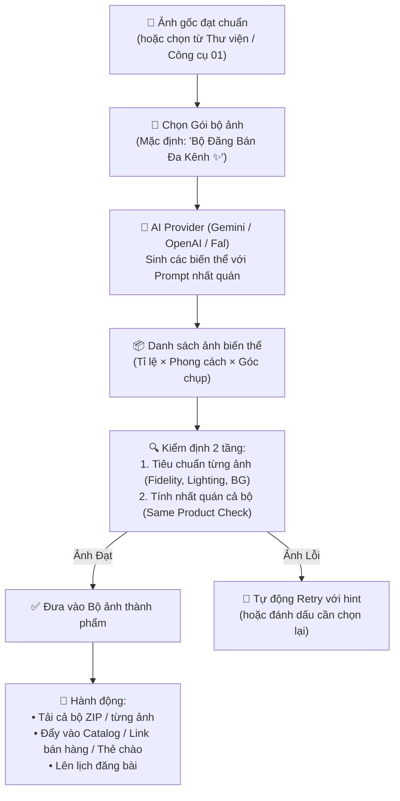

# Công cụ 02 — Tạo bộ ảnh sản phẩm từ một ảnh gốc (User Journey Proposal)

> **Bản chất**: Từ một ảnh gốc đã đạt chuẩn (hoặc ảnh hoàn thiện từ Công cụ 01), hệ thống tự động sinh ra một **Bộ ảnh thương mại đa kênh** (Catalog 1:1, Mạng xã hội 4:5, Story/Reels 9:16) kết hợp đa góc nhìn và đa phong cách mà **giữ nguyên 100% hình thái sản phẩm và nhất quán giữa các ảnh trong bộ**.

---

## 1. Kiến trúc kỹ thuật: Provider Single-Call & Set Consistency

---

## 2. User Journey 5 Bước Trực Quan

### Bước 1 — Đầu vào & Lựa chọn Gói bộ ảnh (Zero Friction)
1. **Khối hướng dẫn (`FeatureGuidanceCard`)**:
   - Tiêu đề: *"Một ảnh gốc → Đủ bộ ảnh cho mọi kênh bán hàng"*
   - Mẹo: `🎯 Dùng ảnh chuẩn từ Công cụ 01` · `✨ Mặc định tạo trọn bộ đa kênh` · `🔒 Đảm bảo 100% cùng một sản phẩm`
2. **Chọn ảnh nguồn**:
   - Chọn nhanh ảnh vừa tạo từ **Công cụ 01**, hoặc tải ảnh mới, hoặc chọn từ **Kho ảnh**.
3. **Lựa chọn Gói bộ ảnh thông minh (Smart Bundle Presets)**:
   - **Gói 1: Bộ Đăng Bán Đa Kênh ✨ (Mặc định)**:
     - 1 ảnh Catalog chuẩn sàn (1:1 - Chính diện)
     - 1 ảnh Bài đăng Facebook/Instagram (4:5 - Góc nghiêng 15°)
     - 1 ảnh Story / Reels / TikTok (9:16 - Đổ bóng Studio)
     - 1 ảnh Cận cảnh chi tiết sản phẩm (1:1 - Close-up)
   - **Gói 2: Bộ Catalog Chi Tiết**: 4 góc chụp khác nhau (Chính diện, Nghiêng trái, Nghiêng phải, Cận cảnh).
   - **Gói 3: Bộ Theo Mùa / Dịp Lễ**: Kết hợp phông nền sự kiện (Tết, Valentine, Khai trương...).
4. **Nút bấm chính**:
   - **"Tạo trọn bộ ảnh ngay ✨"** (Bấm 1 lần là tự động xử lý toàn bộ).
   - *Tùy chọn nâng cao*: Cho phép bật/tắt từng biến thể hoặc tải ảnh chụp thực tế góc phụ làm tham chiếu.

---

### Bước 2 — Trạng thái xử lý song song (Batch Progress)
1. Màn hình chia tiến độ trực quan:
   - Hiển thị thumbnail ảnh gốc.
   - Thước đo tiến độ các biến thể: `Đang tạo ảnh Catalog 1:1...`, `Đang kiểm định tính nhất quán cả bộ...`.
   - Thời gian ước tính: 15–30 giây cho toàn bộ gói.

---

### Bước 3 — Bộ sưu tập kết quả & Báo cáo Kiểm định QC
1. **Lưới ảnh thành phẩm (Product Set Grid)**:
   - Hiển thị toàn bộ các ảnh được tạo theo thẻ trực quan.
   - Mỗi ảnh có badge định danh: `1:1 • Chính diện`, `4:5 • Góc nghiêng`, `9:16 • Story`.
   - Nút phóng to / xem so sánh chi tiết với ảnh gốc.
2. **Báo cáo tính nhất quán cả bộ (Set Consistency Report)**:
   - Điểm số đồng nhất sản phẩm (Set Consistency Score): vd `98% - Cùng một sản phẩm`.
   - Trạng thái kiểm định từng ảnh: ✅ Đạt chuẩn thương mại / ⚠️ Cần chụp thêm góc tham chiếu.

---

### Bước 4 — Tinh chỉnh & Hành động xuất bản
1. **Chọn lọc**: Bật/tắt tick chọn những ảnh ưng ý nhất trong bộ để lưu trữ.
2. **Yêu cầu tạo lại riêng từng ảnh**: Bấm nút Retry trên ảnh chưa ưng ý kèm gợi ý điều chỉnh nhanh.
3. **Hành động một chạm**:
   - **Tải trọn bộ (ZIP)**: Tự động gom file đặt tên chuẩn mực (`<ten-sp>_1x1_front.jpg`, `<ten-sp>_4x5_angle.jpg`...).
   - **Lưu vào Thư viện sản phẩm**.
   - **Chuyển tiếp nhanh**: Sang **Công cụ 03 (Thẻ chào sản phẩm)** hoặc **Công cụ 13 (Link bán hàng)**.
